# 1. Thông tin

| Mục | Nội dung |
|---|---|
| Môn học | Phát triển, vận hành, bảo trì phần mềm |
| Giảng viên | Hoàng Ngọc Long |
| Sinh viên | Nguyễn Thanh Hoàng — MSSV ____ — Lớp ____ |
| Đề tài (Final Project) | HIU Youth E-Office — Văn phòng Đoàn – Hội điện tử Trường ĐH Quốc tế Hồng Bàng |
| Bài | TH1 — Thiết lập baseline, khảo sát hệ thống, đánh giá bảo trì, baseline kiểm thử |
| Hạn nộp | 23:59 ngày 19/10/2026 |
| Ngày thực hiện | 16/10/2026 (lấy bằng lệnh `date`) |
| Repository | https://github.com/HoangntDev/eoffice-hiu |
| Baseline | Tag `course-baseline` → commit `5a34ede` trên `main` |
| Milestone | `TH1` (issue #7, #9, #11, #13) |

# 2. Mục tiêu và phạm vi

**Mục tiêu**

1. Chốt một baseline có thể tái lập: xác nhận build/test trên `main`, gắn tag `course-baseline`.
2. Từ sau tag, áp dụng quy trình Git của môn: issue → branch → commit có số issue → PR → CI xanh → merge commit.
3. Khảo sát hệ thống hiện có: use case, luồng điểm danh QR, ERD và phụ thuộc giữa các module.
4. Đánh giá khả năng bảo trì bằng SonarQube và quan sát thủ công.
5. Lập baseline kiểm thử và đo coverage để làm mốc so sánh cho các thay đổi sau (CR-01).

**Phạm vi**

- Chỉ xét `main` tại tag `course-baseline`: UC1–UC8 (danh mục, tài khoản/Đoàn viên, mẫu biểu mẫu, biểu mẫu động, phản hồi CSV, kế hoạch chương trình, đăng ký, điểm danh QR).
- **Ngoài phạm vi:**
  - Hai nhánh tính năng chưa merge, `feat/program-acceptance` (UC9) và `feat/program-publication` (UC10). Không merge, không rebase, không sửa.
  - Supabase cloud và deploy. Không thực hiện.
  - `supabase db reset` trên DB local đang dùng. Không thực hiện.
- TH1 **không sửa code nghiệp vụ**. Các lỗi tìm thấy chỉ ghi lại là known issue.

# 3. Repository, Git workflow, baseline

## 3.1 Môi trường

| Thành phần | Phiên bản |
|---|---|
| Hệ điều hành | macOS 12.7.4 (21H1123), x86_64 |
| Node.js / npm | v24.16.0 / 12.0.2 |
| Supabase CLI | 2.117.0 (đã có bản 2.121.0; chưa nâng cấp) |
| Docker | 28.1.1 (16 CPU, ~7,7 GB RAM cho Docker) |
| PostgreSQL (Supabase local) | 17 |
| CI | GitHub Actions `ubuntu-latest`, Node 24 |
| SonarQube | Community Build 26.10.0.133078 (Docker `sonarqube:community`), SonarScanner CLI 8.1.0.6389 (Docker `sonarsource/sonar-scanner-cli`) |

Dự án chạy được trên nhiều nền tảng:
- Next.js chạy trên Node.js.
- Supabase local chạy trong Docker.
- CI chạy trên Linux. Môi trường phát triển là macOS.

Ghi chú về dependency (không phải lỗi):
- `npm ci` (npm 12) báo đã chặn install script của `fsevents@2.3.3` và `unrs-resolver@1.12.2`, vì hai gói này không nằm trong `allowScripts`. Cài đặt vẫn thành công; lint, test và build đều PASS.
- Supabase CLI 2.117.0 cũ hơn bản 2.121.0 mới phát hành.

## 3.2 Xác nhận baseline

Quy trình xác nhận:
- `git switch main && git pull` → working tree sạch, `HEAD` = `origin/main` = `5a34ede`.
- DB local đang dùng đã áp thêm migration của UC9/UC10, vốn không có trên `main`, nên **không dùng DB đó để xác nhận**.
- Thay vào đó, dựng **stack Supabase tách biệt** từ `main`:
  - worktree tách rời, `project_id = th1-base`, cổng 553xx;
  - tắt các dịch vụ không cần: studio, imgproxy, vector, logflare, edge-runtime, supavisor, realtime;
  - áp đủ 21 migration của `main`.
- Kiểm tra xong thì gỡ bằng `supabase stop --no-backup` và xóa worktree.

| Lệnh | Kết quả thật | Log |
|---|---|---|
| `npm ci` | OK (2 cảnh báo install script, xem 3.1) | `evidence/baseline/npm-ci.log` |
| `npm run lint` | PASS (0 lỗi) | `evidence/baseline/lint.log` |
| `npm run typecheck` | PASS | `evidence/baseline/typecheck.log` |
| `npm test` (Vitest) | **8 file, 74/74 PASS** (2,54 s) | `evidence/baseline/test.log` |
| `supabase test db` (pgTAP) | **8 file, 205/205 PASS** | `evidence/baseline/pgtap.log` |
| `npm run build` | PASS (compiled 5,9 s) | `evidence/baseline/build.log` |
| Chạy app (`next start`) + mở trang chính | Xem dưới | `evidence/baseline/smoke-*.txt` |

Kiểm tra nhanh các trang trên bản build:

- **Chưa đăng nhập:** `/`, `/login`, `/register`, `/forms` trả 200. `/programs`, `/office/...`, `/organization`, `/attend/...` trả 307 về `/login?next=…`.
- **Đã đăng nhập:**
  - Tạo sinh viên thử `2026990102` qua đúng luồng thật: `/api/auth/register` → email trong Mailpit → `/auth/confirm` → tạo PIN → bootstrap `school_admin` → `/api/auth/login`.
  - Kết quả: `/onboarding/profile`, `/union-membership`, `/organization`, `/office/membership`, `/forms`, `/forms/templates`, `/programs`, `/programs/new`, `/attend/<id>?t=…` đều trả 200.

Tag baseline (annotated):

```
git tag -a course-baseline -m "Course baseline: UC1-UC8 tren main, da xac nhan build/test 16/10/2026"
git push origin course-baseline
```

`course-baseline` → `5a34ede`. Tag cũ `v1.0-local` giữ nguyên, không xóa và không gắn lại.

## 3.3 Known issues tại baseline (chưa sửa trong TH1)

| # | Vấn đề | Bằng chứng | Ảnh hưởng |
|---|---|---|---|
| K1 | **Quét QR khi chưa đăng nhập phải quét lại** (lỗi ở 3 tầng, chi tiết bên dưới) | Chạy thật: `GET /attend/<id>?t=abc` (chưa đăng nhập) → `307 /login?next=%2Fattend%2F<id>` (`evidence/baseline/smoke-auth.txt`) | Sinh viên chưa đăng nhập sẽ mất mã QR. Họ phải đăng nhập rồi quét lại, và có thể lỡ cửa sổ 30 giây |
| K2 | QR điểm danh dùng chung cho cả lượt, nên có thể bị chia sẻ (chụp/gửi link) trong 30 giây hiệu lực | Thiết kế UC8 (`docs/requirements/program-attendance.md`) | Giới hạn thiết kế, đã chấp nhận. RPC vẫn yêu cầu đăng nhập, đăng ký được nhận và mỗi lượt một lần |
| K3 | pgTAP (205 assertion) chưa chạy trên CI. CI chưa upload kết quả test/coverage làm artifact. Comment trong `ci.yml` còn ghi "41 tests" | `.github/workflows/ci.yml` | Lỗi trong RPC/RLS chỉ được phát hiện khi chạy local |
| K4 | README lệch thực tế: ghi "Gmail" thay vì `@student.hiu.vn`, còn cách gọi "Prompt 01/02" | README tại `course-baseline` | **Đã xử lý** trong PR #8 (issue #7) |
| K5 | Tên migration `202610140001`–`202610150003` mang ngày 14–15/10, nhưng được tạo và commit lần đầu ngày 13/10/2026 | `git log --diff-filter=A` cho từng file | Tên không phản ánh ngày thật. Không đổi tên được vì đã áp lên DB. Quy tắc mới trong `CLAUDE.md` (PR #10) |

Chi tiết ba tầng của K1:

1. `src/proxy.ts` chuyển hướng tới `/login?next=<pathname>`, chỉ giữ `pathname` nên làm mất `?t=`.
2. `src/app/login/page.tsx` chỉ đọc `error`, bỏ qua `next`.
3. `POST /api/auth/login` (`src/app/api/auth/login/route.ts`) luôn trả `next: "/onboarding/profile"`.

Đã kiểm tra thêm: `/office` và `/signup` trả 404 vì không có trang gốc, chỉ có trang con. Tuy nhiên `grep` không thấy link hay nút nào trong `src/` trỏ tới hai đường dẫn này (ngoài danh sách tiền tố trong `proxy.ts`). Vì vậy đây **không** được ghi là known issue.

## 3.4 Quy trình Git của môn và các PR Milestone TH1

Quy trình (ghi trong `CLAUDE.md`):

1. Tạo issue, gán Milestone `TH1`.
2. Tạo branch `<loại>/<số-issue>-<mô-tả>` từ `main` mới nhất.
3. Commit theo mẫu `<loại>(<phạm-vi>): <mô tả> (#<số-issue>)`.
4. Mở PR vào `main`, mô tả ghi `Closes #<số>`.
5. Chờ CI xanh rồi merge bằng **Create a merge commit**.

| Mục | Issue | Branch | PR | CI | Kết quả |
|---|---|---|---|---|---|
| A — README | #7 | `docs/7-readme-baseline` | #8 | quality: pass (1m4s) | Đã merge `46721db` |
| B — CLAUDE.md | #9 | `chore/9-claude-md-rules` | #10 | quality: pass (48s) | Đã merge `97744b6` |
| C — Test + coverage | #11 | `test/11-baseline-coverage` | #12 | quality: pass (1m3s) | Đã merge `8253341` |
| D — Báo cáo TH1 | #13 | `docs/13-th1-report` | #14 | xem PR | Chờ sinh viên đọc lại rồi mới merge |

## 3.5 Kiểm chứng lịch sử `main` sau baseline

Hai lệnh dưới đây chạy ngày 16/10/2026 trên `origin/main`, **trước khi mở PR mục D**:

```
$ git log --first-parent --oneline course-baseline..main
8253341 Merge pull request #12 from HoangntDev/test/11-baseline-coverage
97744b6 Merge pull request #10 from HoangntDev/chore/9-claude-md-rules
46721db Merge pull request #8 from HoangntDev/docs/7-readme-baseline

$ git log --first-parent --no-merges --oneline course-baseline..main
(không có dòng nào)
```

Ảnh chụp Terminal thật của hai lệnh trên, chụp **trước khi merge PR #14** (khớp bản text):

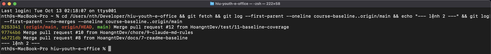

Lệnh thứ nhất cho thấy, tính từ baseline, `main` chỉ tiến lên qua merge commit của PR. Lệnh thứ hai rỗng, nghĩa là **không có commit nào được đẩy thẳng vào `main`**.

## 3.6 Cấu trúc repository và `.gitignore`

| Thành phần | Thư mục |
|---|---|
| Source | `src/` (Next.js: trang và route API trong `src/app`, `src/components`, `src/modules`, `src/lib`, `src/proxy.ts`) và `supabase/migrations/` (21 migration: schema, RLS, RPC — nơi chứa nghiệp vụ chính) |
| Tests | `tests/` (Vitest, 9 file) và `supabase/tests/` (pgTAP, 8 file) |
| Tài liệu TH1 | `docs/TH1/` (báo cáo `.md`/`.docx`, `build-docx.sh`, `diagrams/`, `evidence/`) |
| Khác | `docs/requirements/` (đặc tả nghiệp vụ), `scripts/`, `data/` (CSV danh mục), `.github/workflows/ci.yml` |

`.gitignore` loại khỏi repo:

| Mẫu | Loại |
|---|---|
| `/node_modules` | dependency cài bằng `npm ci` |
| `/.next/`, `/out/`, `/build`, `*.tsbuildinfo`, `next-env.d.ts` | sản phẩm build, file sinh tự động |
| `/coverage` | báo cáo `npm run test:coverage` |
| `.env*` (trừ `!.env.example`) | biến môi trường thật, gồm `.env.local`; chỉ commit file mẫu |
| `.vercel` | cấu hình liên kết Vercel |
| `*.pem`, `.idea/`, `.DS_Store`, log debug | khóa, cấu hình IDE, file rác hệ điều hành |

Kiểm tra secret trong lịch sử (16/10/2026, log: `evidence/security/secret-scan.txt`):
- `git ls-files` và `git log --all --name-only`: file `.env*` duy nhất từng được commit là `.env.example`. Giá trị trong đó là chuỗi giữ chỗ `replace-with-…`.
- Tìm trên toàn bộ diff của mọi nhánh (`git log --all -p`) theo mẫu JWT, `sb_secret_`, `sk_live`, `ghp_`, `AKIA`, private key: **0 kết quả**.
- gitleaks v8.21.2 (Docker) quét 46 commit: 25 cảnh báo `generic-api-key`, **tất cả** nằm ở `evidence/sonarqube/sonar-issues.json`, trường `"key"` là UUID của issue SonarQube. Đây là cảnh báo sai, không phải secret.
- Mật khẩu và token SonarQube local không nằm trong repo.

# 4. Khảo sát hệ thống

## 4.1 Kiến trúc tổng quát

- **Next.js 16 App Router** (`src/app`) phục vụ cả trang và API JSON (`src/app/api/**`).
- `src/proxy.ts` (tên mới của middleware trong Next 16) kiểm tra phiên đăng nhập cho các tiền tố cần bảo vệ.
- **Supabase**: Auth, PostgreSQL 17 và Storage.
- **Nghiệp vụ chính nằm trong PostgreSQL**:
  - 21 migration ở `supabase/migrations/`, khoảng 9.000 dòng SQL.
  - 52 bảng, kèm RLS và các RPC `security definer`.
- Phía TypeScript (khoảng 7.600 dòng trong 124 file `src/`) chỉ làm bốn việc: kiểm tra dữ liệu vào bằng Zod (`src/modules/*/schemas.ts`), gọi RPC, ánh xạ mã lỗi RPC sang HTTP (`src/modules/*/errors.ts`) và hiển thị.

## 4.2 Sơ đồ Use Case (hệ thống hiện có trên `main`)

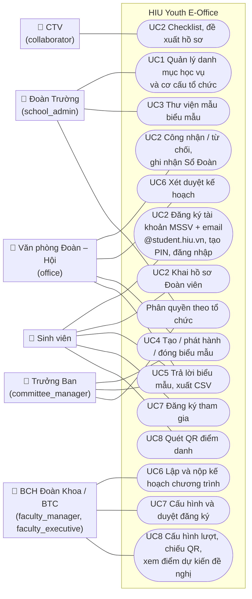

## 4.3 Sequence — luồng điểm danh QR (đã lần theo trong code)

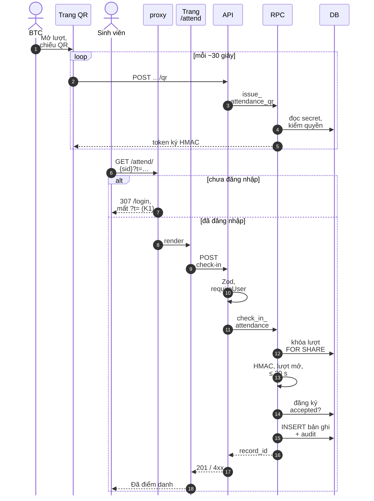

**Các file lần theo trong luồng:**

Tên participant trong sơ đồ được rút gọn; file tương ứng:

| Participant / bước | File |
|---|---|
| Trang QR (chiếu QR) | `src/app/programs/[id]/attendance/[sessionId]/qr/`, `src/components/attendance-qr-display.tsx` |
| API — cấp mã | `src/app/api/attendance/sessions/[sessionId]/qr/route.ts` → RPC `issue_attendance_qr` |
| proxy | `src/proxy.ts` (tiền tố `/attend`) |
| Trang /attend | `src/app/attend/[sessionId]/page.tsx`, `src/components/attendance-check-in.tsx` |
| API — check-in | `src/app/api/attendance/check-in/route.ts`, `src/lib/auth/dal.ts` (`requireUser`), `src/lib/http.ts`, `src/lib/log.ts` |
| Kiểm tra vào / ánh xạ lỗi | `src/modules/program-attendance/schemas.ts` (`checkInSchema`), `src/modules/program-attendance/errors.ts` |
| RPC, DB | `supabase/migrations/202610150003_program_attendance.sql` (hàm `issue_attendance_qr`, `check_in_attendance`; bảng `program_attendance_*`, `audit_events`) |
| Kiểm thử | `supabase/tests/008_program_attendance.sql` (55 assertion), `tests/program-attendance.test.ts`, `tests/core-business-baseline.test.ts` |

## 4.4 ERD (dựng từ migrations trên `main`)

Toàn bộ 52 bảng được trích tự động từ các câu `create table` và `references` trong 21 migration. Ba sơ đồ dưới đây vẽ các bảng lõi theo nhóm; danh sách đầy đủ theo nhóm nằm sau sơ đồ.

Để sơ đồ đọc được khi in A4 dọc:
- Tên bảng dài được ngắt dòng tại dấu `_` (ví dụ `program_registration`↵`_settings`); tên bảng không đổi.
- Bảng dùng chung (`accounts`, `organization_units`, `role_grants`) được vẽ lại ở sơ đồ cần đến để mỗi sơ đồ đọc độc lập.
- Một số liên kết chéo nhóm không vẽ, nhưng có trong migration: `organization_units → forms`, `accounts → form_responses`, `forms → program_registration_settings` (mẫu đăng ký), `accounts → reputation_adjustments` và `event_programs → reputation_adjustments` (sổ uy tín).

**ERD 1 — Tài khoản, danh mục học vụ, tổ chức (UC1, UC2)**

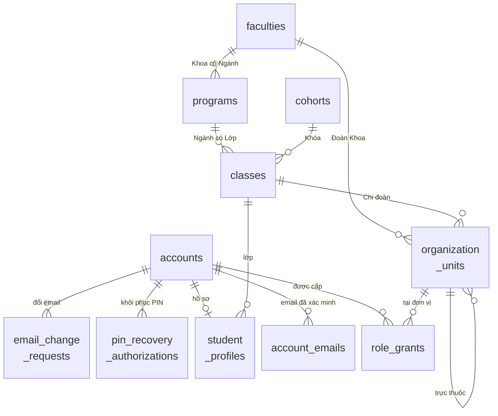

**ERD 2 — Hồ sơ Đoàn viên và biểu mẫu (UC2–UC5)**

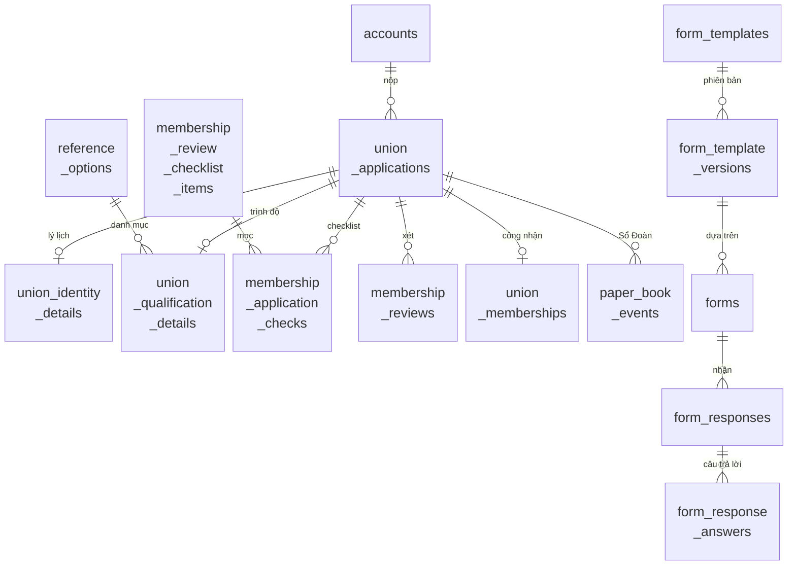

**ERD 3 — Chương trình, đăng ký, điểm danh và kiểm toán (UC6–UC8)**

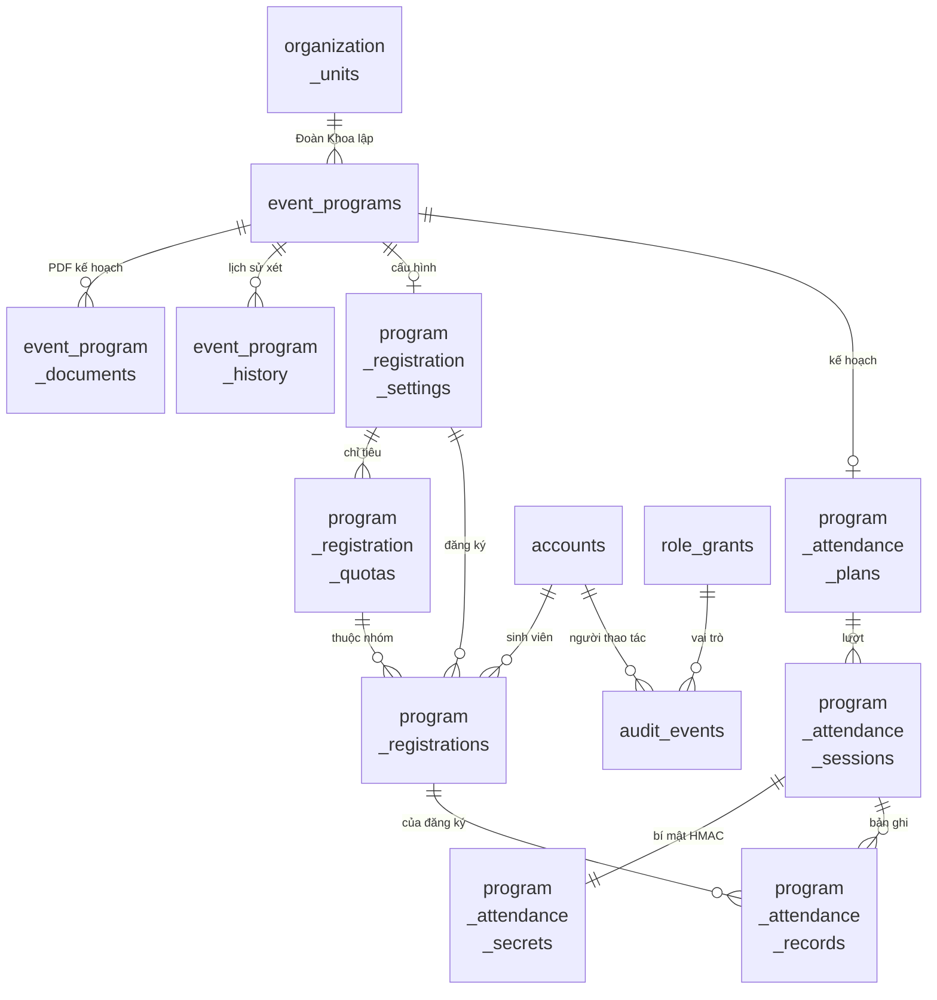

| Nhóm | Bảng |
|---|---|
| Tài khoản (UC2) | `accounts`, `account_emails`, `email_change_requests`, `student_code_rules`, `student_code_changes`, `auth_attempts`, `pending_account_registrations`, `pin_recovery_authorizations`, `student_profiles`, `student_profile_changes` |
| Danh mục / tổ chức (UC1) | `faculties`, `faculty_versions`, `programs` (Ngành), `program_versions`, `cohorts`, `classes`, `class_versions`, `organization_units`, `organization_unit_versions`, `role_grants`, `catalog_import_batches`, `reference_options` |
| Đoàn viên (UC2) | `union_applications`, `union_identity_details`, `union_membership_details`, `union_qualification_details`, `membership_review_checklist_items`, `membership_application_assignments`, `membership_application_checks`, `membership_reviews`, `paper_book_events`, `union_memberships` |
| Biểu mẫu (UC3–UC5) | `form_templates`, `form_template_versions`, `forms`, `form_responses`, `form_response_answers` |
| Chương trình (UC6) | `event_programs`, `event_program_documents`, `event_program_history` |
| Đăng ký (UC7) | `program_registration_settings`, `program_registration_quotas`, `program_registrations`, `program_registration_history`, `reputation_adjustments`, `academic_terms` |
| Điểm danh (UC8) | `program_attendance_plans`, `program_attendance_sessions`, `program_attendance_secrets`, `program_attendance_records`, `program_attendance_history` |
| Kiểm toán | `audit_events` |

Lưu ý: bảng `programs` là **Ngành đào tạo**, còn chương trình sự kiện là `event_programs`. Hai tên dễ nhầm khi bảo trì.

## 4.5 Sơ đồ module / dependency

Số cạnh được đếm từ các câu `import "@/…"` trong `src/` (script đếm chạy ngày 16/10/2026).

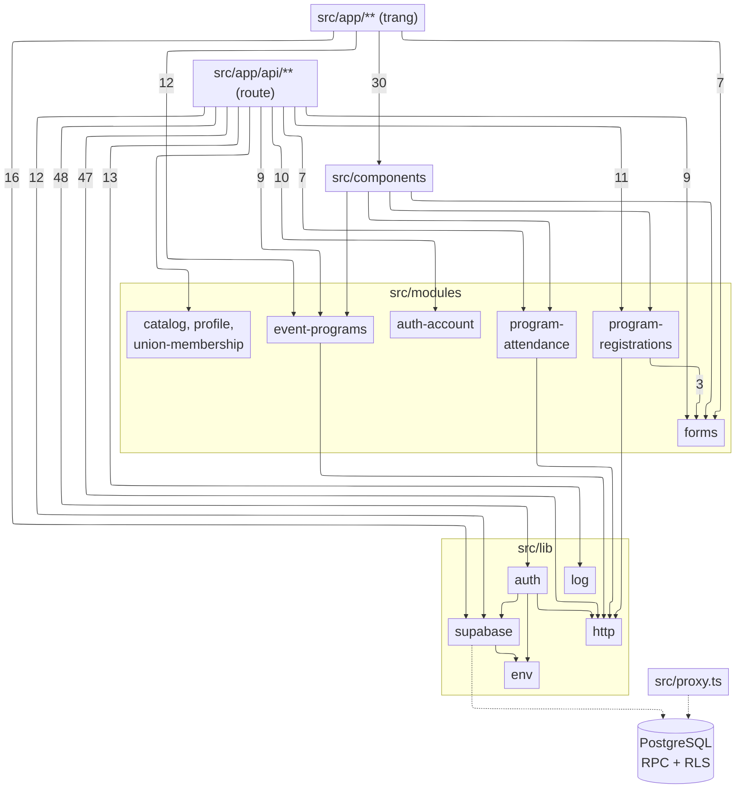

Một số phụ thuộc đáng chú ý:

- **`program-registrations` → `forms`** (3 import): điều kiện đối tượng (`audienceRuleSchema`) và câu hỏi đăng ký dùng lại kiểu dữ liệu của biểu mẫu. Đổi cấu trúc `audience_rule` sẽ ảnh hưởng đồng thời UC4 và UC7.
- **Mọi route API phụ thuộc `lib/auth` (48) và `lib/http` (47)**. Đây là hai điểm có nhiều module phụ thuộc vào nhất: sửa `requireUser` hay `apiError` sẽ ảnh hưởng toàn bộ API.
- **Các module `errors.ts` phụ thuộc `lib/http` (`HttpError`)**. Hợp đồng giữa TS và SQL là các mã lỗi dạng chuỗi (`raise exception 'QR_EXPIRED'`) được so khớp bằng `includes`. Đổi tên mã lỗi trong SQL mà không sửa `errors.ts` thì lỗi sẽ rơi về 500. Phân tích chi tiết ở finding F2 (mục 5.2).
- **Không module nào ở `src/modules` phụ thuộc ngược lên `src/app` hay `src/components`**: các tầng không phụ thuộc vòng.

## 4.6 Lịch sử một file quan trọng

`src/proxy.ts` là cổng chặn đăng nhập cho mọi trang được bảo vệ, cũng là nơi gây ra K1.

```
$ git log --follow --format='%h %ad %s' --date=short -- src/proxy.ts
aa3457a 2026-10-13 feat(attendance): UC8 điểm danh QR lượt và điểm dự kiến đề nghị
8947553 2026-10-13 feat(event-programs): add plan submission and office review UI and API
9e73d74 2026-10-05 feat(forms): implement template library and dynamic forms (Prompt 02)
f9fb85f 2026-10-02 feat(auth): implement verified PIN account lifecycle
aefda8c 2026-09-29 feat(app): implement prompt 01 operational flows
```

Mỗi use case mới đều sửa file này, chủ yếu để thêm tiền tố vào danh sách `protectedPath`. Đây là điểm dễ xung đột khi nhiều nhánh song song (UC9/UC10 cũng sửa). Commit UC8 `aa3457a` thêm `/attend` nhưng không giữ query string khi chuyển hướng, và đó là nguồn gốc của K1.

## 4.7 Bằng chứng từ IDE (Rider)

**Find Usages `requireUser()`.** Rider tìm được 101 usages: 99 trong `src/app`, trong đó 95 ở `src/app/api`. Gần như mọi route handler đều đi qua `lib/auth`, đúng như sơ đồ 4.5: `lib/auth` là điểm phụ thuộc tập trung, sửa chữ ký hàm này sẽ ảnh hưởng toàn bộ tầng API.

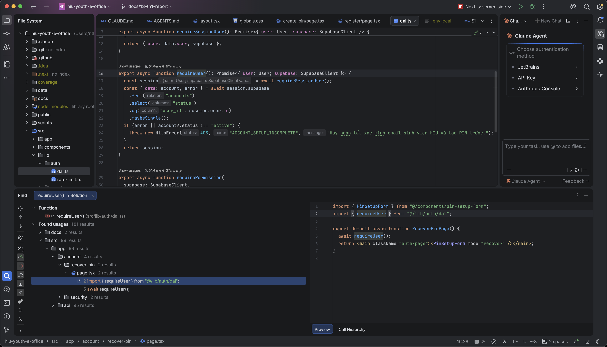

**Call Hierarchy "Callers of `attendanceRpcError`".** Hàm được gọi từ 4 route handler: `POST check-in`, `POST sessions/[sessionId]/status`, `POST sessions/[sessionId]/qr`, `PUT event-programs/[id]/attendance`, cùng với test. Đây là bước cuối của sequence 4.3 (RPC lỗi → ánh xạ mã lỗi → HTTP), và cũng là phạm vi chịu ảnh hưởng của finding F2: ánh xạ `message.includes` sai thứ tự sẽ trả mã sai ở cả 4 route.

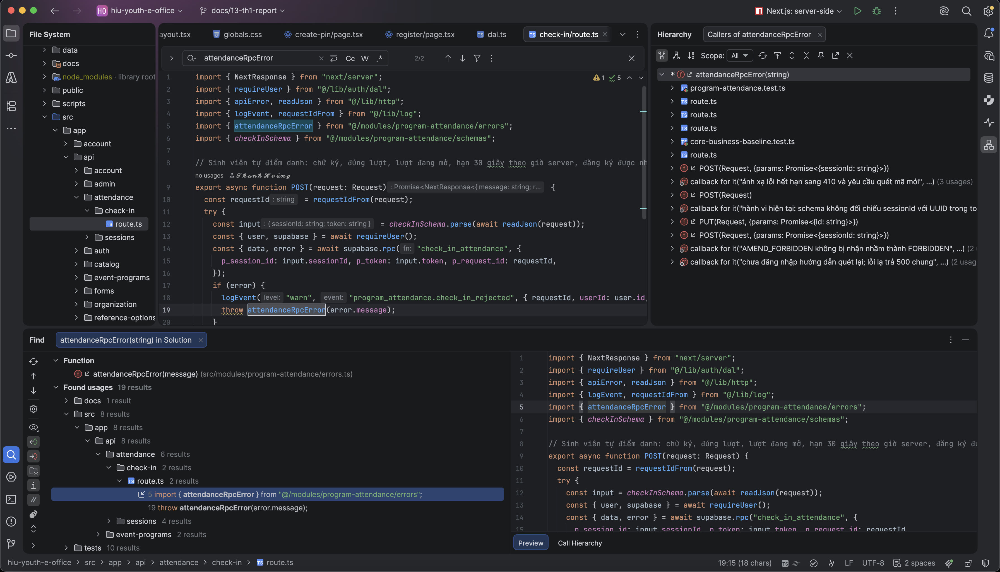

# 5. Đánh giá khả năng bảo trì

## 5.1 SonarQube Community (Docker)

Cách chạy:
- SonarQube Community Build 26.10 chạy trong Docker (`sonarqube:community`, cổng 9000).
- `sonar-scanner` chạy trong Docker với `sonar.sources=src,supabase` và `sonar.tests=tests,supabase/tests`.

Kết quả lưu ở `evidence/sonarqube/`: log scanner, `sonar-measures.json`, `sonar-issues.json` (đã xóa email tác giả), `sonar-top-complexity.json` và 3 ảnh chụp.

| Chỉ số | Giá trị |
|---|---|
| Quality gate | **Passed** |
| Dòng code phân tích (ncloc) | 7.427 (TS 6.955, CSS 445, HTML 27) |
| Security | 0 issue (A); 0 security hotspot |
| Reliability | 25 issue (C) |
| Maintainability | 3 issue (A); technical debt 15 phút |
| Duplications | 1,7% |
| Cyclomatic / Cognitive complexity | 1.830 / 822 |
| Coverage trên SonarQube | 0,0% (không nạp báo cáo LCOV; coverage thật xem mục 6) |

Ảnh chụp: `evidence/sonarqube/sonar-overview.png`, `sonar-issues.png`, `sonar-measures-complexity.png`.

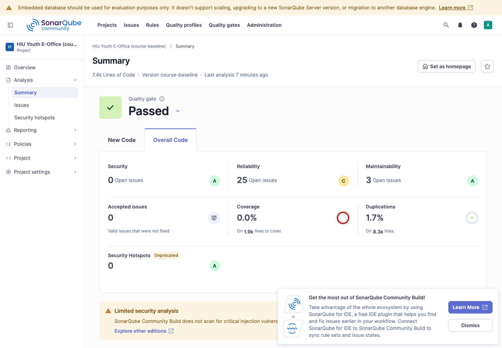

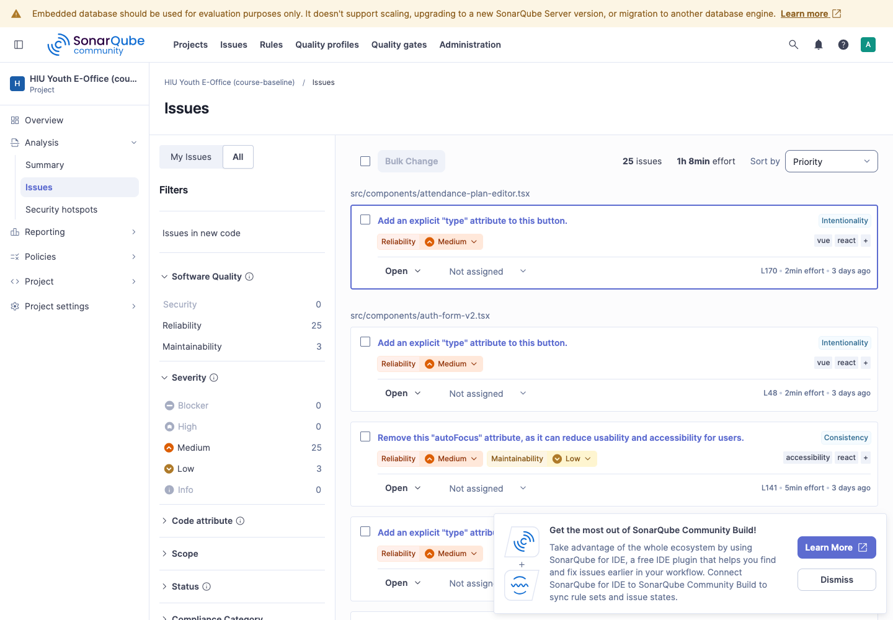

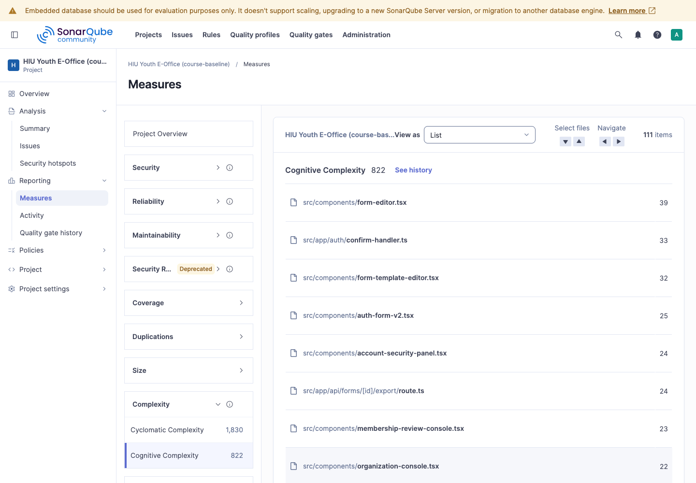

**Giới hạn quan trọng:**
- Bản Community **không có bộ phân tích SQL/PL/pgSQL**. 30 file `.sql` dưới `supabase/` chỉ được quét bằng `TextAndSecretsSensor` (tìm secret), không có rule nào chạy trên logic.
- Theo `ncloc`, SonarQube chỉ đo được phần TypeScript. Khoảng 9.000 dòng SQL chứa phần lớn nghiệp vụ nằm ngoài phân tích tĩnh, và hiện chỉ được bảo vệ bằng pgTAP (mục 6).

## 5.2 Phân tích các finding được chọn

**F1 — `typescript:S9011` "Add an explicit type attribute to this button" (19 issue, Reliability/Medium)**

- *Vị trí:* `src/components/attendance-plan-editor.tsx:170`. Tương tự ở `auth-form-v2.tsx:48,148`, `event-program-actions.tsx:74,111`, `organization-console.tsx:32–42`, `membership-review-console.tsx:13–14`… (19 vị trí).
- *Vấn đề:* `<button>` không ghi `type` sẽ mặc định là `submit`. Tại `attendance-plan-editor.tsx:170`, nút "Lưu kế hoạch điểm danh" là nút cuối trong `<form onSubmit={save}>`, nên hiện tại nộp form đúng ý đồ. Đã đọc từng vị trí: không thấy nút nào đang nộp form ngoài ý muốn. Ví dụ, nút "Xem chi tiết" ở `membership-review-console.tsx:13` nằm trong bảng, không nằm trong form.
- *Rủi ro bảo trì:* Ý đồ "đây là nút submit" chỉ ngầm hiểu. Người sau có thể thêm một nút thao tác phụ (ví dụ "Thêm lượt") vào cùng form mà quên ghi `type="button"`. Khi đó bấm nút sẽ nộp form, gọi API lưu kế hoạch ngoài ý muốn. Với kế hoạch điểm danh đã khóa, việc này dẫn tới lỗi `AMEND_REASON_REQUIRED`, gây khó hiểu cho người dùng.
- *Quyết định:* **Chưa xử lý trong TH1** vì TH1 không sửa code. Đề xuất một PR `refactor` riêng: thêm `type="submit"`/`type="button"` tường minh cho 19 vị trí và bật rule ESLint `react/button-has-type` để chặn tái phát. Chi phí ước tính khoảng 40 phút (SonarQube tính 2 phút mỗi issue). Rủi ro thấp: chỉ đổi thuộc tính, hành vi giữ nguyên.

**F2 — Hợp đồng mã lỗi SQL↔TS so khớp bằng `message.includes(code)` theo thứ tự mảng (quan sát thủ công; SonarQube không phát hiện)**

- *Vị trí:*
  - `src/modules/program-attendance/errors.ts:28` (21 mã), `src/modules/program-registrations/errors.ts:39` (32 mã), `src/modules/event-programs/errors.ts:26` (13 mã, cộng nhánh riêng `MISSING_REQUIRED_FIELDS:` ở dòng 21). 14 route handler trong `src/app/api/**` gọi ba hàm này.
  - Trên `main` (baseline) có 3 module dùng mẫu này. Module thứ tư, `src/modules/program-acceptance/errors.ts`, nằm trên nhánh UC9 chưa merge và dùng cùng mẫu; TH1 không sửa nhánh đó.
- *Vấn đề:*
  - SQL phát lỗi nghiệp vụ bằng `raise exception 'MÃ'` (235 câu `raise exception '…'` trong migrations), không đặt `errcode` riêng, nên mọi lỗi đều có SQLSTATE mặc định `P0001`. Mã lỗi chỉ nằm trong chuỗi `message`.
  - TS lấy mã bằng `known.find(([code]) => message.includes(code))`: chọn **mã đầu tiên trong mảng là chuỗi con của message**. Khi một mã là chuỗi con của mã khác, thứ tự trong mảng quyết định kết quả.
  - Ví dụ: trong `program-attendance/errors.ts`, `AMEND_FORBIDDEN` (dòng 5) phải đứng trước `FORBIDDEN` (dòng 6). Nếu đảo hai dòng, lỗi `AMEND_FORBIDDEN` (`202610150003_program_attendance.sql:286`, "chỉ BCH Đoàn Khoa được điều chỉnh quy tắc") sẽ trả về `code: "FORBIDDEN"` với thông báo chung "Bạn không có quyền…". HTTP vẫn 403 nhưng sai mã và sai hướng dẫn cho người dùng.
  - Script kiểm tra cả 3 file tìm thấy 5 cặp "mã chứa mã", hiện **đều đúng thứ tự**: `SELF_REVIEW_FORBIDDEN`, `OWNER_CHANGE_FORBIDDEN` ⊃ `FORBIDDEN` (event-programs); `AMEND_FORBIDDEN` ⊃ `FORBIDDEN` (attendance); `SELF_DECISION_FORBIDDEN` ⊃ `FORBIDDEN`, `SKIP_REASON_REQUIRED` ⊃ `REASON_REQUIRED` (registrations).
- *Rủi ro bảo trì:*
  - Quy tắc "mã dài đứng trước" không được ghi ở đâu, cũng không có kiểu dữ liệu hay rule lint nào bảo vệ. Thêm mã mới (ví dụ `DELETE_FORBIDDEN`) vào sau `FORBIDDEN`, hoặc sắp xếp lại mảng theo bảng chữ cái, sẽ đổi hành vi trong khi lint và typecheck vẫn xanh.
  - Đổi tên mã trong SQL mà quên sửa TS thì lỗi rơi về 500 `INTERNAL_ERROR`. Hai phía không có kiểm tra đối chiếu tự động.
  - CR sau này (kể cả UC9/UC10) sẽ tiếp tục thêm mã, nên rủi ro tăng dần.
- *Quyết định:* **Chưa sửa trong TH1** vì TH1 không sửa code. Hành vi hiện tại đã được chốt bằng test: `tests/core-business-baseline.test.ts:244–247` (`AMEND_FORBIDDEN` không bị nhận nhầm thành `FORBIDDEN`) và `tests/event-programs.test.ts:116–117` (`SELF_REVIEW_FORBIDDEN`). Đề xuất một PR `refactor` riêng, chọn một trong hai hướng:
  1. **So khớp chính xác theo mã đã tách:** tách mã khỏi message (phần chữ in hoa trước dấu `:` hoặc khoảng trắng), rồi tra trong `Record<string, …>`. Kết quả không còn phụ thuộc thứ tự mảng. Không đụng SQL, chi phí thấp.
  2. **Dùng SQLSTATE/ERRCODE riêng:** `raise exception using errcode = '…', message = 'AMEND_FORBIDDEN'` và ánh xạ theo `error.code`. Cần migration mới cho các hàm RPC, phạm vi lớn hơn.

  Hướng 1 phù hợp hơn cho bước đầu. Các test ở trên là lưới an toàn khi refactor. Nên thêm một test đối chiếu: mọi mã trong `raise exception` của migrations đều có trong bảng `known` tương ứng.

**F3 — Độ phức tạp tập trung trong component "minified" (số đo SonarQube + quan sát thủ công)**

- *Vị trí:* `src/components/membership-review-console.tsx`, `src/components/organization-console.tsx`.
- *Số đo:*
  - `membership-review-console.tsx` chỉ có **13 dòng code** nhưng cognitive complexity **23** và cyclomatic complexity **47**. Có 7 dòng dài hơn 400 ký tự; cả component và hàm xử lý viết liền trên một dòng.
  - `organization-console.tsx`: 41 dòng code, cognitive 22, cyclomatic 68, 10 dòng dài hơn 400 ký tự.
- *Vấn đề:* Code viết dồn theo kiểu "minified" từ giai đoạn Prompt 01. Đọc và review rất khó, và mọi `git diff`/`git blame` đều rơi vào một dòng duy nhất. Hai component này cũng không có test (coverage 0%).
- *Rủi ro bảo trì:* Cao nhất trong phần TS. Đây là màn hình xét duyệt hồ sơ Đoàn viên và phân quyền tổ chức, đúng chỗ dễ gây sai quyền. Sửa một nhánh logic trên một dòng 1.000 ký tự thì rất dễ sai, và lịch sử Git không cho biết dòng nào đổi.
- *Quyết định:* **Chưa xử lý trong TH1.** Đưa vào backlog bảo trì theo thứ tự:
  1. Chạy formatter (chỉ đổi định dạng, một PR riêng, không đổi logic).
  2. Tách các hàm `saveCheck`/`defineCheck`/`send` ra module riêng.
  3. Thêm test component trước khi sửa nghiệp vụ.

  Không gộp vào CR-01 để PR CR-01 giữ đúng "một PR một việc".

**Các finding khác đã xem, không chọn**

- `typescript:S9379` "Remove this autoFocus attribute" (3 issue: `src/components/auth-form-v2.tsx:141`, `:201`, `src/components/pin-setup-form.tsx:109`): giữ có chủ đích vì trang đăng nhập/tạo PIN chỉ có một nhiệm vụ; xem lại khi có yêu cầu kiểm định accessibility.
- `Web:PageWithoutTitleCheck` (3 issue ở `supabase/templates/*.html`): đây là mẫu email Auth, không phải trang web, nên là cảnh báo không áp dụng (false positive).

## 5.3 Nhận xét bảo trì khác

- **Nghiệp vụ nằm trong SQL** giúp quyền và tính đúng đắn được bảo đảm tại một chỗ (RLS, RPC, khóa hàng), tránh trùng lặp ở client. Đổi lại, công cụ phân tích tĩnh và coverage TS không thấy phần này, nên pgTAP là lưới an toàn chính. Việc pgTAP chưa chạy trên CI (K3) là rủi ro lớn nhất cho bảo trì.
- **Hợp đồng lỗi dạng chuỗi giữa SQL và TS** (mục 4.5, F2) chưa có kiểm tra tự động hai phía.
- **Tên dễ nhầm và di sản:** `programs` (Ngành) với `event_programs`; cột/tham số `gmail` dù quy tắc đã là `@student.hiu.vn` (ghi chú trong `schemas.ts` và migration `202610130002`).
- **Tài liệu:** README đã được cập nhật (PR #8). `docs/requirements/mvp-scope.md` vẫn còn tiêu đề "Prompt 01 + Prompt 02".

# 6. Baseline kiểm thử và coverage

## 6.1 Bộ kiểm thử hiện có

| Loại | Công cụ | Phạm vi | Số lượng (16/10/2026) | Chạy ở |
|---|---|---|---|---|
| Unit / component | Vitest 5.0.2 + jsdom + Testing Library | schema Zod, ánh xạ lỗi, xuất CSV, component đăng nhập/hồ sơ, importer CSV | **9 file, 109 test PASS** (baseline: 8 file, 74) | Local + CI |
| Database | pgTAP (`supabase test db`) | RLS, RPC, trạng thái, đồng thời, quyền theo vai trò | **8 file, 205 assertion PASS** | Chỉ local |

Số assertion pgTAP theo file:

| File | Số assertion |
|---|---|
| `001_business_rules` | 9 |
| `002_authorization_workflow` | 10 |
| `003_account_lifecycle` | 10 |
| `004_forms` | 14 |
| `005_event_programs` | 35 |
| `006_bootstrap_template_seed` | 5 |
| `007_program_registrations` | 67 |
| `008_program_attendance` | 55 |
| **Tổng** | **205** |

## 6.2 Bổ sung trong TH1 (PR #12, issue #11)

- Thêm `@vitest/coverage-v8@5.0.2` và ghim `vitest@5.0.2`, để hai gói luôn cùng phiên bản.
- Thêm script `npm run test:coverage`.
- Coverage tính trên **toàn bộ `src/**/*.{ts,tsx}`**, kể cả file chưa có test, để số liệu không bị thổi phồng.
- `tests/core-business-baseline.test.ts`: **35 test** chốt hành vi hiện tại của 3 thành phần nghiệp vụ cốt lõi, có thể test độc lập vì là hàm thuần, không cần DB:

| Thành phần | Ca thành công | Ca biên / lỗi tiêu biểu |
|---|---|---|
| UC6 `saveEventProgramSchema`, `reviewEventProgramSchema`, giờ VN | Bản nháp đầy đủ; chuỗi rỗng → `null` | Tên 5/200 hợp lệ, 4 (sau trim)/201 bị từ chối; kết thúc = bắt đầu bị từ chối; so thời gian theo thời điểm thật khi khác múi giờ; thiếu múi giờ; lý do xét 10 vs 9 ký tự |
| UC7 `saveRegistrationSettingsSchema`, `registerSchema`, `decideRegistrationSchema`, `registrationRpcError` | Tổng chỉ tiêu **bằng đúng** tổng chỗ | Số chỗ 0/1/100000/100001/2,5; 50 vs 51 nhóm chỉ tiêu; 200 vs 201 câu trả lời; client gửi email người trả lời; lý do toàn khoảng trắng |
| UC8 `saveAttendancePlanSchema`, `checkInSchema`, `attendanceRpcError` | Lần mở 6 chữ số; bậc = số lượt | Điểm tối đa 0/100/101/−1; 0/50/51 lượt; chữ ký viết hoa; lần mở 7 chữ số; `AMEND_FORBIDDEN` không bị nhận nhầm thành `FORBIDDEN` |

Hai hành vi hiện tại được ghi lại bằng test, không sửa:
1. Bậc điểm gửi kèm vẫn bị kiểm tra dù quy tắc không phải "theo bậc".
2. `checkInSchema` không đối chiếu `sessionId` với UUID trong token; việc này để DB xử lý (`WRONG_SESSION`).

## 6.3 Kết quả coverage (Vitest, v8)

| Phạm vi | Lines | Branches | Functions | Statements |
|---|---|---|---|---|
| Toàn `src/` — trước | 12,42% (266/2141) | 9,71% (221/2276) | 15,77% (103/653) | 11,95% (322/2693) |
| Toàn `src/` — sau | **12,51%** (268/2141) | **9,97%** (227/2276) | **15,92%** (104/653) | **12,14%** (327/2693) |
| `src/modules/` — trước | 86,15% | 70,81% | 90,00% | 84,52% |
| `src/modules/` — sau | **87,18%** | **74,05%** | **91,25%** | **86,61%** |
| 3 module cốt lõi (UC6/7/8) — trước | 91,24% | 78,85% | 88,71% | 88,20% |
| 3 module cốt lõi (UC6/7/8) — sau | **92,70%** | **82,69%** | **90,32%** | **91,01%** |

Theo file:
- `program-attendance/errors.ts`: 75% → 100% dòng, 50% → 100% nhánh.
- `event-programs/schemas.ts`: nhánh 88,88% → 100%.
- `program-registrations/schemas.ts`: nhánh 85,71% → 92,85%.
- `event-programs/dates.ts`: dòng 77,77% → 88,88%.

Log: `evidence/coverage/coverage-before.log`, `coverage-after.log`, `coverage-summary-*.json`.

**Diễn giải:**
- Coverage toàn `src/` thấp (~12,5%) vì 124 file TS phần lớn là trang, route và component mỏng. Chúng chỉ gọi RPC nên cần DB thật mới test có ý nghĩa.
- Logic thuần TS (`src/modules`) đạt ~87% dòng.
- **Nghiệp vụ chính nằm trong PostgreSQL RPC: ~9.000 dòng SQL, so với ~7.600 dòng TS.** Phần này được bảo vệ bằng **pgTAP 205 assertion**, nhưng v8 coverage không đo được. Vì vậy baseline kiểm thử phải báo cáo cả hai số: coverage Vitest và số assertion pgTAP.

## 6.4 Vùng đã/chưa được bảo vệ và ưu tiên cho CR

**Đã được bảo vệ bằng test tự động**

| Vùng | Test | Số liệu (16/10/2026) |
|---|---|---|
| `src/modules/*/schemas.ts`, `src/modules/*/errors.ts` | Vitest (`tests/`) | `src/modules` 87,18% dòng; 3 module cốt lõi 92,70%; cả 3 file `errors.ts` 100% dòng |
| RPC và RLS trong `supabase/migrations/` | pgTAP (`supabase/tests/`) | 205 assertion; **chỉ chạy local**, chưa có trên CI (K3) |

**Chưa được bảo vệ** (coverage 0% theo `coverage-summary-after.json`, không có test tự động khác)

| Vùng | Vì sao quan trọng |
|---|---|
| `src/proxy.ts` | Cổng đăng nhập của mọi trang được bảo vệ; tầng 1 của K1 |
| `src/app/api/auth/login/route.ts`, `src/app/login/page.tsx` | Tầng 2–3 của K1 (bỏ qua `next`, luôn trả `/onboarding/profile`) |
| Route handler `src/app/api/**` (47 file, 0/737 dòng) | Nơi gọi RPC và ánh xạ lỗi; cần DB thật mới test có ý nghĩa |
| `src/components/membership-review-console.tsx`, `src/components/organization-console.tsx` | Xét duyệt Đoàn viên và phân quyền; code "minified", độ phức tạp cao (F3) |

**Ưu tiên**

- **Khi sửa K1:** viết test trước cho ba tầng, rồi mới sửa:
  - `proxy.ts` giữ cả query string (`?t=`) trong `next`;
  - trang `/login` đọc `next` và chỉ nhận đường dẫn nội bộ bắt đầu bằng `/` (chống open redirect);
  - API login trả `next` đã kiểm tra thay cho giá trị cố định.

  Thêm một kịch bản end-to-end tối thiểu: quét QR khi chưa đăng nhập → đăng nhập → quay lại đúng `/attend/{sid}?t=…`.
- **Khi làm CR-01** (nội dung chốt ở mục 8):
  - Trước khi sửa file nào trong bảng "chưa được bảo vệ", thêm test chốt hành vi hiện tại của phần sẽ sửa.
  - Nếu CR đụng RPC/RLS, bổ sung pgTAP tương ứng.
  - Nếu CR thêm mã lỗi mới, thêm test ánh xạ lỗi (F2).
  - Ưu tiên đưa pgTAP lên CI (K3) để thay đổi SQL của CR được kiểm tra trên mỗi PR.

# 7. Vấn đề gặp phải và cách xử lý

| Vấn đề | Cách xử lý |
|---|---|
| DB local đang dùng đã áp migration UC9/UC10, không đại diện cho `main` | Dựng stack Supabase tách biệt từ worktree `main` (cổng 553xx); gỡ bằng `--no-backup` sau khi xong. DB đang dùng không bị reset |
| Gọi API đăng ký bằng `curl` thì bước xác nhận email báo lỗi (`/register?error=confirmation`) | Luồng PKCE cần cookie `code_verifier` từ lúc đăng ký. Chạy lại với cookie jar ngay từ request đăng ký thì xác nhận thành công |
| `gh` không có trong `PATH` (bản tải về nằm ở `~/Downloads`) | Gọi `gh` bằng đường dẫn đầy đủ; đã kiểm tra `gh auth status` trước khi tạo issue/PR |
| `npm run typecheck` lỗi TS2307 trỏ tới route UC10 | Do thư mục sinh tự động `.next/dev/types` còn sót từ lần chạy `next dev` trên nhánh UC10. Xóa `.next/dev/types` (thư mục cache, không thuộc repo) rồi chạy lại: PASS. CI không bị ảnh hưởng vì checkout sạch |
| Lint báo cảnh báo trong `coverage/block-navigation.js` sau khi bật báo cáo HTML | Thêm `coverage/**` vào `globalIgnores` của ESLint (PR #12) |
| SonarQube Community không phân tích SQL | Ghi nhận là giới hạn công cụ (mục 5.1); bù bằng pgTAP |
| Token phân tích SonarQube không đọc được API kết quả (`Insufficient privileges`) | Dùng tài khoản admin local để đọc số đo và issue; mật khẩu và token chỉ nằm trong scratchpad, không commit |
| `sonar-issues.json` chứa email tác giả commit | Xóa trường `author` trước khi đưa vào `evidence/` |
| Popup quảng cáo che ảnh chụp SonarQube | Script Playwright bấm "Dismiss" trước khi chụp; xem lại từng ảnh |
| Sơ đồ sequence/ERD/module ban đầu có tỉ lệ 2,4–3,5:1; khi in A4 dọc chữ chỉ còn ~2–3 pt | Tách ERD thành 3 sơ đồ, ngắt dòng tên bảng dài, rút gọn nhãn sequence, đổi bố cục module; nâng `mermaid-cli` lên 11.12.0 (hỗ trợ `direction` cho ERD); đặt khổ A4 dọc cho `.docx` và co ảnh vừa khung chữ (`build-docx.sh`); xuất PDF bằng LibreOffice trong Docker để xem từng trang |
| Máy chưa có `pandoc` | Chạy `pandoc` bằng Docker image `pandoc/core` (xem `docs/TH1/build-docx.sh`); sơ đồ Mermaid được render ra PNG bằng image `minlag/mermaid-cli` |

**Sử dụng Claude Code (trợ lý AI) trong TH1.** Sinh viên dùng Claude Code (model Claude Opus 5.5) chạy trong terminal của repo.

Dùng vào việc gì:
- Chạy và ghi log các lệnh xác nhận baseline trên stack tách biệt.
- Tạo issue/branch/PR bằng `gh` theo quy tắc của môn.
- Soạn README, `CLAUDE.md` và test baseline.
- Trích ERD và đồ thị phụ thuộc bằng script.
- Chạy SonarQube và chụp ảnh.
- Soạn bản nháp báo cáo này.

Kiểm chứng ra sao:
- Mọi số liệu trong báo cáo lấy từ output lệnh thật, lưu ở `docs/TH1/evidence/`. Không ghi PASS cho lệnh chưa chạy.
- Test mới được chạy riêng rồi chạy cả bộ, kèm lint và typecheck.
- CI GitHub Actions xanh trước mỗi lần merge.
- Known issue K1 được tái hiện bằng request thật trước khi ghi.
- Mỗi finding SonarQube đều được mở đúng dòng code để đọc, không chép nguyên văn cảnh báo.
- Ảnh chụp được xem lại trước khi đưa vào báo cáo.

Các ràng buộc giao cho trợ lý (cũng ghi trong `CLAUDE.md`):
- Không sửa nhánh UC9/UC10.
- Không reset DB local, không đụng Supabase cloud, không deploy.
- Không commit secret.
- Không merge khi CI đỏ.

Sinh viên đọc lại báo cáo trước khi merge PR mục D.

# 8. Nhận xét, kết luận và ý tưởng CR-01

**Nhận xét**

- Baseline `course-baseline` (UC1–UC8) tái lập được từ đầu: 21 migration áp sạch; lint, typecheck và build PASS; Vitest 74/74; pgTAP 205/205.
- Quy trình Git của môn đã áp dụng cho cả 4 mục của Milestone TH1. `git log --first-parent --no-merges course-baseline..main` rỗng.
- Điểm mạnh về bảo trì:
  - Quyền và nghiệp vụ tập trung trong DB, có pgTAP dày (205 assertion).
  - Không có lỗ hổng hay hotspot trên SonarQube.
  - Các tầng TS không phụ thuộc vòng.
- Điểm yếu cần ưu tiên:
  1. pgTAP chưa chạy trên CI (K3).
  2. Lỗi mất `?t=` khi quét QR lúc chưa đăng nhập (K1).
  3. Hai component "minified" có độ phức tạp cao, không có test (F3).
  4. Hợp đồng mã lỗi SQL↔TS phụ thuộc thứ tự mảng (F2).
  5. Thiếu thuộc tính `type` tường minh cho nút (F1).

**Kết luận:** Hệ thống ở trạng thái đủ ổn định để làm baseline cho các thay đổi sau. Mốc so sánh cho CR-01 là:
- Vitest 109 test, coverage `src/` 12,51% dòng / `src/modules` 87,18% dòng.
- pgTAP 205 assertion.
- SonarQube: 25 Reliability, 3 Maintainability, 0 Security.

**Ý tưởng CR-01 dự kiến:** CR-01 dự kiến theo hướng kỹ thuật nâng cao: bổ sung thông báo real-time trong ứng dụng (Supabase Realtime) khi kế hoạch chương trình được Văn phòng duyệt hoặc trả sửa và khi kết quả đăng ký của sinh viên thay đổi, thay cho việc người dùng phải tự tải lại trang để kiểm tra.
