# 1. Thông tin

| Mục | Nội dung |
|---|---|
| Môn học | Phát triển, vận hành, bảo trì phần mềm |
| Giảng viên | Hoàng Ngọc Long |
| Sinh viên | Nguyễn Thanh Hoàng — MSSV 2211110012 — Lớp TH22DH-CN1 |
| Đề tài (Final Project) | HIU Youth E-Office — Văn phòng Đoàn – Hội điện tử Trường ĐH Quốc tế Hồng Bàng |
| Bài | TH2 — Git workflow, CI, cấu hình và dependency, kiểm thử, Release v1.0.0, issue CR-01 |
| Hạn nộp | 23:59 ngày 26/10/2026. **Nộp trễ**: phần chính làm ngày 20–21/10/2026; issue CR-01, smoke test trên artifact và báo cáo này làm ngày 29/10/2026 (lấy bằng lệnh `date`) |
| Repository | https://github.com/HoangntDev/eoffice-hiu |
| Release | Tag `v1.0.0` → commit `fe2b984`; GitHub Release https://github.com/HoangntDev/eoffice-hiu/releases/tag/v1.0.0 |
| Milestone | `TH2`: issue #21, #23, #25, #27, #28, #31, #33, #35, #38, #40, #42; PR #22, #24, #26, #29, #30, #32, #34, #36, #39, #41 và PR chèn ảnh của #42 |

**Công nghệ chính** (theo `package-lock.json` và README):

| Thành phần | Phiên bản |
|---|---|
| Next.js (App Router, `src/proxy.ts`) | 16.3.8 |
| React / React DOM | 19.2.8 |
| TypeScript | 5.9.3 |
| Tailwind CSS | 4.3.3 |
| Supabase JS / `@supabase/ssr` | 2.117.2 / 0.12.7 |
| PostgreSQL (Supabase local) | 17 |
| Kiểm thử | Vitest 5.0.2 (unit), pgTAP qua `supabase test db` |
| Node.js / npm | v24.16.0 / 12.0.2 |
| Supabase CLI / Docker | 2.117.0 / 28.1.1 |
| CI | GitHub Actions, `ubuntu-latest` |

Phần lớn nghiệp vụ nằm trong hàm PostgreSQL (RPC) và chính sách RLS ở `supabase/migrations/`. Phía Next.js kiểm tra dữ liệu vào bằng Zod, gọi RPC và hiển thị.

# 2. Mục tiêu và phạm vi

**Mục tiêu**

1. Chuẩn hóa cách tạo issue và PR bằng issue form và PR template.
2. Dựng CI trên GitHub Actions: build, chạy toàn bộ automated test, lưu kết quả test thành artifact.
3. Tách cấu hình ra biến môi trường, rà secret, cố định phiên bản dependency và kiểm tra lỗ hổng.
4. Viết test case cho các use case chính, thực thi và ghi kết quả; có checklist smoke test.
5. Phát hành v1.0.0: CHANGELOG, tag, GitHub Release có artifact và release notes, smoke test trên artifact.
6. Tạo issue CR-01 bằng form Change Request.

**Đã thực hiện**

| Việc | Issue / PR | Kết quả |
|---|---|---|
| Issue form và PR template | #21 / #22 | 3 form (Task, Bug report, Change Request), `config.yml` tắt issue trống, PR template |
| CI | #23 / #24 | Job `build-test` và `pgtap`, artifact giữ 7 ngày. Mức A |
| Cấu hình và dependency | #25 / #26, #31 / #32 | Mọi biến đọc qua `src/lib/env.ts`, `LOG_LEVEL` theo môi trường, đọc cấu hình lúc chạy, cố định 26 dependency, `next` 16.3.6 → 16.3.8 |
| Test case | #27 / #29 | 15 test case cho UC-A..D, chạy 3 lần; checklist smoke test 8 bước |
| Sửa lỗi tìm ra khi kiểm thử | #28 / #30 | K1: giữ `?t=` của mã QR khi đăng nhập |
| Release v1.0.0 | #33 / #34 | CHANGELOG, hướng dẫn triển khai, tag `v1.0.0`, Release có gói `.zip` và `.sha256` |
| Sửa giao diện sau phát hành | #35 / #36 | Trang chủ khách bỏ cặp nút đăng nhập lặp, ghi vào `[Unreleased]` |
| Smoke test trên artifact | #38 / #39 | 8/8 PASS trên gói tải từ Release |
| Issue CR-01 | #37 (Milestone TH4) | Tạo ngày 29/10/2026, giảng viên chưa phản hồi (xem 3.4) |
| Báo cáo TH2 | #40 | Báo cáo này |

**Chưa thực hiện**

- **Thanh toán online** qua cổng thanh toán sandbox. Đây là chức năng bắt buộc, dự kiến hoàn thành trước 13/11/2026. Đã ghi trong Known issues của CHANGELOG v1.0.0.
- **CR-01** mới có issue. Chưa có Impact Analysis, chưa có spike, chưa có branch `cr/`. Các việc này thuộc TH3.
- Workflow phát hành tự động khi push tag (điểm cộng, không bắt buộc). Gói v1.0.0 được build tay từ worktree sạch tại tag.
- Không thuộc phạm vi: nhánh `feat/program-acceptance` (UC9) và `feat/program-publication` (UC10), Supabase cloud, deploy, `supabase db reset` trên DB local đang dùng.

# 3. Repository và Git workflow

## 3.1 Quy trình

Áp dụng từ tag `course-baseline` (ghi trong `CLAUDE.md`):

1. Tạo issue bằng issue form, gán Milestone `TH2`.
2. Tạo branch `<loại>/<số-issue>-<mô-tả>` từ `main` mới nhất.
3. Commit theo mẫu `<loại>(<phạm-vi>): <mô tả> (#<số-issue>)`.
4. Mở PR vào `main` theo PR template, mô tả ghi `Closes #<số>`.
5. Chờ CI xanh rồi merge bằng **Create a merge commit**.

## 3.2 Issue và PR thuộc Milestone TH2

| Issue | Nội dung | Branch | PR | CI (build-test / pgtap) | Merge |
|---|---|---|---|---|---|
| [#21](https://github.com/HoangntDev/eoffice-hiu/issues/21) | Template issue và PR | `chore/21-issue-pr-templates` | [#22](https://github.com/HoangntDev/eoffice-hiu/pull/22) | pass 1m26s (workflow cũ, job `quality`) | `044bfe3`, 20/10 |
| [#23](https://github.com/HoangntDev/eoffice-hiu/issues/23) | CI build, test, artifact, pgTAP | `ci/23-build-test-workflow` | [#24](https://github.com/HoangntDev/eoffice-hiu/pull/24) | pass 1m27s / pass 2m43s | `5f56811`, 20/10 |
| [#25](https://github.com/HoangntDev/eoffice-hiu/issues/25) | Tách cấu hình, `LOG_LEVEL`, dependency | `refactor/25-externalize-config` | [#26](https://github.com/HoangntDev/eoffice-hiu/pull/26) | pass 1m4s / pass 1m33s | `15f0a5f`, 20/10 |
| [#27](https://github.com/HoangntDev/eoffice-hiu/issues/27) | Test case UC-A..D, smoke test checklist | `test/27-use-case-tests` | [#29](https://github.com/HoangntDev/eoffice-hiu/pull/29) | pass 54s / pass 1m46s | `5953e07`, 20/10 |
| [#28](https://github.com/HoangntDev/eoffice-hiu/issues/28) | Bug K1: mất `?t=` khi quét QR lúc chưa đăng nhập | `fix/28-giu-qr-khi-dang-nhap` | [#30](https://github.com/HoangntDev/eoffice-hiu/pull/30) | pass 1m17s / pass 2m50s | `634108d`, 20/10 |
| [#31](https://github.com/HoangntDev/eoffice-hiu/issues/31) | Đọc `NEXT_PUBLIC_*` lúc chạy | `refactor/31-runtime-public-env` | [#32](https://github.com/HoangntDev/eoffice-hiu/pull/32) | pass 1m17s / pass 1m40s | `caa2a92`, 20/10 |
| [#33](https://github.com/HoangntDev/eoffice-hiu/issues/33) | CHANGELOG v1.0.0, hướng dẫn cài đặt | `docs/33-release-notes` | [#34](https://github.com/HoangntDev/eoffice-hiu/pull/34) | pass 1m28s / pass 2m45s | `fe2b984`, 20/10 (tag `v1.0.0`) |
| [#35](https://github.com/HoangntDev/eoffice-hiu/issues/35) | Trang chủ khách lặp nút đăng nhập | `fix/35-home-duplicate-auth` | [#36](https://github.com/HoangntDev/eoffice-hiu/pull/36) | pass 1m18s / pass 1m49s | `cf8c161`, 21/10 |
| [#38](https://github.com/HoangntDev/eoffice-hiu/issues/38) | Smoke test trên gói v1.0.0 | `test/38-smoke-artifact-v1.0.0` | [#39](https://github.com/HoangntDev/eoffice-hiu/pull/39) | pass 1m18s / pass 1m55s | `d727856`, 29/10 |
| [#40](https://github.com/HoangntDev/eoffice-hiu/issues/40) | Báo cáo TH2 | `docs/40-th2-report` | [#41](https://github.com/HoangntDev/eoffice-hiu/pull/41) | pass 1m17s / pass 1m56s | `37873be`, 29/10 |
| [#42](https://github.com/HoangntDev/eoffice-hiu/issues/42) | Chèn ảnh minh chứng vào báo cáo | `docs/42-th2-report-images` | PR của bản cập nhật này | chờ CI xanh rồi mới merge | — |

Ngày merge tính theo giờ Việt Nam. Thời gian CI lấy từ `gh pr checks`. PR #22 chạy trước khi workflow mới vào `main`, nên chỉ có một job.

Issue #21 tạo trước khi có form (chính issue này thêm form), nên được viết tay theo cấu trúc của form Task. Từ #23, mọi issue tạo bằng issue form: #23, #25, #27, #31, #33, #38, #40 dùng form Task; #28 và #35 dùng form Bug report; #37 dùng form Change Request. Ngoài Milestone TH2 không còn PR nào mở, trừ #5 (UC9) và #6 (UC10). Hai PR này có từ trước baseline và cố ý chưa merge.

## 3.3 Issue form và PR template

| File | Nội dung |
|---|---|
| `.github/ISSUE_TEMPLATE/task.yml` | Mục tiêu và nội dung, tiêu chí hoàn thành, branch dự kiến |
| `.github/ISSUE_TEMPLATE/bug_report.yml` | Loại, test case / use case liên quan, mô tả và các bước tái hiện, kết quả mong đợi và thực tế, phiên bản / môi trường, bằng chứng |
| `.github/ISSUE_TEMPLATE/change_request.yml` | Mã `CR-01-<TenCR>`, hướng CR, trao đổi với giảng viên, hiện trạng, thay đổi mong muốn, tiêu chí Cho trước/Khi/Thì, phạm vi, tự đánh giá |
| `.github/ISSUE_TEMPLATE/config.yml` | `blank_issues_enabled: false`: người đóng góp phải dùng form. GitHub vẫn để "Blank issue" cho maintainer (nhãn "Maintainers only" trong ảnh dưới); quy ước của repo là không dùng |
| `.github/pull_request_template.md` | Mô tả, `Closes #`, cách kiểm thử, checklist trước khi merge |

Đã tạo thêm hai label `incident` và `change-request`.

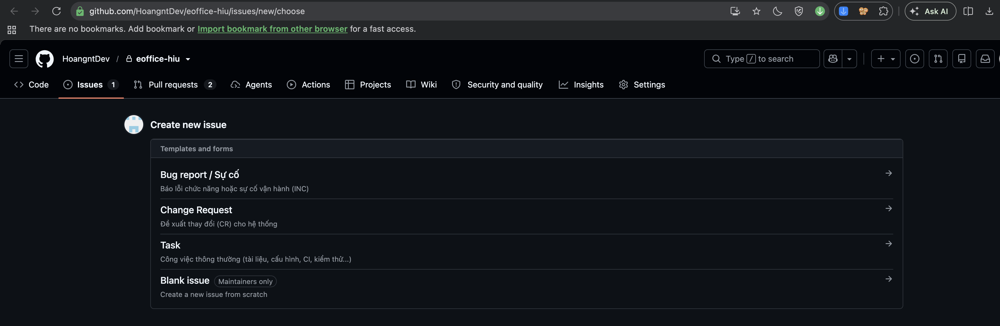

## 3.4 Issue CR-01

- Issue: [#37 – CR-01-ThongBaoRealtime: Thông báo trong ứng dụng theo thời gian thực](https://github.com/HoangntDev/eoffice-hiu/issues/37), tạo bằng form Change Request, label `change-request`, Milestone `TH4`.
- Hướng CR: kỹ thuật nâng cao khác (Supabase Realtime). Người dùng nhận thông báo trong ứng dụng (biểu tượng chuông trên thanh đầu trang) khi trạng thái liên quan đến mình thay đổi, không cần tải lại trang; hệ thống vẫn dùng được khi realtime lỗi hoặc bị tắt.
- Có 7 tiêu chí chấp nhận AC1–AC7: đăng ký được duyệt hoặc từ chối, hồ sơ Đoàn viên đổi trạng thái, kế hoạch chương trình được xử lý, RLS cho cả truy vấn và realtime, đánh dấu đã đọc, chạy được khi mất realtime (YC4), không lộ dữ liệu nhạy cảm trong thông báo và log (YC5).
- **Ngày tạo: 29/10/2026, sau hạn 25/10/2026.**
- **Tình trạng trao đổi với giảng viên:** sinh viên đã đề xuất hướng CR này. Tuần 20–24/10/2026 giảng viên bận nên lớp nghỉ, **chưa có phản hồi**. Trường "Trao đổi với giảng viên" của issue ghi đúng như vậy, không ghi là đã thống nhất. Sinh viên tiến hành theo đề xuất để kịp lịch TH3–TH4 và sẽ cập nhật issue khi có ý kiến của giảng viên.
- Chưa tạo branch `cr/`, chưa sửa code.

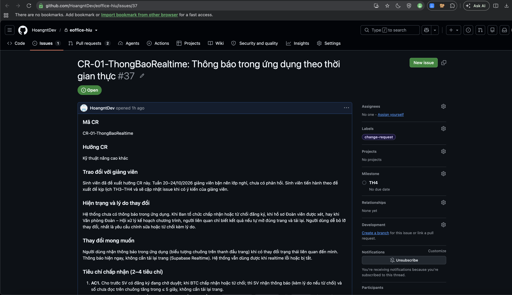

Ảnh chụp phần đầu issue. Toàn văn AC1–AC7 và phạm vi xem tại link #37.

## 3.5 Kiểm chứng lịch sử `main` sau baseline

Hai lệnh dưới đây chạy ngày 29/10/2026 trên `main` = `origin/main` = `d727856`, **trước khi merge PR #41** (báo cáo này). Output lưu ở `evidence/git-log-first-parent.txt`:

```
$ git log --first-parent --oneline course-baseline..main
d727856 Merge pull request #39 from HoangntDev/test/38-smoke-artifact-v1.0.0
cf8c161 Merge pull request #36 from HoangntDev/fix/35-home-duplicate-auth
fe2b984 Merge pull request #34 from HoangntDev/docs/33-release-notes
caa2a92 Merge pull request #32 from HoangntDev/refactor/31-runtime-public-env
634108d Merge pull request #30 from HoangntDev/fix/28-giu-qr-khi-dang-nhap
5953e07 Merge pull request #29 from HoangntDev/test/27-use-case-tests
15f0a5f Merge pull request #26 from HoangntDev/refactor/25-externalize-config
5f56811 Merge pull request #24 from HoangntDev/ci/23-build-test-workflow
044bfe3 Merge pull request #22 from HoangntDev/chore/21-issue-pr-templates
69d7675 Merge pull request #20 from HoangntDev/docs/19-th1-report-ui
bd06583 Merge pull request #18 from HoangntDev/fix/17-ui-polish
2713860 Merge pull request #16 from HoangntDev/docs/15-th1-thong-tin-sv
6467a31 Merge pull request #14 from HoangntDev/docs/13-th1-report
8253341 Merge pull request #12 from HoangntDev/test/11-baseline-coverage
97744b6 Merge pull request #10 from HoangntDev/chore/9-claude-md-rules
46721db Merge pull request #8 from HoangntDev/docs/7-readme-baseline

$ git log --first-parent --no-merges --oneline course-baseline..main
(không có dòng nào)
```

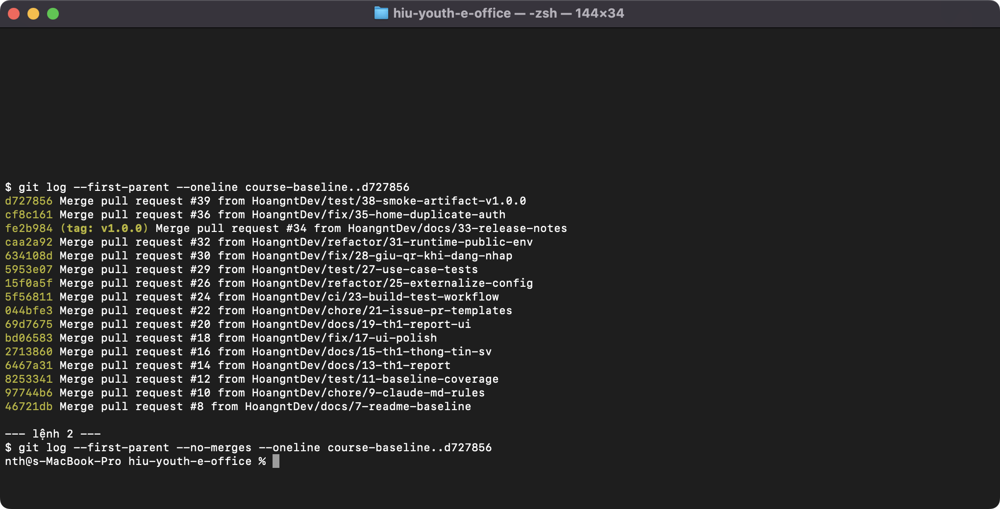

Ảnh chụp cửa sổ Terminal ngày 29/10/2026, chạy trên `d727856`, trước khi merge PR #41. Hai lệnh dùng `d727856` thay cho `main` để kết quả cố định đúng thời điểm đó.

Lệnh thứ nhất cho thấy, tính từ baseline, `main` chỉ tiến lên qua merge commit của PR: 7 PR của TH1 và 9 PR của TH2 tính đến `d727856`. Sau đó `main` có thêm merge của PR #41 (`37873be`) và PR chèn ảnh của #42, cũng qua merge commit. Lệnh thứ hai rỗng, nghĩa là **không có commit nào được đẩy thẳng vào `main`**. Không có tag nào bị xóa hay gắn lại: `course-baseline`, `v1.0-local` và `v1.0.0` trên origin vẫn trỏ đúng commit cũ.

# 4. Quản lý cấu hình và dependency

Chi tiết: `docs/TH2/config-dependency.md`. Bằng chứng: `docs/TH2/evidence/config/`.

## 4.1 Bảng kê cấu hình (trước và sau khi tách)

Cấu hình đọc từ biến môi trường qua một file duy nhất là `src/lib/env.ts`. Khi chạy local, giá trị đặt trong `.env.local`; file này bị `.gitignore` loại khỏi repo.

| Mục cấu hình | Trước khi tách | Sau khi tách | Nhạy cảm | Theo môi trường |
|---|---|---|---|---|
| `NEXT_PUBLIC_SUPABASE_URL` | Đọc qua `env.ts`, riêng `src/proxy.ts` đọc thẳng `process.env` (bị nhúng lúc build) | Chỉ đọc qua `env.ts`, **đọc lúc chạy** (#32) | Không | Dev `:54321`, stack demo `:55321`, CI giá trị giữ chỗ |
| `NEXT_PUBLIC_SUPABASE_PUBLISHABLE_KEY` | Như trên | Như trên | Thấp (công khai; quyền do RLS quyết định) | Mỗi stack một key |
| `SUPABASE_SERVICE_ROLE_KEY` | `env.ts` (`serverSupabaseEnv`) | Giữ nguyên, chỉ server | **Có** | Mỗi stack một key; CI dùng giá trị giữ chỗ |
| `AUTH_RATE_LIMIT_PEPPER` | `env.ts` | Giữ nguyên, chỉ server | **Có** | Mỗi môi trường một chuỗi ngẫu nhiên (`openssl rand -hex 32`) |
| `NEXT_PUBLIC_APP_URL` | Mặc định `http://127.0.0.1:3000`, bị nhúng lúc build | Đọc lúc chạy (#32) | Không | Dev `:3000`, demo `:3200` |
| `LOG_LEVEL` | `src/lib/log.ts` đọc thẳng `process.env`, không có trong tài liệu, luôn là `info` | `env.ts` → `logLevel()`, có trong `.env.example` và README | Không | Để trống: dev `debug`, production `info`, test `warn` |
| Cookie `Secure` (`NODE_ENV`) | `confirm-handler.ts` đọc thẳng `process.env.NODE_ENV` | `env.ts` → `isProduction()` | Không | Bật ở production |
| `PORT` | Mặc định 3000 | Giữ nguyên, ghi trong README | Không | Đổi khi chạy song song |
| Chuỗi kết nối Postgres | Không nằm trong app; CLI quản qua `supabase/config.toml` | Giữ nguyên | Có (mật khẩu DB local mặc định) | Stack tách biệt đổi `project_id` và cổng |
| `DEMO_SUPABASE_URL`, `DEMO_SERVICE_ROLE_KEY` | Chỉ cho `scripts/seed-demo.mjs`, không đọc `.env.local` | Giữ nguyên | Có | Script từ chối host không phải local |
| Giới hạn PDF 5 MB, hạn QR 30 giây | Hằng số / RPC trong DB | **Cố ý giữ** trong code và DB | Không | Là quy tắc nghiệp vụ có test, không phải cấu hình môi trường |

## 4.2 Quản lý secret

- Secret chỉ nằm trong `.env.local` (không commit) hoặc biến shell lúc chạy script. Không có secret nào trong mã nguồn.
- File mẫu `.env.example` chỉ có giá trị giả:

```
NEXT_PUBLIC_SUPABASE_URL=http://127.0.0.1:54321
NEXT_PUBLIC_SUPABASE_PUBLISHABLE_KEY=replace-with-local-or-project-publishable-key
SUPABASE_SERVICE_ROLE_KEY=replace-with-server-only-service-role-key
AUTH_RATE_LIMIT_PEPPER=replace-with-a-random-server-only-value
NEXT_PUBLIC_APP_URL=http://127.0.0.1:3000
LOG_LEVEL=
```

- **Rà lịch sử Git** (`evidence/config/secret-scan.txt`): chạy `git log --all -p -S '<mẫu>'` với 12 mẫu (tên biến khóa, JWT `eyJhbGciOi`, `sb_secret_`, `PRIVATE KEY`, `ghp_`, `AKIA`, `sk_live`…) trên 76 commit của mọi nhánh. Chỉ thấy giá trị giữ chỗ và giá trị cố ý cho stack demo. Chỉ có `.env.example` từng được commit. Không có secret bị lộ, nên không cần đổi khóa.
- **Secret trên CI:** workflow không cần secret thật. Job `build-test` dùng giá trị giữ chỗ, job `pgtap` dựng Postgres trong runner. Chưa tạo mục nào ở Settings → Secrets.
- **Log:** `src/lib/log.ts` ghi JSON có `requestId`. Log không ghi PIN hay khóa. Log của lần smoke test (mục 6.5) chỉ có UUID người dùng và chương trình.

## 4.3 Đọc cấu hình lúc chạy (#31, PR #32)

Trước đây `appUrl()` và proxy đọc `process.env.NEXT_PUBLIC_…` bằng tên viết sẵn, nên Next nhúng giá trị của máy build vào bản build. Ứng dụng không có Supabase client phía trình duyệt, nên `env.ts` nay đọc mọi biến bằng tên động. **Build một lần, cấu hình lúc chạy.**

Kiểm chứng (`evidence/config/runtime-env-check.txt`):

- Build với giá trị giữ chỗ (`http://placeholder.invalid:1`, `placeholder-pk`), rồi `grep` thư mục `.next/server` và `.next/static`: không thấy giá trị nào bị nhúng.
- Chạy chính bản build đó với `.env.local` của stack demo: khách mở `/programs` bị `307` về `/login`; đăng nhập trả 200; trang chương trình hiện dữ liệu của stack demo.

Nhờ vậy gói v1.0.0 không bị gắn với một máy chủ Supabase cụ thể. Smoke test ở mục 6.5 xác nhận lại điều này: gói được build ngày 20/10 chạy được với một stack hoàn toàn mới ở cổng 563xx.

## 4.4 Bảng kê dependency đã cố định phiên bản

`npm ls --depth=0` liệt kê 26 dependency trực tiếp (12 runtime, 14 dev); output ở `evidence/config/npm-ls-depth0.txt`. Trước đây 18/26 dependency khai báo khoảng (`^5.9.1`, `^4`, `^19`…). Nay mọi dependency trực tiếp trong `package.json` ghi đúng phiên bản đang cài. `.npmrc` có `save-exact=true` để lần cài sau cũng ghi phiên bản cố định. Phiên bản bắc cầu do `package-lock.json` khóa; CI dùng `npm ci`.

| Tên | Phiên bản | Mục đích | Loại | Ghi chú rủi ro |
|---|---|---|---|---|
| `next` | 16.3.8 | Framework web | Runtime | Nâng từ 16.3.6 để vá 6 advisory high. Ngày 29/10 có advisory mới (mục 4.5) |
| `react`, `react-dom` | 19.2.8 | Giao diện | Runtime | Đi cùng phiên bản Next, chưa nâng riêng |
| `@supabase/supabase-js` | 2.117.2 | Gọi Auth, RPC, Storage | Runtime | Không có cảnh báo lúc phát hành |
| `@supabase/ssr` | 0.12.7 | Phiên đăng nhập bằng cookie | Runtime | Bản 0.x, API có thể đổi; đã cố định |
| `zod` | 4.6.5 | Kiểm tra dữ liệu vào | Runtime | Không có cảnh báo lúc phát hành. Ngày 29/10 có advisory mới (mục 4.5) |
| `qrcode` | 1.5.4 | Sinh QR điểm danh | Runtime | Bản mới nhất, ít cập nhật |
| `react-hook-form`, `@hookform/resolvers` | 7.89.0 / 5.9.1 | Form | Runtime | Khai báo nhưng `src/` chưa import; sẽ dọn ở việc khác |
| `typescript` | 5.9.3 | Kiểm tra kiểu | Dev | Có TS 7 nhưng là major mới, chưa nâng |
| `vitest`, `@vitest/coverage-v8` | 5.0.2 | Unit test, coverage, JUnit | Dev | Không có cảnh báo lúc phát hành |
| `eslint`, `eslint-config-next` | 9.39.5 / 16.3.8 | Lint | Dev | Kéo chuỗi bắc cầu tới `braces` có advisory high (mục 4.5) |

## 4.5 Kiểm tra lỗ hổng (`npm audit`)

| Thời điểm | Kết quả | Log |
|---|---|---|
| 20/10, trước khi sửa | 7 high: `next` (6 advisory), `source-map-js`, chuỗi `eslint-config-next` → `braces` | `evidence/config/npm-audit-before.txt` |
| 20/10, sau khi sửa (PR #26) | 5 high, chỉ còn chuỗi `eslint-config-next` → `@next/eslint-plugin-next` → `fast-glob` → `micromatch` → `braces` (dev) | `evidence/config/npm-audit-after.txt` |
| 29/10, khi cài gói v1.0.0 | 7 lỗ hổng (3 moderate, 3 high, 1 critical). Riêng production (`--omit=dev`): `next` 16.0.0–16.4.0 (critical) và `zod` <4.6.6 (high) | `evidence/smoke-artifact/10-npm-audit.log` |

Quyết định ở PR #26:

1. **`next` 16.3.6 → 16.3.8**: bản vá cùng nhánh 16.3, đóng 6 advisory. Chạy lại lint, typecheck, test, build và chạy lại app.
2. `source-map-js` 1.2.1 → 1.2.2 bằng `npm audit fix` (bắc cầu, không đổi API).
3. Chuỗi `braces`: **chấp nhận rủi ro**. Đây là công cụ lint chỉ chạy lúc phát triển và trên CI, không có trong bản build; dữ liệu vào là glob của repo. Cách sửa duy nhất npm gợi ý là hạ `eslint-config-next` về 14.2.35, không tương thích Next 16.

Kết quả ngày 29/10 là **advisory mới công bố sau ngày phát hành**. Gói v1.0.0 không đổi; phải sửa bằng phiên bản kế tiếp (v1.0.1), không gắn lại tag. Việc nâng `next` và `zod` chưa làm trong TH2 (xem mục 8).

# 5. Continuous Integration

## 5.1 Workflow `.github/workflows/ci.yml`

| Thuộc tính | Giá trị |
|---|---|
| Sự kiện kích hoạt | `push` vào `main` và `pull_request` vào `main`. Không chạy cho mọi branch, để tiết kiệm phút chạy |
| Runner | `ubuntu-latest` (dự án đa nền tảng: Node.js và Postgres trong Docker) |
| Quyền | `permissions: contents: read` |
| Chống chạy trùng | `concurrency: ci-${{ github.ref }}`, `cancel-in-progress: true` |
| Job `build-test` | Timeout 15 phút. Biến môi trường là giá trị giữ chỗ |
| Job `pgtap` | Timeout 20 phút. Chạy song song với `build-test` |
| Artifact | `vitest-results` (JUnit `test-results/`, `coverage-summary.json`, `coverage/index.html`) và `pgtap-results` (`test-results/pgtap.txt`), `if: always()`, `retention-days: 7` |

Các bước:

| Job `build-test` | Job `pgtap` |
|---|---|
| 1. `actions/checkout@v7` | 1. `actions/checkout@v7` |
| 2. `actions/setup-node@v7`, Node 24, cache npm | 2. `supabase/setup-cli@v3`, CLI 2.117.0 (giống máy local) |
| 3. `npm ci` | 3. `supabase db start`: dựng Postgres trong runner và áp toàn bộ migration |
| 4. `npm run lint` | 4. `supabase test db` (pgTAP), ghi ra `test-results/pgtap.txt` với `set -o pipefail` |
| 5. `npm run typecheck` | 5. Upload `pgtap-results` |
| 6. `npm run test:ci` (Vitest, JUnit và coverage) | |
| 7. `npm run build` | |
| 8. Upload `vitest-results` | |

Lệnh build và test chạy được trên máy cá nhân, ghi trong README: `npm run lint`, `npm run typecheck`, `npm test`, `npm run build`, `supabase test db`.

## 5.2 Mức CI và lý do

**Mức A**: build và **toàn bộ** automated test chạy trên GitHub-hosted runner.

- Unit test (Vitest) không cần mạng hay DB.
- Test nghiệp vụ trong DB (pgTAP) cần PostgreSQL có schema của Supabase (role `authenticated`, `auth.uid()`…). Thay vì service container Postgres thuần, job `pgtap` dùng Supabase CLI dựng Postgres ngay trong runner, áp đủ migration như máy local. Vì vậy không cần chuyển sang mức B.
- Phần chạy ở máy cá nhân là **test case thủ công/tích hợp** trên bản build (mục 6.1) và smoke test (mục 6.5). Hai phần này cần web chạy cùng stack Supabase đầy đủ (Auth, Storage, Mailpit), có log làm bằng chứng. Chúng là kiểm thử bổ sung, không phải automated test bị đẩy ra khỏi CI.

## 5.3 Lần chạy thành công

Lần chạy [40737995933](https://github.com/HoangntDev/eoffice-hiu/actions/runs/40737995933) (PR #39, 29/10/2026):

| Job | Kết quả | Thời gian | Số liệu trong log |
|---|---|---|---|
| `build-test` | success | 1m18s | Vitest `Test Files 13 passed (13)`, `Tests 142 passed (142)`; `✓ Compiled successfully in 15.4s` |
| `pgtap` | success | 1m55s | `Files=8, Tests=205`, `Result: PASS` |

Artifact: `vitest-results` (13 614 byte) và `pgtap-results` (814 byte), hết hạn 04/11/2026. Artifact của các lần chạy ngày 20–21/10 đã hết hạn sau 7 ngày nên không còn tải được; số liệu của chúng vẫn xem được trong log (ví dụ lần chạy trên `main` sau PR #36: 142/142 và 205/205).

Trang lần chạy có 2 annotation thật của GitHub: nhãn `ubuntu-latest` chuyển sang Ubuntu 26 từ 19/10/2026. CI vẫn xanh; cần theo dõi khi runner đổi image (Node 24 và Supabase CLI được cài lại ở mỗi lần chạy).

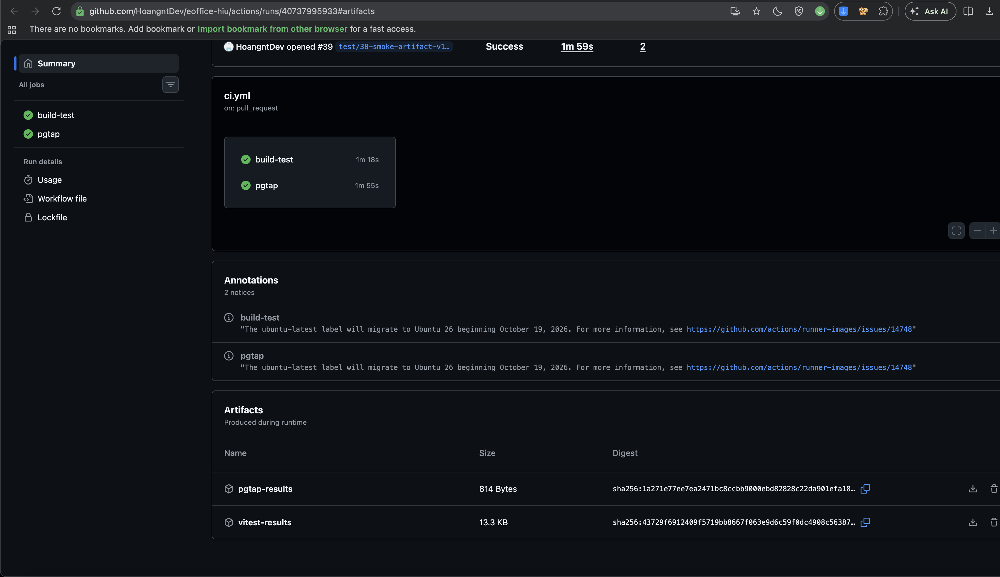

## 5.4 CI đỏ

`gh run list` ghi 50 lần chạy từ 06/10 đến 21/10/2026, cộng thêm các lần chạy ngày 29/10 của PR #39: **tất cả đều `success`**. Trong Milestone TH2 không có lần CI đỏ nào, nên không có mục "CI đỏ và cách sửa".

Lỗi được chặn trước khi push: các PR sửa mã (#26, #30, #32, #36) ghi trong mô tả kết quả lint, typecheck và test chạy ở máy cá nhân trước khi mở PR, theo PR template.

# 6. Kiểm thử và Release v1.0.0

## 6.1 Test case các use case chính

Chi tiết từng test case (tiền điều kiện, các bước, dữ liệu, mong đợi, thực tế): `docs/TH2/test-cases.md`.

- **Bản build:** production (`npm run build` rồi `next start -p 3200`), worktree riêng.
- **Dữ liệu:** stack Supabase demo tách biệt (`hiu-eoffice-demo`, cổng 553xx), seed theo `docs/TH2/demo-data.md`. Tài khoản là dữ liệu giả.
- **Cách chạy:** `evidence/test-run/run-test-cases.mjs` gọi API thật của bản build như trình duyệt (cookie phiên, header `origin`), rồi đọc trạng thái DB demo bằng `psql`.

| Mã | UC | Nội dung | Lần 1 | Lần 2 | Lần 3 |
|---|---|---|---|---|---|
| TC-UCA-01 | UC-A Hồ sơ Đoàn viên | Văn phòng ghi nhận Sổ Đoàn rồi công nhận → `recognized` | Pass | Pass | Pass |
| TC-UCA-02 | UC-A | Công nhận khi chưa tiếp nhận Sổ → 422 | Pass | Pass | Pass |
| TC-UCA-03 | UC-A | Sinh viên gọi API xét duyệt → 403 | Pass | Pass | Pass |
| TC-UCB-01 | UC-B Kế hoạch chương trình | Người lập tự duyệt → 403 | Pass | Pass | Pass |
| TC-UCB-02 | UC-B | Yêu cầu chỉnh sửa với lý do < 10 ký tự → 422 | **Fail** (dữ liệu test sai) | Pass | Pass |
| TC-UCB-03 | UC-B | Văn phòng chấp thuận → `approved` | Pass | Pass | Pass |
| TC-UCC-01 | UC-C Đăng ký tham gia | Đăng ký chương trình đang mở → 201 `accepted` | Pass | Pass | Pass |
| TC-UCC-02 | UC-C | Hết chỗ → 409 `REGISTRATION_FULL` | Pass | Pass | Pass |
| TC-UCC-03 | UC-C | Không thuộc đối tượng → 403 `AUDIENCE_NOT_MET` | Pass | Pass | Pass |
| TC-UCC-04 | UC-C | BTC duyệt đăng ký `pending` → `accepted` | Pass | Pass | Pass |
| TC-UCD-01 | UC-D Điểm danh QR | Điểm danh bằng token còn hạn; điểm dự kiến đề nghị = 2 | Pass | Pass | Pass |
| TC-UCD-02 | UC-D | Quét lại cùng lượt → 409 `ALREADY_CHECKED_IN` | Pass | Pass | Pass |
| TC-UCD-03 | UC-D | Chưa có đăng ký được nhận → 403 | Pass | Pass | Pass |
| TC-UCD-04 | UC-D (K1) | Quét QR khi chưa đăng nhập, đăng nhập xong quay lại đúng trang điểm danh | **Fail** | **Fail** → Bug #28 | Pass |
| TC-UCD-05 | UC-D | Token quá 30 giây → 410 `QR_EXPIRED` | Pass | Pass | Pass |
| **Tổng** | | | **13/15** | **14/15** | **15/15** |

Log: `evidence/test-run/run-1-truoc-sua-K1.log`, `run-2-truoc-sua-K1.log`, `run-3-sau-sua-K1.log` (chữ ký token QR đã che).

- **Lần 1, TC-UCB-02 Fail do dữ liệu test:** test gửi `decision: "needs_changes"` và mong đợi 400. API thực tế nhận `request_changes` và trả lỗi validation bằng 422. Đã sửa test case, reset DB demo, chạy lại.
- **Lần 2, TC-UCD-04 Fail là lỗi thật (K1):** `/attend/<id>?t=<token>` bị chuyển tới `/login?next=%2Fattend%2F<id>`, mất `?t=`; đăng nhập luôn trả `next: "/onboarding/profile"`. Đã tạo Bug #28 bằng form Bug report và sửa đủ 3 tầng ở PR #30: `src/proxy.ts` giữ cả query string; trang đăng nhập đọc `next`; API đăng nhập kiểm `next` bằng `safeNextPath` (chỉ nhận đường dẫn nội bộ, chặn open redirect).
- **Lần 3** chạy trên bản build của nhánh sửa K1 (`2ea826f`): 15/15 Pass. Kiểm thêm qua giao diện bằng Playwright (`evidence/test-run/k1-ui/`): đăng nhập xong quay lại trang điểm danh và báo "Đã điểm danh lượt Buổi sáng" sau 3,8 giây.

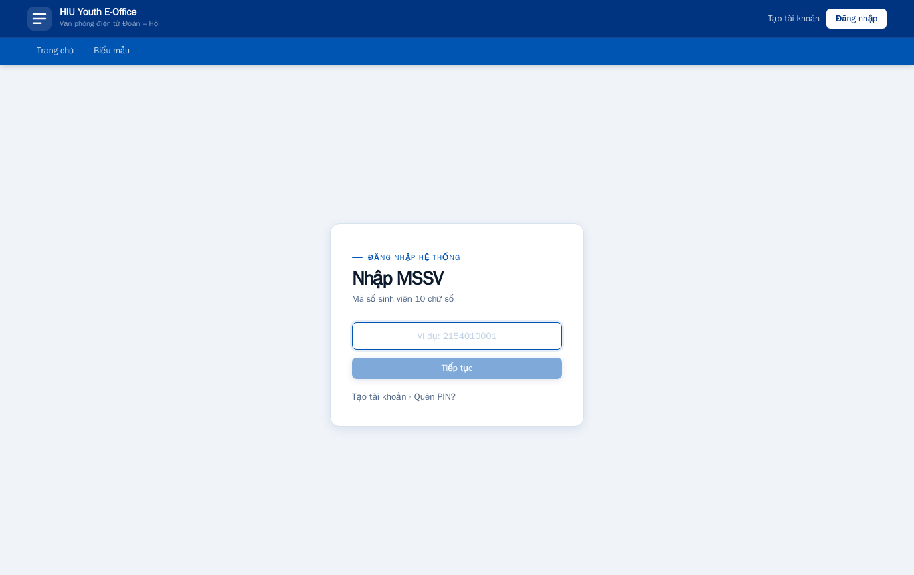{width=12cm}

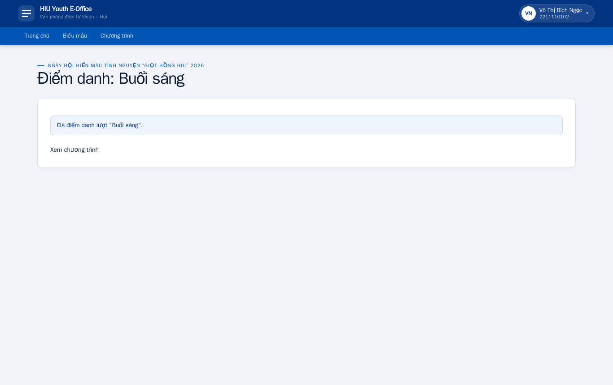{width=12cm}

## 6.2 Automated test trên CI

| Bộ test | Phạm vi | Cách tự chuẩn bị dữ liệu | Kết quả trên CI (lần chạy 40737995933) |
|---|---|---|---|
| Vitest (`tests/*.test.ts`) | Validation, quyền hiển thị, lý do không đăng ký được, cấu hình `env.ts`, `safeNextPath` (16 test thêm cùng bản sửa K1) | Dữ liệu là hằng số trong test, không dùng DB hay mạng | 13 file, **142/142 PASS** |
| pgTAP (`supabase/tests/*.sql`) | UC-A (`002_authorization_workflow.sql`), UC-B (`005_event_programs.sql`), UC-C (`007_program_registrations.sql`), UC-D (`008_program_attendance.sql`) và quyền, danh mục, biểu mẫu | Mỗi file chạy trong `begin … rollback`, tự tạo tài khoản và vai trò bằng UUID cố định | 8 file, **205/205 PASS** |

So với mốc TH1 (Vitest 74 test ở baseline, 109 test sau PR #12), Vitest tăng lên 142 test: thêm `tests/env-config.test.ts` (#26, #32) và `tests/login-next-path.test.ts` (#30). pgTAP vẫn là 205 assertion, nay chạy trên mỗi PR (trước đây chỉ chạy local, known issue K3).

## 6.3 Checklist smoke test

`docs/testing/smoke-test.md`, dùng lại ở TH3 và TH4:

| # | Bước | Kết quả đạt |
|---|---|---|
| 1 | Ứng dụng khởi động | Log có `Ready`, không có `MISSING_ENV` |
| 2 | Trang chủ trả lời | `200`, có "Văn phòng điện tử Đoàn – Hội HIU" |
| 3 | Kết nối Supabase/DB | Stack đang chạy; `/forms` trả `200` và hiện biểu mẫu lấy từ DB |
| 4 | Trang bảo vệ chặn khách | `/programs` → `307` về `/login?next=%2Fprograms` |
| 5 | Đăng nhập | Thanh trên hiện họ tên và MSSV |
| 6 | Mở màn hình chính | Có "Việc của tôi"; bảng chương trình có cột "Đăng ký của tôi" |
| 7 | Một giao dịch chính (UC-C) | Đăng ký chương trình đang mở thành công, trạng thái hiện ở trang chương trình và "Việc của tôi" |
| 8 | Đăng xuất | Về trang chủ khách; mở lại `/programs` bị chuyển tới `/login` |

## 6.4 Release v1.0.0

| Mục | Nội dung |
|---|---|
| CHANGELOG | `CHANGELOG.md` theo Keep a Changelog 1.1.0. Mục `[1.0.0] - 2026-10-20` có Added (UC-A..D, phần nền), Changed, Fixed (K1, K3, K4, K6, K7, K9), Known issues (thanh toán online, UC9/UC10, K2, K5). Thay đổi sau phát hành (#36) nằm ở `[Unreleased]` |
| Tag | `v1.0.0` (annotated) → `fe2b984`, merge commit của PR #34, ngày 20/10/2026 |
| GitHub Release | https://github.com/HoangntDev/eoffice-hiu/releases/tag/v1.0.0, phát hành 20/10/2026, không phải bản nháp |
| Artifact | `hiu-youth-e-office-v1.0.0.zip` (8 804 965 byte) và `hiu-youth-e-office-v1.0.0.zip.sha256` |
| Cách build | Từ worktree sạch tại tag (`git status` rỗng), `npm ci`, `npm run build` với `NODE_ENV=production` và biến giữ chỗ. Gói gồm mã nguồn tại tag (`git archive`), `.next/` đã bỏ `.next/cache`, `BUILD-INFO.txt`, `HUONG-DAN-TRIEN-KHAI.md`. Không có `node_modules`, `.env.local`, secret hay dữ liệu cá nhân |
| Release notes | Lấy từ CHANGELOG mục `[1.0.0]`, kèm link hướng dẫn triển khai, README và smoke test |
| Hướng dẫn cài đặt | README mục "Cài đặt và chạy từ môi trường mới" (từ mã nguồn) và `docs/release/huong-dan-trien-khai.md` (từ gói đã build) |

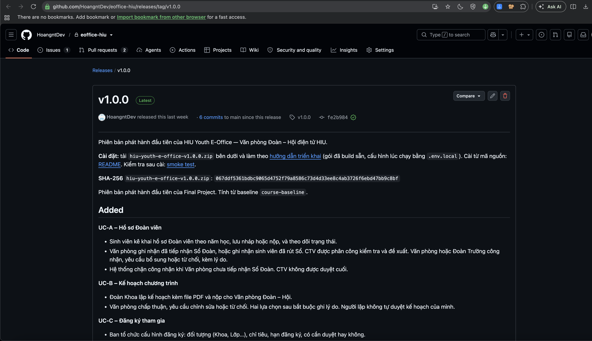

Mục Assets nằm cuối trang Release. Ảnh dưới chụp trang `releases/expanded_assets/v1.0.0` của GitHub: đây là phần GitHub nạp vào mục Assets, mở trực tiếp nên không có giao diện.

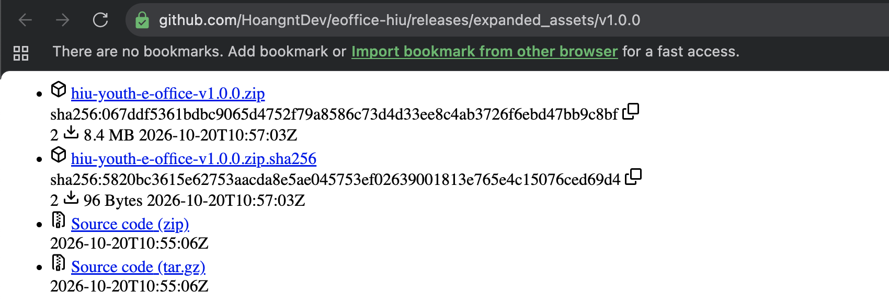{width=12cm}

## 6.5 Smoke test trên artifact

Issue #38, PR #39. Bằng chứng: `docs/TH2/evidence/smoke-artifact/` (log từng lệnh, `README.md`, script `smoke-ui.mjs`).

Cách làm (29/10/2026):

1. Tải gói bằng `gh release download v1.0.0` vào thư mục mới `~/Developer/eoffice-smoke-v1.0.0`, ngoài repo. SHA-256 `067ddf53…bc9065d4…47bb9c8bf` khớp file `.sha256` trên Release.
2. Giải nén. `BUILD-INFO.txt` ghi tag `v1.0.0`, commit `fe2b984`, build ngày 20/10/2026, Next.js 16.3.8. **Không build lại.**
3. Cài theo `docs/release/huong-dan-trien-khai.md`: `npm ci`; đổi `project_id = "eoffice-v100"` và cổng 563xx để chạy song song với stack đang dùng (543xx) và stack demo (553xx); `supabase start` áp 21 migration; tạo `.env.local` trỏ vào stack mới; nạp danh mục và dữ liệu demo (dữ liệu giả).
4. `PORT=3300 npm start`, rồi chạy 8 bước: bước 1–4 bằng `curl`, bước 5–8 bằng Playwright 1.49.1 trong Docker.

| # | Bước | Kết quả thực tế | Trạng thái |
|---|---|---|---|
| 1 | Khởi động | `✓ Ready in 257ms`, không có `MISSING_ENV` | PASS |
| 2 | Trang chủ | `200`, có "Văn phòng điện tử Đoàn – Hội HIU" | PASS |
| 3 | Kết nối DB | Stack `eoffice-v100` đang chạy; `/forms` trả `200`, hiện 2 biểu mẫu đang mở lấy từ DB | PASS |
| 4 | Chặn khách | `307 http://localhost:3300/login?next=%2Fprograms` | PASS |
| 5 | Đăng nhập | Tài khoản demo 2211110103, thanh trên hiện "Huỳnh Gia Hân 2211110103" | PASS |
| 6 | Màn hình chính | Có "Việc của tôi"; bảng có cột "Đăng ký của tôi" | PASS |
| 7 | Giao dịch UC-C | "Đăng ký thành công. Bạn đã được xác nhận tham gia."; trạng thái "Ngày hội Hiến máu" đổi từ "Đang mở đăng ký" sang "Đã xác nhận"; log server có sự kiện `program_registration.registered` | PASS |
| 8 | Đăng xuất | Về trang chủ khách; mở `/programs` bị chuyển tới `/login?next=%2Fprograms` | PASS |

**Kết quả: 8/8 PASS.** Đã thêm một dòng vào bảng kết quả của `docs/testing/smoke-test.md`.

Ghi chú trung thực về lần chạy:

- Lần chạy đầu của bước 5–8 (tài khoản 2241110104) có bước 5–7 PASS. Bước 8 dừng với `net::ERR_ABORTED`, do **script** mở `/programs` khi điều hướng sau đăng xuất chưa xong. Đã thêm `waitForLoadState("networkidle")` và chạy lại bằng một tài khoản khác, vì tài khoản đầu đã đăng ký ở lần 1. Log cả hai lần đều giữ trong `evidence/smoke-artifact/`.
- Lần đầu nạp dữ liệu, `catalog:import` báo `ENOENT: ... '.env.local'`, do chạy trước bước tạo `.env.local`. Làm đúng thứ tự trong hướng dẫn triển khai (Cấu hình → Khởi tạo dữ liệu) thì chạy được.

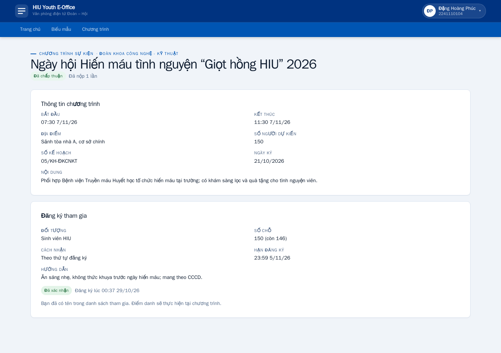{width=14cm}

Ảnh chụp bằng Playwright (`evidence/smoke-artifact/smoke-screenshot.mjs`) trên bản cài từ gói v1.0.0 tại `http://localhost:3300`, stack `eoffice-v100`. Trong container Playwright, địa chỉ này là `host.docker.internal:3300`. Đăng ký của tài khoản này được tạo ở lần chạy bước 5–8 đầu tiên (00:37 29/10/2026).

# 7. Vấn đề gặp phải và cách xử lý

| Nhóm | Vấn đề | Cách xử lý |
|---|---|---|
| Cấu hình, build | `NEXT_PUBLIC_*` đọc bằng tên viết sẵn nên Next nhúng URL Supabase và `APP_URL` của máy build vào bản build; một gói chỉ chạy được với một máy chủ | Issue #31, PR #32: `env.ts` đọc mọi biến bằng tên động. Kiểm bằng cách build với giá trị giữ chỗ rồi `grep` `.next/` (`evidence/config/runtime-env-check.txt`) |
| Cấu hình | `proxy.ts`, `log.ts`, `confirm-handler.ts` đọc thẳng `process.env`; `LOG_LEVEL` không có trong tài liệu | PR #26: gom về `env.ts`, thêm `LOG_LEVEL` theo môi trường, cập nhật `.env.example` và README, 6 test mới |
| Dependency | 18/26 dependency khai báo khoảng phiên bản; `npm audit` 7 high | PR #26: cố định phiên bản, `.npmrc` `save-exact=true`; nâng `next` 16.3.8 và `source-map-js`; chấp nhận chuỗi `braces` (dev, chỉ sửa được bằng cách hạ `eslint-config-next` về 14) |
| Dependency | Ngày 29/10, `npm audit` trên gói v1.0.0 báo advisory mới cho `next` (critical) và `zod` (high) | Ghi nhận ở `evidence/smoke-artifact/10-npm-audit.log` và mục 4.5. Không gắn lại tag; sẽ nâng phiên bản ở bản v1.0.1 qua issue riêng |
| Kiểm thử | Lần chạy 1, TC-UCB-02 Fail do test dùng sai giá trị `needs_changes` và mong đợi sai mã HTTP | Đọc lại schema API, sửa test case, reset **DB demo** (không phải DB đang dùng), chạy lại |
| Kiểm thử | TC-UCD-04 phát hiện lỗi thật K1 | Bug #28 theo form Bug report; sửa 3 tầng ở PR #30, thêm 16 test Vitest; lần 3 chạy 15/15 |
| Kiểm thử | Mỗi lần chạy test case làm thay đổi dữ liệu, không chạy lại được trên cùng DB | Mỗi lần chạy dùng DB demo vừa seed; `seed-demo.mjs` từ chối chạy khi DB đã có tài khoản |
| Môi trường | Máy đã chạy hai stack Supabase (543xx đang dùng, 553xx demo); smoke test cần stack thứ ba | Đổi `project_id` và cổng 563xx theo hướng dẫn triển khai; không đụng hai stack kia |
| Môi trường | Docker Desktop chưa chạy khi bắt đầu smoke test (`Cannot connect to the Docker daemon`) | Mở Docker Desktop rồi chạy lại |
| Môi trường | Lúc đầu phiên làm việc ngày 29/10, `gh` không có trong `PATH` | Cài lại `gh` bằng Homebrew (`/usr/local/bin/gh`), kiểm `gh auth status` trước khi tạo issue/PR |
| Smoke test | `catalog:import` đọc `.env.local`, chạy trước khi tạo file thì lỗi `ENOENT` | Làm đúng thứ tự trong hướng dẫn triển khai; ghi lại trong `evidence/smoke-artifact/README.md` |
| Smoke test | Script Playwright lỗi `ERR_ABORTED` ở bước 8 | Lỗi của script, không phải của ứng dụng. Thêm `waitForLoadState("networkidle")`, chạy lại, giữ log cả hai lần |
| CI | Artifact chỉ giữ 7 ngày; đến 29/10 artifact của các lần chạy ngày 20–21/10 đã hết hạn | Lấy số liệu từ log CI; ảnh và artifact cho báo cáo dùng lần chạy ngày 29/10 (PR #39, còn đến 04/11) |
| Giao diện | Sau phát hành, trang chủ khách có hai cặp nút Đăng nhập/Tạo tài khoản và mục hướng dẫn lặp ý | Bug #35, PR #36. Ghi vào `[Unreleased]`, không sửa mục `[1.0.0]` và tag `v1.0.0`. Ảnh trước/sau ở `evidence/ui/` |
| Git, tiến độ | Giảng viên chưa phản hồi đề xuất CR-01 (lớp nghỉ tuần 20–24/10); issue CR-01 tạo trễ hạn 25/10 | Tạo #37 ngày 29/10, ghi đúng tình trạng "chưa có phản hồi" trong issue; sẽ cập nhật khi có ý kiến giảng viên |
| Bằng chứng | Chụp màn hình bằng `screencapture` chỉ ra hình nền desktop: ứng dụng chạy lệnh chưa có quyền Screen Recording | Cấp quyền trong System Settings → Privacy & Security → Screen Recording, mở lại ứng dụng rồi chụp lại |
| Bằng chứng | Không cuộn được trang GitHub để chụp phần dưới (macOS chặn gửi phím, trình duyệt tắt JavaScript từ AppleScript); `sips --cropOffset` cắt sai vùng | Chụp theo vùng màn hình (`screencapture -R`) bỏ thanh tab; mở URL có neo `#artifacts` cho trang CI và trang `expanded_assets` cho mục Assets của Release |

Trang chủ khách trước và sau PR #36:

| Trước | Sau |
|:---:|:---:|
| 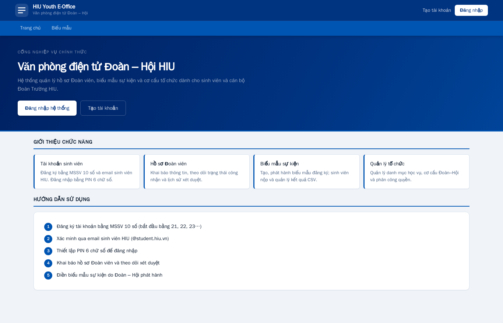{width=8cm} | 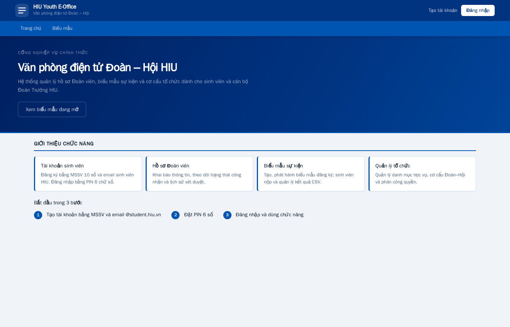{width=8cm} |

**Sử dụng Claude Code (trợ lý AI) trong TH2.** Sinh viên dùng Claude Code (model Claude Opus 5.5) chạy trong terminal của repo.

Dùng vào việc gì:

- Soạn issue form, PR template và workflow `ci.yml`.
- Viết test: `tests/env-config.test.ts`, `tests/login-next-path.test.ts`, script chạy test case `run-test-cases.mjs`, script Playwright cho K1, trang chủ và smoke test.
- Refactor cấu hình (`env.ts`), sửa K1 và trang chủ khách.
- Chạy và ghi log: `npm audit`, rà secret, smoke test trên artifact.
- Tạo issue/branch/PR bằng `gh` theo quy tắc của môn.
- Soạn CHANGELOG, hướng dẫn triển khai, `docs/TH2/*.md` và bản nháp báo cáo này.

Kiểm chứng ra sao:

- Mọi số liệu trong báo cáo lấy từ output lệnh thật, log CI và trang Release; log lưu ở `docs/TH2/evidence/`. Không ghi PASS cho lệnh chưa chạy.
- PR sửa mã chạy lint, typecheck và test ở máy cá nhân (ghi trong mô tả PR); mọi PR có CI GitHub Actions xanh trước khi merge.
- Test case được chạy lại sau mỗi lần sửa (3 lần). Lỗi K1 được tái hiện bằng request thật trước khi sửa, rồi kiểm lại qua giao diện.
- Sinh viên tự đọc lại diff (Files changed) của từng PR, kiểm không có secret, `.env.local` hay dữ liệu thật; log đã che khóa và IP LAN.
- Các ràng buộc giao cho trợ lý (ghi trong `CLAUDE.md`): không commit thẳng vào `main`, không merge khi CI đỏ, không xóa hay gắn lại tag, không reset DB đang dùng, không đụng Supabase cloud và không deploy.

Ghi chú: công cụ tự thêm dòng ghi tên trợ lý AI vào mô tả PR #22–#32 và vào 26 commit từ #7 đến #31 (dòng `Co-Authored-By`). Lịch sử không viết lại. Từ PR #34, mô tả PR và commit không còn dòng này.

# 8. Nhận xét và kết luận

**Nhận xét**

- Quy trình Git của môn áp dụng cho mọi PR của Milestone TH2 (#22–#41 và PR chèn ảnh). `git log --first-parent --no-merges course-baseline..main` rỗng. Từ #23, mọi issue tạo bằng issue form.
- CI mức A: lint, typecheck, build, Vitest (142 test) và pgTAP (205 assertion) chạy trên mỗi PR và mỗi lần push `main`; chưa có lần nào đỏ.
- Cấu hình tách khỏi mã nguồn, không có secret trong lịch sử Git. Một bản build dùng cho mọi môi trường; smoke test trên gói tải từ Release đạt 8/8.
- Kiểm thử tìm ra một lỗi thật (K1) và lỗi đó được sửa trước khi phát hành.

**Mức sẵn sàng cho vận hành (TH3)**

| Mảng | Đã có | Còn thiếu |
|---|---|---|
| Logging | Log JSON phía server có `requestId`, `LOG_LEVEL` theo môi trường, không ghi PIN hay khóa | Chưa gom log về một nơi, chưa có cảnh báo |
| Backup | `docs/operations/backup-restore.md` (dump, restore drill trên stack tách biệt); hướng dẫn triển khai nhắc sao lưu trước khi nâng cấp | Chưa diễn tập restore trên gói v1.0.0 |
| Sự cố | Label `incident`, form Bug report; quy trình rollback trong `docs/release/huong-dan-trien-khai.md` (chỉ khi không phải gỡ migration) | Chưa có runbook xử lý sự cố |
| Phát hành | CHANGELOG, tag, Release, gói build sẵn, checklist smoke test dùng lại được | Chưa có workflow phát hành tự động |

**Mức sẵn sàng cho CR-01 (#37)**

- Đã có issue với 7 tiêu chí chấp nhận. Mốc so sánh: Vitest 142 test, pgTAP 205 assertion, smoke test 8 bước.
- CR-01 đụng DB (bảng thông báo, trigger, RLS), cấu hình (cờ bật/tắt realtime) và giao diện. Phần nghiệp vụ sẽ kiểm bằng pgTAP chạy trên CI.
- Việc tiếp theo ở TH3: Impact Analysis (`docs/TH3/CR-01-ThongBaoRealtime/impact-analysis.md`, issue Milestone TH3), spike Supabase Realtime trên branch `spike/CR-01-ThongBaoRealtime`. Cần cập nhật issue #37 khi giảng viên phản hồi; nếu giảng viên đề nghị đổi hướng thì điều chỉnh CR trước khi hiện thực.

**Hạn chế còn lại**

- **Chưa có thanh toán online** (sandbox), hạn 13/11/2026.
- Advisory mới ngày 29/10 cho `next` (critical) và `zod` (high) trên gói v1.0.0. Cần phát hành v1.0.1 sau khi nâng phiên bản và chạy lại toàn bộ test, smoke test.
- K2 – QR điểm danh dùng chung cho cả lượt, có thể bị chia sẻ trong 30 giây hiệu lực. Giới hạn thiết kế đã chấp nhận.
- K5 – Tên một số migration mang ngày 14–15/10 trong khi tạo ngày 13/10. Không đổi được vì đã áp lên DB.
- K8 – DB local đang dùng còn dữ liệu thử; không dọn vì không được reset. Trình bày dùng stack demo.
- Chuỗi `braces` (dev) chưa có bản sửa tương thích Next 16. `react-hook-form` khai báo nhưng chưa dùng.
- K3 (pgTAP chưa chạy trên CI) **đã xử lý** ở PR #24, không còn là hạn chế.
- UC9 (nghiệm thu, điểm uy tín) và UC10 (đăng bài) vẫn ở nhánh riêng, chưa thuộc v1.0.0.

**Kết luận:** Hệ thống ở trạng thái phát hành được: v1.0.0 có tag, Release, gói build sẵn và smoke test đạt trên gói đó. CI mức A bảo vệ mọi thay đổi tiếp theo. TH2 nộp trễ so với hạn 26/10/2026; issue CR-01 tạo sau hạn 25/10/2026 và đang chờ giảng viên phản hồi.
