# 1. Thông tin

| Mục | Nội dung |
|---|---|
| Môn học | Phát triển, vận hành, bảo trì phần mềm |
| Giảng viên | Hoàng Ngọc Long |
| Sinh viên | Nguyễn Thanh Hoàng — MSSV 2211110012 — Lớp TH22DH-CN1 |
| Đề tài (Final Project) | HIU Youth E-Office — Văn phòng Đoàn – Hội điện tử Trường ĐH Quốc tế Hồng Bàng |
| Bài | TH3 — Logging, sao lưu/phục hồi, sự cố INC-01 và rollback, bắt đầu hiện thực CR-01 (test RED) |
| Hạn nộp | 23:59 ngày 08/11/2026 (giảng viên dời từ hạn ban đầu 02/11/2026). Impact Analysis và test RED của CR-01 làm ngày 30/10/2026; logging, sao lưu/phục hồi, INC-01, v1.0.1, rollback và báo cáo làm ngày 06/11/2026 (lấy bằng lệnh `date`) |
| Repository | https://github.com/HoangntDev/eoffice-hiu |
| Release | Tag `v1.0.1` → commit `fb5eb99`; GitHub Release https://github.com/HoangntDev/eoffice-hiu/releases/tag/v1.0.1 |
| Milestone | `TH3`: issue #44, #46, #48, #51, #53, #55, #57, #59, #61, #63, #65, #67, #69, #71, #73; PR #45, #47, #49, #52, #54, #56, #58, #60, #62, #64, #66, #68, #70, #72 và PR của báo cáo này. CR-01: PR #50 (Draft, Milestone TH4) |

**Công nghệ chính** (theo `package-lock.json` tại `v1.0.1`):

| Thành phần | Phiên bản |
|---|---|
| Next.js (App Router, `src/proxy.ts`, `src/instrumentation.ts`) | 16.4.5 (TH2: 16.3.8) |
| React / React DOM | 19.2.8 |
| TypeScript | 5.9.3 |
| Zod | 4.6.7 (TH2: 4.6.5) |
| Supabase JS / `@supabase/ssr` | 2.117.2 / 0.12.7 |
| PostgreSQL (Supabase local) | 17.6 |
| Logging | winston 3.19.0, winston-daily-rotate-file 5.0.0 |
| Kiểm thử | Vitest 5.0.2, pgTAP qua `supabase test db`, Playwright 1.49.1 (smoke test, trong Docker) |
| Node.js / npm | v24.16.0 / 12.0.2 |
| Supabase CLI / Docker | 2.117.0 / 28.1.1 |
| CI | GitHub Actions, `ubuntu-latest`, job `build-test` và `pgtap` |

# 2. Mục tiêu và phạm vi

**Mục tiêu** (Lab03 mục 1)

1. Ghi log ra file có xoay vòng, đọc mức log từ cấu hình, có trạng thái vận hành.
2. Xây dựng và diễn tập sao lưu/phục hồi dữ liệu, có số liệu kiểm chứng.
3. Xử lý sự cố INC-01 theo quy trình: phát hiện → thu thập bằng chứng → chẩn đoán → xác định nguyên nhân gốc → khắc phục → kiểm chứng → phòng ngừa.
4. Rollback về phiên bản ổn định và kiểm chứng bằng smoke test.
5. Bắt đầu hiện thực CR-01 từ Impact Analysis đã merge, theo nguyên tắc viết test trước (RED).

**Đã thực hiện**

| Việc | Issue / PR | Kết quả |
|---|---|---|
| Impact Analysis CR-01-TaiKhoanToChuc | #44, #46, #48 / #45, #47, #49 | Impact Matrix, so sánh 3 phương án, ước lượng 46–61 giờ, kế hoạch chuyển dữ liệu, 2 lần spike |
| Test RED CR-01 | #37 / PR #50 (Draft, TH4); bằng chứng #51, #53 / #52, #54 | 116 test/assertion mới cho AC1–AC14; CI đỏ ở bước test đúng mong đợi |
| Logging | #55 / #56 | Log JSON ra `logs/app-%DATE%.log`, xoay theo ngày, giữ 7 file; `/api/health`; trang lỗi có mã tham chiếu; kiểm tra YC5 |
| Sao lưu và phục hồi | #57 / #58 | `scripts/backup.sh`, `scripts/restore.sh`, runbook 7 mục; RPO 1 giờ, RTO 30 phút; diễn tập khớp 54/54 bảng |
| Sự cố INC-01-ThieuCauHinh | #59 / #60 | Tái hiện 3 trường hợp trên v1.0.0, hotfix RED → GREEN, incident report (#67 / #68) |
| Lỗi QR sai định dạng | #61 / #62 | 500 → 422 `QR_INVALID`, RED → GREEN |
| Bảo mật dependency | #63 / #64 | `next` 16.4.5, `zod` 4.6.7; `npm audit --omit=dev` 0 lỗ hổng |
| Phát hành v1.0.1 | #65 / #66 | CHANGELOG, tag annotated, Release; smoke test 8/8 trên gói |
| Rollback | #69 / #70 | v1.0.1 → v1.0.0 trong 32,6 giây, smoke 8/8 |
| Script đóng gói | #71 / #72 | Đóng gói có tự kiểm tra; chặn được gói lỗi của v1.0.1 lần đầu |

**Chưa thực hiện (ngoài phạm vi TH3 hoặc chuyển sang TH4)**

- Phần GREEN của CR-01: theo đề, làm ở TH4 trên cùng branch `cr/CR-01-TaiKhoanToChuc`; PR #50 để mở.
- Thanh toán online (sandbox): chưa làm, hạn trước buổi báo cáo 13/11/2026 (mục 8).
- Sửa xử lý mất kết nối database (K2): đã tái hiện và ghi thành đề xuất trong incident report, chưa sửa code.
- Lịch sao lưu tự động (cron): runbook đặt RPO 1 giờ nhưng mới chạy bằng tay.
- Supabase cloud và triển khai thật: chưa được phê duyệt, không đụng tới.

# 3. Repository và Git workflow

## 3.1 Quy trình

Áp dụng từ tag `course-baseline` (ghi trong `CLAUDE.md`), giống TH2:

1. Tạo issue bằng issue form, gán Milestone `TH3`. Sự cố dùng form Bug report, loại "Sự cố vận hành (INC)", label `incident`.
2. Tạo branch `<loại>/<số-issue>-<mô-tả>` từ `main` mới nhất. Hotfix dùng `hotfix/INC-01-<TenSuCo>`, CR dùng `cr/CR-01-<TenCR>` (Hướng dẫn Git workflow của môn).
3. Commit theo mẫu `<loại>(<phạm-vi>): <mô tả> (#<số-issue>)`.
4. Mở PR vào `main`, mô tả ghi `Closes #<số>`.
5. Chờ CI xanh rồi merge bằng **Create a merge commit**. Ruleset `main-protection` bắt buộc PR và hai check `build-test`, `pgtap`; ruleset `tag-protection` chặn sửa/xóa tag `v*` và `course-baseline`.

## 3.2 Issue và PR thuộc Milestone TH3

| Issue | Nội dung | Branch | PR | CI | Merge |
|---|---|---|---|---|---|
| [#44](https://github.com/HoangntDev/eoffice-hiu/issues/44) | Impact Analysis CR-01 | `docs/44-cr01-impact-analysis` | [#45](https://github.com/HoangntDev/eoffice-hiu/pull/45) | xanh | `b8ce02e`, 30/10 |
| [#46](https://github.com/HoangntDev/eoffice-hiu/issues/46) | Cập nhật IA theo đăng nhập hai bước | `docs/46-cr01-impact-analysis-update` | [#47](https://github.com/HoangntDev/eoffice-hiu/pull/47) | xanh | `1af3f5e`, 30/10 |
| [#48](https://github.com/HoangntDev/eoffice-hiu/issues/48) | Chốt các điểm còn mở của IA | `docs/48-cr01-chot-quyet-dinh` | [#49](https://github.com/HoangntDev/eoffice-hiu/pull/49) | xanh | `15823fe`, 30/10 |
| [#51](https://github.com/HoangntDev/eoffice-hiu/issues/51) | Bằng chứng test RED CR-01 | `docs/51-cr01-red-evidence` | [#52](https://github.com/HoangntDev/eoffice-hiu/pull/52) | xanh | `443f4ce`, 30/10 |
| [#53](https://github.com/HoangntDev/eoffice-hiu/issues/53) | Ảnh chụp bằng chứng RED | `docs/53-cr01-red-screenshots` | [#54](https://github.com/HoangntDev/eoffice-hiu/pull/54) | xanh | `ea88a99`, 06/11 |
| [#55](https://github.com/HoangntDev/eoffice-hiu/issues/55) | Logging cho vận hành | `feat/55-logging` | [#56](https://github.com/HoangntDev/eoffice-hiu/pull/56) | xanh (1m25s / 1m28s) | `ed902df`, 06/11 |
| [#57](https://github.com/HoangntDev/eoffice-hiu/issues/57) | Sao lưu và phục hồi | `chore/57-backup-restore` | [#58](https://github.com/HoangntDev/eoffice-hiu/pull/58) | xanh | `b67ee3e`, 06/11 |
| [#59](https://github.com/HoangntDev/eoffice-hiu/issues/59) | **INC-01-ThieuCauHinh** (label `incident`) | `hotfix/INC-01-ThieuCauHinh` | [#60](https://github.com/HoangntDev/eoffice-hiu/pull/60) | RED đỏ, GREEN xanh (1m6s / 1m25s) | `a787366`, 06/11 |
| [#61](https://github.com/HoangntDev/eoffice-hiu/issues/61) | Bug: token QR sai định dạng trả 500 | `fix/61-qr-token-invalid` | [#62](https://github.com/HoangntDev/eoffice-hiu/pull/62) | RED đỏ, GREEN xanh | `25305fc`, 06/11 |
| [#63](https://github.com/HoangntDev/eoffice-hiu/issues/63) | Nâng `next`, `zod` theo `npm audit` | `chore/63-security-next-zod` | [#64](https://github.com/HoangntDev/eoffice-hiu/pull/64) | xanh | `8285c2d`, 06/11 |
| [#65](https://github.com/HoangntDev/eoffice-hiu/issues/65) | Phát hành v1.0.1 | `chore/65-release-v1.0.1` | [#66](https://github.com/HoangntDev/eoffice-hiu/pull/66) | xanh | `fb5eb99`, 06/11 (tag `v1.0.1`) |
| [#67](https://github.com/HoangntDev/eoffice-hiu/issues/67) | Incident report INC-01 | `docs/67-inc01-incident-report` | [#68](https://github.com/HoangntDev/eoffice-hiu/pull/68) | xanh | `41aba69`, 06/11 |
| [#69](https://github.com/HoangntDev/eoffice-hiu/issues/69) | Diễn tập rollback | `chore/69-rollback-drill` | [#70](https://github.com/HoangntDev/eoffice-hiu/pull/70) | xanh | `81940ed`, 06/11 |
| [#71](https://github.com/HoangntDev/eoffice-hiu/issues/71) | Script đóng gói có tự kiểm tra | `feat/71-package-release` | [#72](https://github.com/HoangntDev/eoffice-hiu/pull/72) | xanh (37s / 1m44s) | `24e005a`, 06/11 |
| [#73](https://github.com/HoangntDev/eoffice-hiu/issues/73) | Báo cáo TH3 | `docs/73-th3-report` | PR của báo cáo này | chờ CI xanh rồi mới merge | — |

Ngày merge theo giờ Việt Nam. "RED đỏ" là commit test tái hiện lỗi, CI đỏ ở bước test là đúng mong đợi; PR chỉ merge sau commit GREEN có CI xanh.

**CR-01:** [PR #50](https://github.com/HoangntDev/eoffice-hiu/pull/50) `[WIP] CR-01-TaiKhoanToChuc: tài khoản tổ chức đăng nhập hai bước`, branch `cr/CR-01-TaiKhoanToChuc`, **Draft, Milestone TH4, đang mở**, `Closes #37`. PR này tương ứng "PR #30" trong đề. Không merge ở TH3.

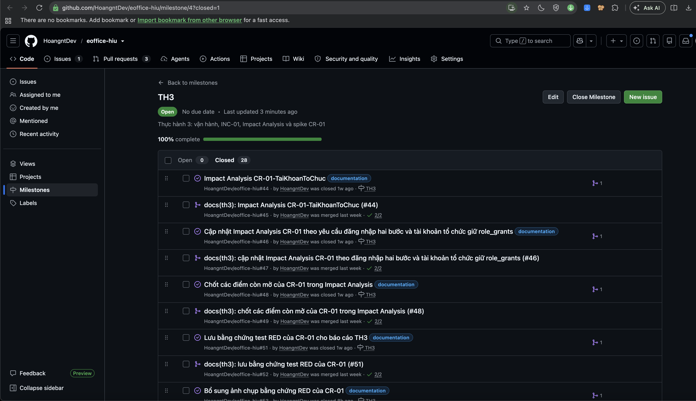

## 3.3 Kiểm chứng lịch sử `main` sau baseline

Hai lệnh dưới đây chạy lúc 17:13 ngày 06/11/2026 trên `main` = `origin/main` = `24e005a`, commit mới nhất **trước khi merge PR báo cáo này**. Output lưu ở `evidence/report/git-log-first-parent.txt`:

```
$ git log --first-parent --oneline course-baseline..main
24e005a Merge pull request #72 from HoangntDev/feat/71-package-release
81940ed Merge pull request #70 from HoangntDev/chore/69-rollback-drill
41aba69 Merge pull request #68 from HoangntDev/docs/67-inc01-incident-report
fb5eb99 Merge pull request #66 from HoangntDev/chore/65-release-v1.0.1
8285c2d Merge pull request #64 from HoangntDev/chore/63-security-next-zod
25305fc Merge pull request #62 from HoangntDev/fix/61-qr-token-invalid
a787366 Merge pull request #60 from HoangntDev/hotfix/INC-01-ThieuCauHinh
b67ee3e Merge pull request #58 from HoangntDev/chore/57-backup-restore
ed902df Merge pull request #56 from HoangntDev/feat/55-logging
ea88a99 Merge pull request #54 from HoangntDev/docs/53-cr01-red-screenshots
443f4ce Merge pull request #52 from HoangntDev/docs/51-cr01-red-evidence
15823fe Merge pull request #49 from HoangntDev/docs/48-cr01-chot-quyet-dinh
1af3f5e Merge pull request #47 from HoangntDev/docs/46-cr01-impact-analysis-update
b8ce02e Merge pull request #45 from HoangntDev/docs/44-cr01-impact-analysis
e6a66db Merge pull request #43 from HoangntDev/docs/42-th2-report-images
37873be Merge pull request #41 from HoangntDev/docs/40-th2-report
d727856 Merge pull request #39 from HoangntDev/test/38-smoke-artifact-v1.0.0
cf8c161 Merge pull request #36 from HoangntDev/fix/35-home-duplicate-auth
fe2b984 Merge pull request #34 from HoangntDev/docs/33-release-notes
caa2a92 Merge pull request #32 from HoangntDev/refactor/31-runtime-public-env
634108d Merge pull request #30 from HoangntDev/fix/28-giu-qr-khi-dang-nhap
5953e07 Merge pull request #29 from HoangntDev/test/27-use-case-tests
15f0a5f Merge pull request #26 from HoangntDev/refactor/25-externalize-config
5f56811 Merge pull request #24 from HoangntDev/ci/23-build-test-workflow
044bfe3 Merge pull request #22 from HoangntDev/chore/21-issue-pr-templates
69d7675 Merge pull request #20 from HoangntDev/docs/19-th1-report-ui
bd06583 Merge pull request #18 from HoangntDev/fix/17-ui-polish
2713860 Merge pull request #16 from HoangntDev/docs/15-th1-thong-tin-sv
6467a31 Merge pull request #14 from HoangntDev/docs/13-th1-report
8253341 Merge pull request #12 from HoangntDev/test/11-baseline-coverage
97744b6 Merge pull request #10 from HoangntDev/chore/9-claude-md-rules
46721db Merge pull request #8 from HoangntDev/docs/7-readme-baseline

$ git log --first-parent --no-merges --oneline course-baseline..main
(không có dòng nào)
```

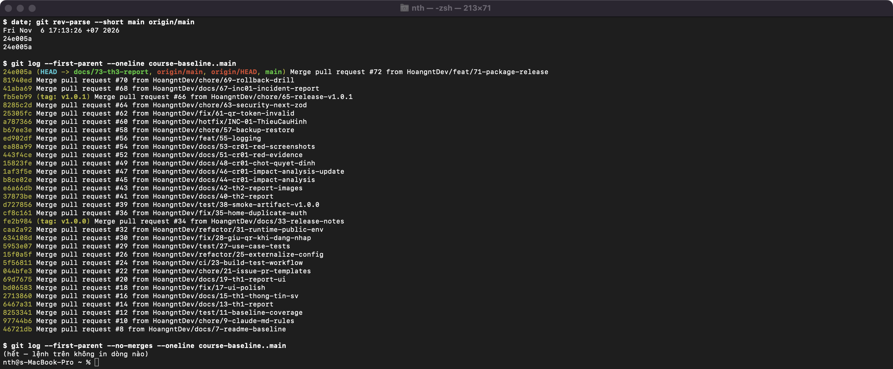

Lệnh thứ nhất in 32 merge commit (7 PR của TH1, 11 của TH2, 14 của TH3): `main` chỉ tiến lên qua merge commit của PR. Lệnh thứ hai rỗng, nghĩa là **không có commit nào đẩy thẳng vào `main`**. Không tag nào bị xóa hay gắn lại: `course-baseline`, `v1.0-local`, `v1.0.0` giữ nguyên; `v1.0.1` là tag mới.

# 4. Logging và sao lưu/phục hồi

## 4.1 Thư viện và cấu hình logging (#55, PR #56)

- **Thư viện:** winston 3.19.0 với transport winston-daily-rotate-file 5.0.0 (Lab03 Phụ lục A.5), pin chính xác trong `package.json`.
- **File log:** `logs/app-%DATE%.log`, `datePattern: YYYY-MM-DD`, `maxFiles: 7` (giữ 7 file). Thư mục `logs/` nằm trong `.gitignore`. Console vẫn ghi như cũ.
- **Định dạng:** mỗi dòng một JSON: `ts`, `level`, `source` (module), `event`, `requestId` (request web), rồi các trường riêng.
- **Mức log từ cấu hình:** `LOG_LEVEL` (`debug`, `info`, `warn`, `error`) đọc qua `src/lib/env.ts`. Để trống thì dev → `debug`, production → `info`, test → `warn`. Đổi mức chỉ cần đổi biến môi trường và khởi động lại. Ngưỡng ghi `db.slow` đọc từ `DB_SLOW_MS` (mặc định 1000 ms). Hai biến có trong `.env.example` và README.
- **Chỉ nạp winston ở runtime Node:** `src/instrumentation.ts` chỉ `import("@/lib/log-node")` khi `NEXT_RUNTIME === "nodejs"`; `src/lib/log.ts` vẫn giữ API `logEvent()`/`requestIdFrom()` cũ và gửi dòng log sang file qua một "sink". `next.config.ts` đặt `serverExternalPackages: ["winston", "winston-daily-rotate-file"]`. Build không có cảnh báo.
- **Mã tham chiếu yêu cầu:** `src/proxy.ts` gắn `x-request-id` cho mọi request, chuyển xuống route/trang và trả lại ở header phản hồi.
- **Không ghi dữ liệu nhạy cảm:** mọi trường đi qua bộ lọc: bỏ hẳn khóa tên `pin`, `password`, `token`, `secret`, `cookie`, `authorization`, `pepper`, `…Key`; che MSSV dạng `221***34`; che email dạng `n***@student.hiu.vn`.

## 4.2 Sự kiện được ghi log

Log thật lấy trên stack tách biệt `eoffice-v100` (dữ liệu demo giả), web chạy bản build ở cổng 3400, `LOG_LEVEL=info`. Trích đoạn đầy đủ ở `docs/TH3/evidence/logging/excerpts/`.

| Sự kiện (Lab03 mục 4.1) | Mức | `event` | Thông tin ghi |
|---|---|---|---|
| Khởi động, dừng | info | `app.start`, `app.stop` | `version`, `nodeEnv`, `logLevel`; `signal`, `exitCode`, `uptimeSec` |
| Lỗi chưa xử lý | error | `app.unhandled_error` (qua `onRequestError`), `api.unhandled_error` | `reference`, `requestId`, `path`, `errorMessage`, `stack` |
| Giao dịch chính | info | `auth.login_succeeded`, `event_program.submitted/reviewed`, `union_application.submitted/reviewed`, `program_registration.registered`, `program_attendance.checked_in` | `userId`, UUID đối tượng (`programId`, `applicationId`, `sessionId`), kết quả (`status`, `outcome`) |
| Gọi database lỗi/chậm | error / warn | `db.call_failed`, `db.slow` | `operation` (ví dụ `select.accounts`, `rpc.is_valid_student_code`), `durationMs`, `status`, `errorCode` |
| Đăng nhập sai, truy cập bị từ chối | warn | `auth.login_failed`, `auth.access_denied` | MSSV đã che, `ip`, `reason`/`code` |

Trích đoạn (cắt bớt `requestId`):

```
{"ts":"2026-11-06T01:53:39.540Z","level":"info","source":"app","event":"app.start","version":"1.0.0","nodeEnv":"production","logLevel":"info","pid":58871}
{"ts":"2026-11-06T01:56:08.413Z","level":"info","source":"app","event":"app.stop","version":"1.0.0","nodeEnv":"production","signal":"SIGTERM","exitCode":143,"uptimeSec":150}
{"ts":"2026-11-06T01:54:49.055Z","level":"warn","source":"auth","event":"auth.login_failed","studentCode":"221***01","ip":"198.51.100.7","reason":"wrong_pin","status":401}
{"ts":"2026-11-06T01:54:54.845Z","level":"warn","source":"api","event":"auth.access_denied","path":"/api/event-programs/b758a3a1-…/review","ip":"203.0.113.10","code":"FORBIDDEN","status":403,"userId":"1b984dc1-…","studentCode":"221***01"}
{"ts":"2026-11-06T01:56:39.439Z","level":"error","source":"proxy","event":"db.call_failed","operation":"select.accounts","durationMs":48,"status":503,"errorCode":"PGRST001"}
{"ts":"2026-11-06T01:56:14.768Z","level":"warn","source":"supabase.user","event":"db.slow","operation":"select.student_profiles","durationMs":27,"status":200,"thresholdMs":20}
```

Dòng `db.slow` lấy ở lần chạy đặt `DB_SLOW_MS=20` để có mẫu; dòng `db.call_failed` lấy khi dừng container DB của stack thử 1 giây.

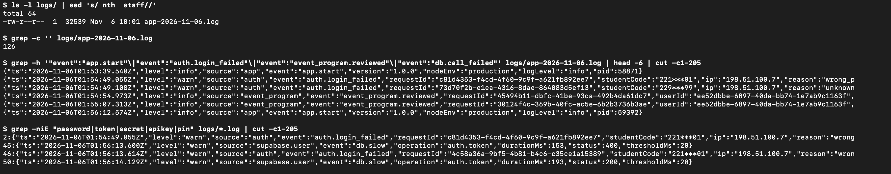

**Lỗi chưa xử lý: người dùng thấy gì.** Trên stack thử, đặt `questions` của một biểu mẫu thành dữ liệu sai cấu trúc rồi mở trang, sau đó trả lại giá trị gốc. Người dùng chỉ thấy câu thân thiện và mã tham chiếu `090bf686`, trùng 8 ký tự đầu của `requestId` trong dòng `app.unhandled_error`:

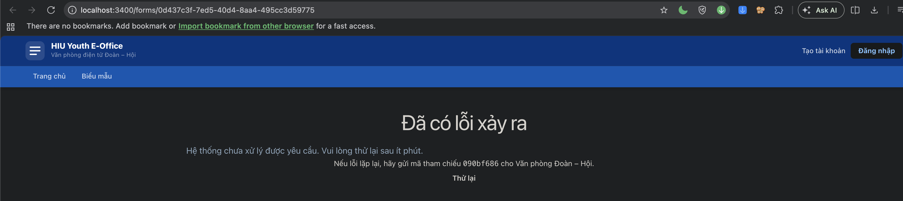{width=14cm}

**`GET /api/health`** trả `{app, db, config, version}`; 200 khi bình thường, 503 khi DB hoặc cấu hình lỗi. Không trả URL, mã lỗi hay tên biến; chi tiết nằm trong log.

## 4.3 Kiểm tra YC5 – không làm lộ thông tin

Lệnh `grep -niE "password|token|secret|apikey|pin" logs/*.log` trên file log của lần chạy (87 dòng lúc lưu bằng chứng) có **4 dòng khớp, không dòng nào là bí mật**:

| Dòng | Từ khớp | Giải thích |
|---|---|---|
| 2, 46 | `pin` trong `"reason":"wrong_pin"` | Mã lý do đăng nhập sai, không phải giá trị PIN |
| 45, 50 | `token` trong `"operation":"auth.token"` | Tên endpoint `/auth/v1/token` của Supabase Auth, không có giá trị token |

Kiểm tra thêm trên cùng file, đều 0 dòng: `@` (email), `123456` (PIN demo), `sb-` (cookie phiên), `eyJ` (JWT), `Bearer`, `sb_publishable`, `sb_secret`, MSSV đầy đủ. Vitest: `tests/logging.test.ts` kiểm lọc mức log theo từng `LOG_LEVEL`, che MSSV/email và không ghi trường cấm (27 test cùng `env-config`, PASS). Chi tiết: `docs/TH3/evidence/logging/README.md`.

## 4.4 Sao lưu và phục hồi (#57, PR #58)

**Phạm vi:** Postgres (schema `public` nghiệp vụ, `auth` tài khoản đăng nhập, `storage` metadata file) và file PDF kế hoạch chương trình trong Storage (bucket `event-program-plans`). Lược đồ không sao lưu vì đã có trong `supabase/migrations/`.

**Mục tiêu đề xuất từ số liệu diễn tập:**

| Mục tiêu | Giá trị | Lý do |
|---|---|---|
| RPO | **1 giờ** trong giờ hoạt động (06:00–22:00), cộng 1 bản mỗi đêm | Một lần sao lưu chỉ mất 1,17 giây, tạo 784 KB, không cần dừng web. Dữ liệu điểm danh QR và đăng ký dồn vào ngày diễn ra chương trình và **không thu thập lại được** sau đó, nên mất 24 giờ là quá nhiều |
| RTO | **30 phút** | Phần kỹ thuật đo được 14,1 giây. Thời gian thật chủ yếu là việc của con người: xác định sự cố từ log và `/api/health`, chọn bản sao lưu, báo người dùng phần dữ liệu sẽ mất, smoke test bằng tay. Dữ liệu thật lớn hơn dữ liệu demo nhiều lần |

**Tóm tắt runbook** (`docs/runbooks/backup-restore.md`, chuyển từ `docs/operations/` bằng `git mv`, đủ 7 mục theo Phụ lục B.2):

- `scripts/backup.sh <stack>`: đếm số bản ghi 54 bảng → `pg_dump -Fc -n public -n auth -n storage` → chép thư mục file Storage → SHA-256. Tạo `backups/<stack>_<YYYYMMDDTHHMMSS>.{dump,storage/,counts.tsv,manifest,sha256}`; `backups/` trong `.gitignore`.
- `scripts/restore.sh <stack> <bản sao lưu|latest>`: kiểm checksum → kiểm phiên bản migration → trong **một transaction** `TRUNCATE` rồi `pg_restore --data-only` (trigger tắt bằng `session_replication_role = replica`) → thay thư mục Storage → so sánh số bản ghi.
- Không có mật khẩu trong script: chạy `pg_dump`/`psql` trong container của stack qua `docker exec`; tên container, user đổi được bằng biến môi trường.
- Phục hồi vào stack dev chính bị từ chối nếu thiếu cờ `--confirm-dev-stack`.

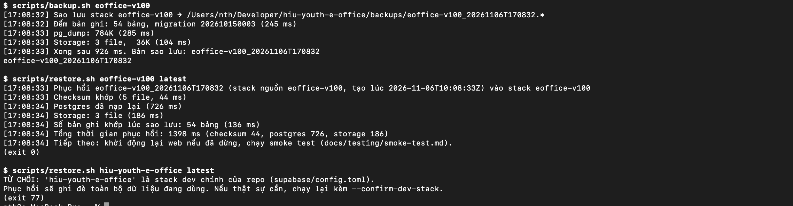

## 4.5 Diễn tập sao lưu/phục hồi

Ngày 06/11/2026 trên stack tách biệt `eoffice-v100`. Bằng chứng: `docs/TH3/evidence/backup/`.

| Bước | Kết quả | Thời gian |
|---|---|---|
| 1. Số liệu trước | 12 bảng chính (`auth.users` 7, `event_programs` 7, `program_registrations` 9, `union_applications` 4, `storage.objects` 3…), bản ghi mẫu, sha256 của 3 PDF | 610 ms |
| 2. Sao lưu | dump 784 KB, 54 bảng, 3 PDF 36 KB | 1 406 ms |
| 3. Gây hỏng | Từ chối nhầm 4 đăng ký Hiến máu (`UPDATE 4`), đổi sai tên/địa điểm 2 kế hoạch, xóa 1 hồ sơ Đoàn viên, xóa 1 PDF, ghi đè 1 PDF | 355 ms |
| 4. Dừng web | | 404 ms |
| 5. Phục hồi | Checksum khớp 5 file; Postgres 883 ms; Storage 310 ms; "Số bản ghi khớp lúc sao lưu: 54 bảng" | 1 951 ms |
| 6. Khởi động web đến khi `/api/health` = 200 | | 1 731 ms |
| 7. So sánh trước/sau | `diff` rỗng: số bản ghi, bản ghi mẫu, sha256 PDF giống hệt | 657 ms |
| 8. Smoke test | 8/8 PASS (bước 2–4 `curl`, bước 5–8 Playwright) | 9 179 ms |
| **RTO kỹ thuật (bước 4 → 8)** | | **14 063 ms** |

Kiểm tra an toàn: phục hồi vào stack dev chính bị từ chối (mã 77); bản sao lưu có file bị sửa dừng ở bước checksum (mã 65), chưa đụng dữ liệu.

**Các lần diễn tập bị loại.** Lần chính thức là lần thứ 5. Lần 1 và 2: kịch bản định xóa đăng ký nhưng bị khóa ngoại của bảng điểm danh và lịch sử đăng ký chặn, transaction tự hủy; đổi thành "từ chối nhầm hàng loạt". Lần 3: chạy hết và khớp nhưng ảnh số liệu chưa có thống kê trạng thái đăng ký nên không thấy được lỗi; thêm thống kê. Lần 4: phục hồi khớp nhưng smoke bước 7 không có nút "Gửi đăng ký" vì tài khoản smoke đã đăng ký sẵn trong dữ liệu demo; đổi tài khoản. Bản sao lưu của bốn lần này đã xóa.

# 5. Sự cố INC-01 và rollback

Incident report đầy đủ: `docs/TH3/INC-01-ThieuCauHinh/incident-report.md` (Phụ lục D, 8 mục). Mọi kịch bản chạy trên gói v1.0.0 cài ngoài repo, stack tách biệt `eoffice-v100`, dữ liệu demo giả; sao lưu trước mỗi kịch bản.

## 5.1 Kịch bản và cách phát hiện

| | K1a – thiếu `AUTH_RATE_LIMIT_PEPPER` | K1b – `SUPABASE_SERVICE_ROLE_KEY` sai | K1c – thiếu `NEXT_PUBLIC_SUPABASE_URL` |
|---|---|---|---|
| v1.0.0 khởi động | `Ready`, trang chủ 200 | `Ready`, trang chủ 200 | `Ready` |
| Người dùng thấy | Đăng nhập → 503 "Dịch vụ chưa được cấu hình biến môi trường." | Đăng nhập → 500 "Không thể xử lý yêu cầu. Vui lòng thử lại." | Mọi trang → "Internal Server Error" thô |
| Log của v1.0.0 | Không có dòng nào | Không có dòng nào | Chỉ stack trace trên console |

| v1.0.0 | v1.0.1 |
|:---:|:---:|
| {width=5cm} | 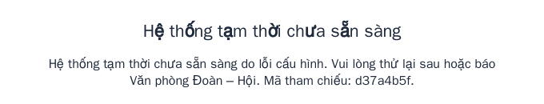{width=8cm} |
| K1c: mọi trang chỉ có "Internal Server Error" | K1c: trang 503 có câu thân thiện và mã tham chiếu |
| 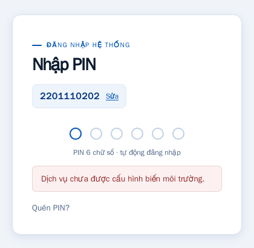{width=6.5cm} | 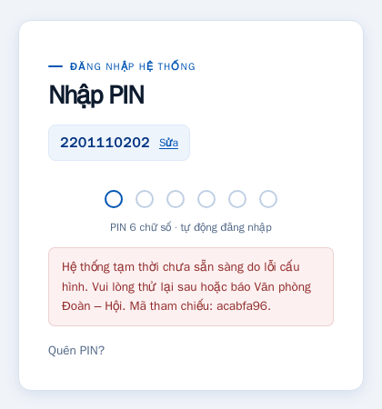{width=6.5cm} |
| K1a: đăng nhập báo lỗi cấu hình, không có mã, không có log | K1a: câu thân thiện kèm mã `acabfa96`, khớp log |

Ảnh cắt từ ảnh gốc trong `INC-01-ThieuCauHinh/evidence/` (`a-v1.0.0/k1/`, `d-v1.0.1-lap-lai/`), chỉ giữ vùng nội dung. Ảnh có đăng nhập chụp bằng Playwright (Chromium headless) vì cần gõ MSSV và PIN.

## 5.2 Dòng thời gian, thời gian phát hiện và khôi phục

| Thời điểm (06/11) | Sự kiện |
|---|---|
| 09:31:36 / 09:31:44 / 09:32:11 | K1a: bắt đầu / phát hiện (mô phỏng) / khôi phục |
| 09:32:11 / 09:32:20 / 09:32:38 | K1b: bắt đầu / phát hiện (mô phỏng) / khôi phục |
| 09:55:36 / 09:55:40 / 09:55:56 | K1c: bắt đầu / phát hiện (mô phỏng) / khôi phục |
| 09:56:15 | Mở issue #59 (form Bug report, loại INC, label `incident`) |
| 09:58:11 → 10:00:48 | Commit RED `57eb927` (CI đỏ: 9 failed \| 163 passed) → commit GREEN `96705c9` |
| 10:02:52 | Merge PR #60 |
| 10:16:51 / 10:18:23 | Tag annotated `v1.0.1` / công bố Release |
| 10:21 | Smoke test 8/8 PASS trên gói v1.0.1 tải từ Release |
| 10:21:55–10:23:09 | Lặp lại K1a/K1b/K1c trên v1.0.1 |

| Trường hợp | v1.0.0: bắt đầu → phát hiện | v1.0.0: phát hiện → khôi phục | v1.0.1: bắt đầu → phát hiện |
|---|---|---|---|
| K1a | 8 giây (mô phỏng) | 27 giây | 1 giây, log `config.invalid` |
| K1b | 9 giây (mô phỏng) | 18 giây | 2 giây, log `config.invalid` |
| K1c | 4 giây (mô phỏng) | 16 giây | 1 giây, log `config.invalid` |

**Đọc số liệu cho đúng:** thời điểm "phát hiện" ở v1.0.0 là lúc tôi mô phỏng người dùng thao tác ngay sau khi khởi động. Thực tế v1.0.0 không có log và không có health check, nên chỉ phát hiện khi có người dùng gặp lỗi **và báo lại**. Ở v1.0.1, dòng `config.invalid` có ngay khi khởi động và `/api/health` trả 503, nên smoke test bước 1 bắt được trước khi mở cho người dùng. Khôi phục nhanh: dừng web, trả `.env.local` từ bản dự phòng chép trước sự cố, khởi động lại, kiểm tra đăng nhập; dữ liệu không bị ảnh hưởng nên không cần `restore.sh`.

## 5.3 Phân tích 5 Whys

1. **Vì sao người dùng không đăng nhập được, hoặc chỉ thấy "Internal Server Error"?** → Vì request cần một biến cấu hình bắt buộc đang thiếu hoặc sai. *(Triệu chứng)*
2. **Vì sao ứng dụng vẫn chạy khi cấu hình đã thiếu/sai?** → Vì v1.0.0 chỉ đọc biến khi có request cần tới (`required()` trong `src/lib/env.ts`); lúc khởi động không kiểm tra gì. *(Nguyên nhân trực tiếp)*
3. **Vì sao vận hành không biết, phải chờ người dùng báo?** → Vì `apiError` trả 503/500 mà không ghi log, không có `/api/health`, log không ghi ra file.
4. **Vì sao K1c làm hỏng mọi trang thay vì báo lỗi rõ?** → Vì bản build đã gộp mất phép kiểm tra trong `optionalPublicSupabaseEnv()` thành `let t={url:…,publishableKey:…};if(!t)` (điều kiện không bao giờ đúng), nên proxy vẫn tạo Supabase client với URL rỗng; lỗi trong proxy không đi qua trang lỗi.
5. **Vì sao lọt qua phát hành v1.0.0?** → Vì khi chuyển sang "build một lần, cấu hình lúc chạy" (#32), dự án không thêm bước xác thực cấu hình khi khởi động; test và smoke test chỉ chạy với cấu hình đúng, không kiểm hành vi trên bản build.

**Nguyên nhân gốc:** thiếu cơ chế kiểm tra cấu hình bắt buộc ngay khi khởi động có tín hiệu cho vận hành (log, health check), và thiếu test cho đường "cấu hình thiếu/sai".

## 5.4 Khắc phục, kiểm chứng và phòng ngừa

**Hotfix (PR #60):** commit RED `57eb927` thêm `tests/inc-01-config.test.ts` (10 test phủ K1a, K1b, K1c; Supabase giả lập theo YC2) và khung `config-check.ts` giữ hành vi v1.0.0 → 9 test thất bại ở assertion. Commit GREEN `96705c9`:

- `src/lib/config-check.ts` kiểm 4 biến bắt buộc và thử service role key với `GET /auth/v1/admin/users` (401/403 → `rejected`); `instrumentation.ts` chạy lúc khởi động, ghi `config.invalid` kèm **tên** biến, không ghi giá trị.
- `/api/health` thêm `config`; lỗi → 503.
- `optionalPublicSupabaseEnv()` đọc biến qua vòng lặp nên bản build giữ đúng điều kiện (đã kiểm trong `.next/server/chunks` trên Next 16.3.8 và 16.4.5).
- Proxy trả trang 503 "Hệ thống tạm thời chưa sẵn sàng" kèm mã tham chiếu; khóa bị từ chối → 503 `SERVICE_NOT_CONFIGURED` thay vì 500.

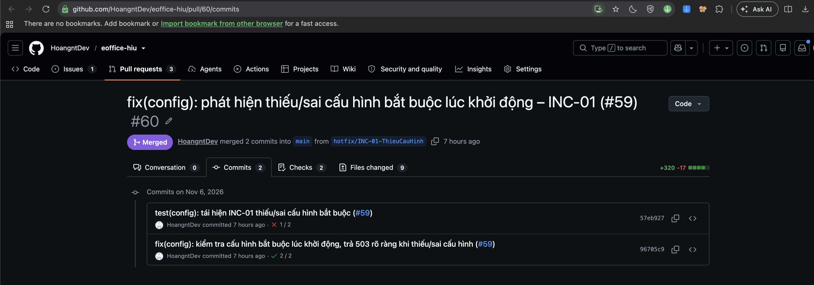

**Kiểm chứng trên v1.0.1:** cả ba trường hợp bị ghi `config.invalid` 1–2 giây sau khởi động, `/api/health` 503 `config: error`, người dùng thấy câu thân thiện kèm mã tham chiếu (`acabfa96`, `b736a9a5`, `d37a4b5f`) trùng `requestId` trong log; trả cấu hình xong thì health 200 và đăng nhập được.

**Phòng ngừa** – đã làm trong hotfix: kiểm tra cấu hình lúc khởi động, health check, log có tên biến, test chạy trong CI. Đề xuất ngoài phạm vi:

- **K2 – mất kết nối database (chưa sửa).** Tái hiện trên v1.0.0: dừng container DB lúc 09:33:05 khi web đang chạy. Lúc 09:33:07, người dùng đã đăng nhập bị đẩy về `/login` với thông báo sai; đăng nhập lại bị 500. Console web 0 dòng, chỉ PostgREST (`PGRST000`) và Auth có log. 09:33:43 tự hoạt động lại sau `docker start`, không cần khởi động lại web (36 giây từ phát hiện), dữ liệu không mất. Nguyên nhân sơ bộ: proxy và DAL coi "Auth không gọi được" là "chưa đăng nhập". Hướng sửa: phân biệt lỗi hạ tầng với chưa đăng nhập, hiện trang 503 và giữ phiên; cần issue và test riêng vì nhạy cảm về bảo mật.
- Job CI kiểm tra gói phát hành; không để lỗi nạp logging làm sập server; giám sát `/api/health` định kỳ.

## 5.5 Lỗi QR #61, nâng cấp bảo mật và phát hành v1.0.1

- **Lỗi token QR (#61, PR #62):** token có phần đầu không phải UUID (ví dụ 36 số 0) lọt qua mẫu `[0-9a-f-]{36}`, xuống DB gặp `22P02` và bị ánh xạ thành 500. RED: 4 failed \| 173 passed. GREEN: mẫu UUID 8-4-4-4-12, route trả 422 `QR_INVALID` không gọi RPC, ánh xạ `22P02` thành `QR_INVALID`. Kiểm trên gói v1.0.1: 422. Phát hiện khi trích log cho mục 4.
- **`npm audit` (#63, PR #64):** trước 15 lỗ hổng (1 critical `next`, 3 high gồm `zod`, 11 moderate) → sau 13 (0 critical, 2 high, 11 moderate); `npm audit --omit=dev`: **0**. Nâng `next` 16.3.8 → 16.4.5 (GHSA-2464-fhr4-w9xw, GHSA-p3m5-59mp-jv5r, GHSA-673q-mjm6-r5xr), `zod` 4.6.5 → 4.6.7 (GHSA-mrhx-c7xc-m3w5). 13 lỗ hổng còn lại nằm trong công cụ phát triển (vitest, vite, undici qua jsdom, minimatch qua typescript-eslint).
- **v1.0.1 (#65, PR #66):** CHANGELOG `[1.0.1]` gồm Fixed (INC-01, QR, trang chủ #36), Security (`next`, `zod`), Added (log ra file, `/api/health`, sao lưu/phục hồi — ghi rõ là cải tiến vận hành, không đổi hành vi nghiệp vụ). Tag annotated `v1.0.1` trên `fb5eb99` sau khi CI trên `main` xanh.
- **Smoke test trên gói tải từ Release:** lần đầu `npm start` thất bại `Cannot find module 'winston-592a0a42b673a90a'` do gói thiếu symlink (mục 7). Sau khi thay gói (SHA-256 `0f4a744b…`): **8/8 PASS**, `/api/health` = `{"app":"ok","db":"ok","config":"ok","version":"1.0.1"}`.

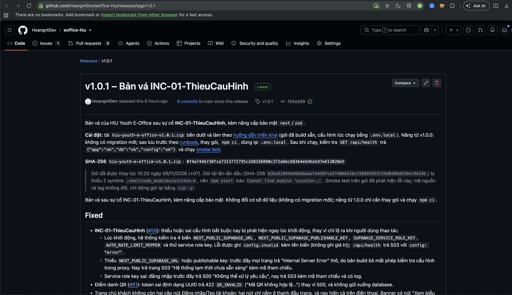

## 5.6 Rollback v1.0.1 → v1.0.0 (#69, PR #70)

Trước khi làm: `git diff --stat v1.0.0 v1.0.1 -- supabase/` rỗng, migration cuối của cả hai tag là `202610150003`. **v1.0.1 không đổi schema**, nên rollback chỉ thay mã chạy, không gỡ migration hay phục hồi DB; dữ liệu ghi bởi v1.0.1 dùng tiếp được với v1.0.0.

Diễn tập trên stack `eoffice-v100`, cổng 3500, giả định v1.0.1 vừa phát hành gặp lỗi nghiêm trọng:

| Bước | Thời gian |
|---|---|
| 1. Quyết định rollback: kiểm schema, `scripts/backup.sh` | 1 199 ms |
| 2. Dừng v1.0.1 (`kill -TERM`, log `app.stop`) | 155 ms |
| 3. Cài v1.0.0 từ Release: tải, checksum OK, giải nén, `npm ci` (14 s, máy đã có cache npm), khởi động | 19 255 ms |
| 4. Smoke test 8 bước: **8/8 PASS** (`/api/health` 404 đúng như mong đợi vì v1.0.0 chưa có) | 11 895 ms |
| **Từ quyết định rollback tới smoke xong** | **32 588 ms** |

Mục 6 "Rollback" của `docs/release/huong-dan-trien-khai.md` được viết lại theo diễn tập này. Ghi chú: bước 3 của smoke in "0 dịch vụ running" do lệnh đếm của script sai (Supabase CLI 2.117 không in chữ "running"); đã kiểm lại ngay bằng `docker inspect`, các container của stack đều chạy.

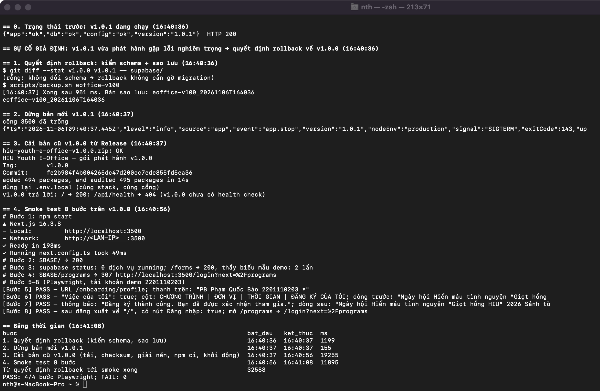

**Phòng ngừa sự cố đóng gói (#71, PR #72):** `scripts/package-release.sh <version>` build từ tag annotated trong worktree sạch, đóng gói bằng `zip -y` (giữ symlink), tạo `.sha256`, rồi **tự kiểm tra**: giải nén vào thư mục tạm, `npm ci`, kiểm symlink, khởi động, `/api/health` phải có `app: ok` và đúng version; hỏng thì dừng, không đưa gói vào `dist/`. Chạy với 1.0.1: ĐẠT. Chạy `--verify` với gói lỗi lần đầu (SHA-256 `b3ba5289…`): THẤT BẠI đúng lý do. Không thay tài sản trên Release v1.0.1.

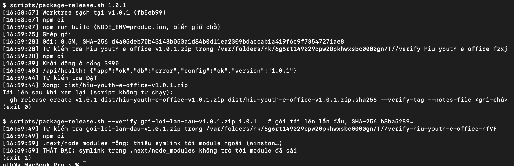

# 6. CR-01

## 6.1 Đổi hướng CR

Ngày 30/10/2026, CR-01 (issue #37) đổi hướng từ "Thông báo realtime" (đề xuất 29/10, nêu ở báo cáo TH2) sang **CR-01-TaiKhoanToChuc: tài khoản tổ chức đăng nhập hai bước**. Lý do (bình luận gửi giảng viên trên #37, https://github.com/HoangntDev/eoffice-hiu/issues/37#issuecomment-6518753896): trong vận hành thật, các thao tác quản lý (tạo kế hoạch, duyệt, điểm danh…) phải do đơn vị thực hiện, có xác thực cán bộ thao tác. Hướng realtime chuyển thành chức năng phát triển sau, không làm trong môn.

**Tình trạng: đến ngày nộp bài, giảng viên chưa phản hồi bình luận trên #37.** Issue ghi đúng tình trạng này; sẽ điều chỉnh nếu giảng viên yêu cầu.

Tóm tắt yêu cầu: tài khoản tổ chức cho Đoàn Trường, Văn phòng Đoàn – Hội, các Đoàn Khoa; bước 1 chọn đơn vị + PIN tổ chức (phiên tạm 5 phút), bước 2 MSSV + PIN của cán bộ là thành viên đơn vị; nút "Đổi cán bộ"; quyền quản lý chuyển sang tài khoản tổ chức, cán bộ chỉ để xác thực; audit ghi cán bộ; chức năng sinh viên giữ nguyên. Chi tiết R1–R9 và AC1–AC14 ở #37.

## 6.2 Impact Analysis

`docs/TH3/CR-01-TaiKhoanToChuc/impact-analysis.md` (PR #45, #47, #49), lập từ code trên `main` tại `e6a66db`.

**Impact Matrix (tổng hợp, phương án chọn P1):**

| Nhóm | Ảnh hưởng |
|---|---|
| Hàm kiểm quyền "cổng" và RPC quản lý | 6 hàm cổng/đọc quyền thêm `organization_session_ok()`; 32 RPC quản lý giữ nguyên |
| Policy RLS | 1 sửa (`audit_events_read_authorized`); 26/27 policy gọi hàm cổng giữ nguyên |
| Hàm hiện có phải sửa | 11: `write_audit`, `review_event_program`, `fill_event_program_history_actor`, `enforce_current_student_code_rule`, `bootstrap_school_admin` và 6 hàm cổng |
| Bảng/ràng buộc | `accounts` thêm 2 cột (1 check viết lại), 4 bảng mới, 3 bảng lịch sử + `audit_events` thêm cột, 5 trigger mới |
| Khóa ngoại tới `accounts(user_id)` | 0/45 phải đổi |
| Server/giao diện | 3 route mới, khoảng 25 route API đổi lớp kiểm phiên, 2 trang đăng nhập + khung `/admin` |
| pgTAP | Sửa fixture 5 file (181/205 assertion), thêm 009 và 010 |

**So sánh phương án:**

| | P1. `role_grants` cấp cho tài khoản tổ chức (**chọn**) | P2. `role_grants` ở tài khoản cá nhân, phiên tổ chức gắn vào hàm cổng | P3. Mỗi RPC nhận tham số phiên |
|---|---|---|---|
| Tổng hàm + policy phải sửa | **12** | 11 (+ khoảng 58 chỗ đổi hành vi gián tiếp) | khoảng 70 |
| Rủi ro sót đường kiểm quyền | Thấp: trigger chặn cấp lại quyền cho cá nhân | Trung bình | Cao |

Giữ P1 dù nhiều hơn P2 một chỗ sửa vì: vai trò quản lý rời khỏi tài khoản cá nhân ở tầng dữ liệu; sót một đường kiểm quyền thì P2 lộ quyền cho tài khoản cá nhân còn P1 chỉ lộ cho phiên tổ chức không có cán bộ (rất khó có được); menu dùng tiếp được. Ước lượng **46–61 giờ**.

**Bộ test hồi quy:** Vitest (13 file, 142 test tại `e6a66db`), pgTAP 8 file 205 assertion, 15 test case TH2 (UC-A..D), smoke test 8 bước; ưu tiên UC-B, UC-C, UC-D trước UC-A.

**Rủi ro chính:** R-1 viết lại check `accounts` làm lỏng quy tắc MSSV (Cao); R-2 cấp lại vai trò quản lý cho cá nhân (Cao, trigger chặn ở DB); R-7/R-11 phiên tổ chức không có cán bộ hoặc token cũ sau "Đổi cán bộ" vẫn đọc được (đã chốt: đọc cũng đòi cán bộ, xóa phiên Auth cũ); R-4 thời gian bước 1 lộ đơn vị có tài khoản (kiểm PIN giả); R-10 sửa fixture 181 assertion (Cao); R-13 không kịp 09/11.

## 6.3 Kết quả hai lần spike

Branch `spike/CR-01-TaiKhoanToChuc` (không merge), stack tách biệt `eoffice-cr01-spike`.

| | Spike lần 1 (P2, `688f9d5`) | Spike lần 2 (P1, `d064324`) |
|---|---|---|
| Kịch bản | 14/14 PASS ở 3 lần chạy | **17/17 PASS ở 2 chu trình sạch** (M1, M1b, M2, L1–L12) |
| Thời gian đăng nhập | 227–293 ms (một bước) | Bước 1: 78–93 ms (có bcrypt), 19–25 ms khi đơn vị chưa có tài khoản (R-4); bước 2: 368–410 ms |
| pgTAP hiện có | 5 file FAIL `FORBIDDEN` | 001, 003, 006 PASS; 002, 004, 005, 007, 008 dừng ở fixture (đúng dự đoán) |
| Phát hiện | Kiểm phiên viết bằng SQL thuần chậm khoảng 35 lần (mục 7) | Thiếu action `org_login`; thời gian bước 1 lộ thông tin; phiên không cán bộ đọc được qua RLS; `bootstrap_school_admin` xung đột trigger |

Kết luận: P1 chạy được, không cần đổi phương án.

## 6.4 Test RED cho tiêu chí chấp nhận

Branch `cr/CR-01-TaiKhoanToChuc`, commit `fa1d4c9` `test(cr01): add failing tests for CR-01 acceptance criteria (#37)`, PR #50 (Draft). Tổng 116 test/assertion mới: pgTAP `009_account_types.sql` (26), `010_organization_accounts.sql` (66), Vitest `tests/organization-auth.test.ts` (24).

| AC | Test tự động | Kết quả RED |
|---|---|---|
| AC1 Đăng nhập hai bước, thanh trên cùng | pgTAP 010 (6); Vitest (6) | 6/6, 6/6 FAIL: chưa có hàm đăng nhập tổ chức |
| AC2 Dropdown nhóm theo cấp | pgTAP 010 (2); Vitest (1) | FAIL: chưa có `list_organization_login_units` |
| AC3 Chặn Chi đoàn, Ban | pgTAP 009 (5) | 5/5 FAIL: chưa có `account_type`, trigger |
| AC4 Lỗi chung; thời gian bước 1 như nhau | pgTAP 010 (6); Vitest (2) | FAIL |
| AC5 Giới hạn 5 lần/15 phút | pgTAP 010 (1); Vitest (1) | FAIL: `auth_attempts` chưa nhận `org_login` |
| AC6 Tài khoản cá nhân bị từ chối; chuyển dữ liệu | pgTAP 009 (2); 010 (6) | 8/8 FAIL: cá nhân vẫn tạo được kế hoạch |
| AC7 Đơn vị chỉ làm việc của mình; CTV giữ tài khoản cá nhân | pgTAP 010 (3) | 2 FAIL, 1 PASS (hành vi giữ nguyên) |
| AC8 Audit cán bộ; tự duyệt theo cán bộ | pgTAP 010 (4) | 4/4 FAIL |
| AC9 Phân luồng trang, menu | Vitest (10) | 10/10 FAIL `NOT_IMPLEMENTED` |
| AC10 Quản lý tài khoản tổ chức; bootstrap | pgTAP 010 (11) | 10 FAIL, 1 PASS |
| AC11 Chức năng sinh viên không đổi | pgTAP 009 (7) + 001–008 + Vitest cũ | 6/7 PASS, 1 FAIL; 205 assertion và 142 test cũ PASS |
| AC12 Phiên tạm 5 phút, dùng một lần | pgTAP 010 (4); Vitest (1) | FAIL |
| AC13 Đổi cán bộ | pgTAP 010 (2); Vitest (1) | FAIL |
| AC14 Phiên chưa có cán bộ không đọc/ghi; thu hồi token cũ | pgTAP 010 (7); Vitest (2) | FAIL |

Tổng: pgTAP 009 18/26 FAIL, 010 63/66 FAIL, Vitest 24/24 FAIL; `Files=10, Tests=297`, không file nào dừng giữa chừng. Mọi thất bại là do chức năng chưa có (bảng/hàm chưa tồn tại, `NOT_IMPLEMENTED`), không phải lỗi cú pháp hay cấu hình. CI của PR #50 đỏ ở bước test, đúng mong đợi. Bằng chứng: `docs/TH3/evidence/cr01-red/`.

![PR #50: Draft, tiêu đề [WIP], Closes #37, Milestone TH4](evidence/cr01-red/pr50-draft.png)

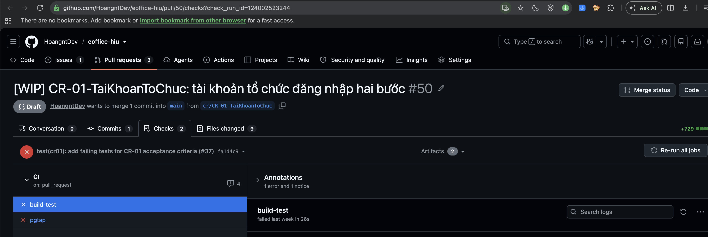

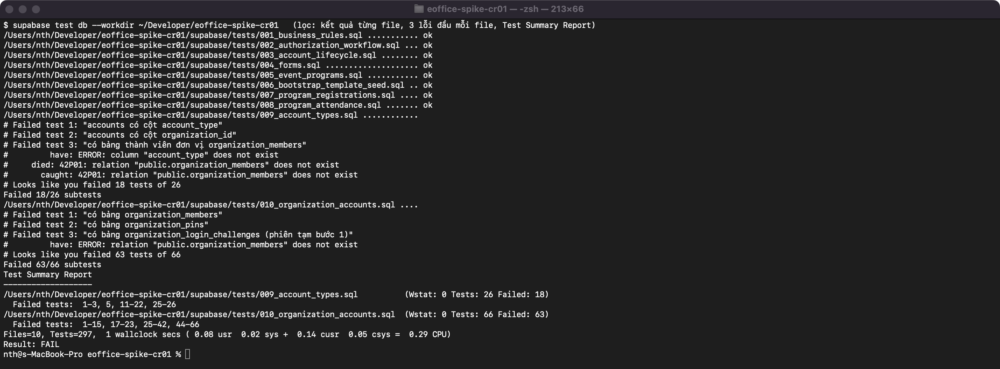

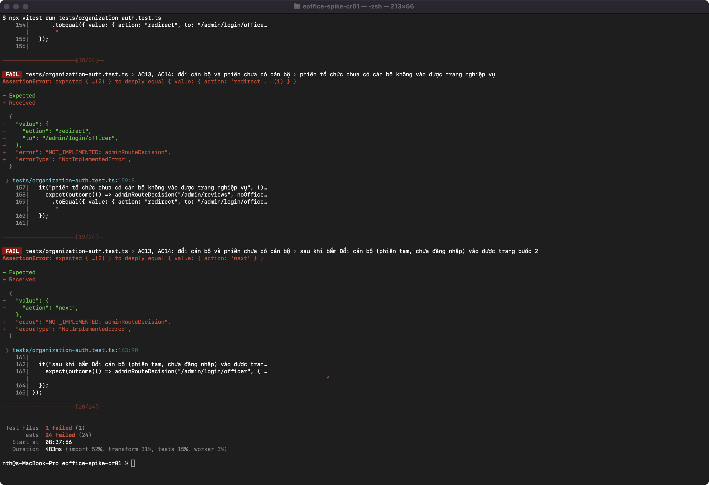

# 7. Vấn đề gặp phải và cách xử lý

| Nhóm | Vấn đề | Cách xử lý |
|---|---|---|
| Môi trường | Sáng 06/11, Docker Desktop kẹt khi khởi động: backend dừng ở bước "starting nfs", `docker info` báo không kết nối được daemon trong vài phút | Thoát hẳn Docker Desktop rồi mở lại; daemon lên sau 9 giây, các stack tự khởi động lại |
| Phát hành | Gói v1.0.1 tải lên lần đầu (SHA-256 `b3ba52894b46b66eba7e4507ce27d06bd16c158059953729d0388d839ec9d24b`) không chạy được: `Cannot find module 'winston-592a0a42b673a90a'`. Turbopack tạo symlink `.next/node_modules/winston-*` → `../../node_modules/winston`; khi ghép gói, symlink bị treo và `zip` (mặc định đi theo symlink) bỏ qua | Smoke test trên gói bắt được lỗi. Đóng gói lại bằng `zip -y`, thay tài sản trên Release lúc 10:20 (SHA-256 mới `0f4a744b738fca7313772795c2d8336890c372a6bc683b4eb4ba5d7e613020e5`), ghi chú việc thay trong release notes; mã nguồn và tag không đổi. Phòng ngừa: `scripts/package-release.sh` (mục 5.6) |
| Logging | Trang lỗi thân thiện lúc đầu không hiện mã tham chiếu: lỗi xảy ra ở client component nên React render lại trên trình duyệt và mất `digest` | Layout gốc đưa `x-request-id` vào thẻ meta; trang lỗi dùng `digest` hoặc 8 ký tự đầu của `requestId` (PR #56). Lần sửa đầu dùng `setState` trong `useEffect` bị lint chặn; chuyển sang `useSyncExternalStore` |
| Logging | Lỗi ném trong proxy không đi qua `onRequestError` ở Next 16 | Ghi nhận; với INC-01, proxy tự xử lý thiếu cấu hình và tự ghi log (PR #60) |
| CR-01 | Spike lần 1: hàm kiểm phiên viết bằng SQL thuần (`security definer` có `SET search_path`) chậm khoảng 35 lần: 0,60 ms/lần so với 0,017 ms/lần, đo 10 000 lần gọi | Viết lại bằng plpgsql: 0,08–0,11 ms/lần. Phương án P1 không sửa thân hàm cổng nên tránh được phần lớn chi phí này |
| Sao lưu | 4 lần diễn tập bị loại trước lần chính thức (khóa ngoại chặn 2 lần, ảnh số liệu thiếu thống kê, tài khoản smoke đã đăng ký) | Sửa kịch bản sau mỗi lần, ghi lại trong runbook mục 7; xóa bản sao lưu của các lần hỏng |
| Sự cố | Bản build gộp mất phép kiểm tra cấu hình trong proxy (K1c) | Đọc biến qua vòng lặp; kiểm bản biên dịch sau mỗi lần nâng Next (PR #60, #64) |
| Kiểm thử | Script diễn tập rollback đếm sai số dịch vụ Supabase ("0 dịch vụ running") | Kiểm lại bằng `docker inspect`, ghi chú trong log và README bằng chứng |
| Script | `package-release.sh` lần đầu báo sai tên khi `.next/node_modules` rỗng; Bash 3.2 của macOS lỗi `unbound variable` với mảng rỗng khi `set -u` | Sửa trước khi commit; log trong repo là lần chạy sau khi sửa |
| Bằng chứng | Cốc Cốc không nhận phím từ AppleScript (macOS chặn gửi phím), nên không gõ được MSSV/PIN để chụp trang có đăng nhập | Trang có đăng nhập chụp bằng Playwright (Chromium headless trong Docker); trang GitHub chụp bằng Cốc Cốc với `screencapture -R` bỏ thanh tab; Terminal chụp bằng `screencapture -l` theo cửa sổ |
| Bằng chứng | Một lần chụp trang Release bị dính cửa sổ khác vì Cốc Cốc chưa lên trước | Xóa ảnh, đưa Cốc Cốc lên trước rồi chụp lại; mở xem lại từng ảnh trước khi commit |
| Git, tiến độ | Hạn nộp TH3 ban đầu 02/11/2026; giảng viên dời sang 08/11/2026. Giảng viên chưa phản hồi đổi hướng CR-01 | Ghi đúng trong báo cáo và issue #37 |

**Sử dụng Claude Code (trợ lý AI) trong TH3.** Sinh viên dùng Claude Code (model Claude Opus 5.5) chạy trong terminal của repo.

Dùng vào việc gì:

- Viết code và test: logging (`log.ts`, `log-node.ts`, `instrumented-fetch.ts`, `/api/health`), kiểm tra cấu hình INC-01, sửa lỗi QR, test Vitest/pgTAP RED của CR-01.
- Viết script: `backup.sh`, `restore.sh`, `package-release.sh`, script diễn tập sao lưu và rollback, script Playwright mô phỏng người dùng.
- Chạy diễn tập, tái hiện sự cố trên stack tách biệt, đóng gói và phát hành v1.0.1.
- Soạn tài liệu: runbook, incident report, hướng dẫn triển khai, CHANGELOG, mô tả issue/PR và bản nháp báo cáo này.
- Tự chụp ảnh màn hình bằng `screencapture` (Terminal, Cốc Cốc) và Playwright (trang có đăng nhập).

Kiểm chứng ra sao:

- Mọi PR có CI GitHub Actions xanh trước khi merge (ruleset bắt buộc). Hotfix và lỗi QR đi theo RED → GREEN: commit test trước, CI đỏ đúng lý do, rồi commit sửa, CI xanh.
- Bản sửa được kiểm trên bản build thật và trên gói tải từ Release: smoke test 8/8, lặp lại kịch bản sự cố, diễn tập rollback.
- Mọi số liệu lấy từ output lệnh thật, lưu ở `docs/TH3/evidence/` và `docs/TH3/INC-01-ThieuCauHinh/evidence/`; chỗ đo bằng mô phỏng (thời điểm phát hiện ở v1.0.0) ghi rõ là mô phỏng.
- Trợ lý tự mở xem từng ảnh trước khi commit; một ảnh chụp sai đã bị loại.
- Log và ảnh bằng chứng đã che IP mạng nội bộ thành `<LAN-IP>` như ở TH2 (issue #75): thay trong file log, tô lại vùng IP trong ảnh, rồi quét chữ (OCR) toàn bộ 31 ảnh của `docs/TH3` để chắc không còn IP dải riêng.
- Sinh viên xem lại kết quả, diff và tài liệu. Ràng buộc giao cho trợ lý (ghi trong `CLAUDE.md`): không commit thẳng `main`, không merge khi CI đỏ, không xóa/gắn lại tag, không reset DB đang dùng, không đụng Supabase cloud, không deploy; mọi diễn tập và sự cố chỉ chạy trên stack tách biệt.
- Không có dòng ghi tên trợ lý AI trong commit và mô tả PR của TH3 (kiểm 20 commit từ `e6a66db` đến `24e005a` bằng `git log … | grep -iE "co-authored-by|generated with"`: 0 dòng).

# 8. Nhận xét và kết luận

**Nhận xét**

- Quy trình Git của môn áp dụng cho mọi PR của Milestone TH3; `git log --first-parent --no-merges course-baseline..main` rỗng.
- CI xanh trên mọi PR đã merge. Vitest hiện có 16 file, 177 test; pgTAP 8 file, 205 assertion.
- Sự cố INC-01 được xử lý đủ vòng: tái hiện, issue `incident`, 5 Whys, hotfix RED → GREEN, phát hành v1.0.1, kiểm chứng trên gói, incident report. Hai lỗi phụ (QR, đóng gói) cũng được phát hiện nhờ log và smoke test, có sửa và phòng ngừa.

**Mức sẵn sàng vận hành (v1.0.1)**

| Mảng | Đã có | Còn thiếu |
|---|---|---|
| Logging | Log JSON ra file xoay vòng 7 ngày, `requestId`, che dữ liệu nhạy cảm, đạt YC5; `/api/health` | Chưa gom log về một nơi, chưa có cảnh báo tự động |
| Sao lưu | Script một lệnh có checksum, runbook, diễn tập đạt; RPO 1 giờ, RTO 30 phút | Chưa có lịch chạy tự động; bản sao lưu nằm cùng máy |
| Sự cố | Kiểm tra cấu hình lúc khởi động; incident report; quy trình rollback đã diễn tập (32,6 giây) | K2 (mất DB) chưa sửa |
| Phát hành | Tag, Release, gói build sẵn, script đóng gói có tự kiểm tra, smoke test | Chưa có job CI kiểm tra gói |

**Hạn chế còn lại**

- **K2 – mất kết nối database:** người dùng bị đẩy về trang đăng nhập với thông báo sai; đã có đề xuất trong incident report.
- **2 lỗ hổng high trong công cụ phát triển** (`undici` qua jsdom, `vite` qua vitest) và 11 moderate; không có trong bản chạy production (`npm audit --omit=dev` = 0), phần lớn phải nâng phiên bản lớn.
- **K5 – tên một số migration** mang ngày 14–15/10 trong khi tạo ngày 13/10; không đổi được vì đã áp lên DB.
- Chưa có thanh toán online (sandbox).

**Kế hoạch** (lịch giảng viên: buổi TH4 ngày **09/11/2026**, báo cáo Project Assignment ngày **13/11/2026**, ký xác nhận điểm quá trình ngày **20/11/2026**)

1. **CR-01 GREEN (TH4):** hiện thực trên branch `cr/CR-01-TaiKhoanToChuc` theo RED → GREEN → refactor, ước lượng **46–61 giờ**. Nếu thiếu thời gian, cắt theo thứ tự trong Impact Analysis mục 2.7: (1) giao diện đổi PIN `/admin/settings`, (2) giao diện `/admin/accounts` (thay bằng script service role), (3) chuyển trang Đoàn Trường sang `/admin`, (4) chuyển trang UC-A sang `/admin/reviews`. Không cắt: loại tài khoản và trigger, đăng nhập hai bước, "Đổi cán bộ", audit theo cán bộ, đọc/ghi đều đòi cán bộ, kiểm PIN giả, viết lại bootstrap, migration dữ liệu, pgTAP 005/007/008/009/010. Kiểm thử hồi quy theo bộ test đã chọn; phát hành **v1.1.0** có release notes và smoke test, so sánh với v1.0.0. **Nếu chưa xong tất cả tiêu chí trước 09/11:** không merge khi còn test thất bại, không gắn tag `v1.1.0`, để PR #50 mở và ghi rõ tiêu chí đã đạt/chưa đạt (Lab04 mục 4.6).
2. **Thanh toán Đoàn phí qua VNPay sandbox:** hoàn thành trước buổi báo cáo 13/11/2026 (Lab03 mục 4.5); log phải có mã đơn, mã giao dịch, kết quả kiểm chữ ký, không ghi secret. Nghiệp vụ cụ thể (đối tượng, mức phí, kỳ thu) sẽ chốt sau.
3. Đề xuất sửa K2 thành issue riêng sau khi CR-01 ổn định.

**Kết luận:** Hệ thống ở trạng thái vận hành được ở mức một dự án môn học: có log, health check, sao lưu/phục hồi đã diễn tập, quy trình sự cố và rollback đã kiểm chứng bằng số liệu thật. v1.0.1 sửa INC-01 và các lỗ hổng `next`/`zod`, đã qua smoke test trên gói phát hành. CR-01 đã có Impact Analysis, hai lần spike và bộ test RED; phần GREEN làm ở TH4. Báo cáo nộp trước hạn đã dời 08/11/2026.
