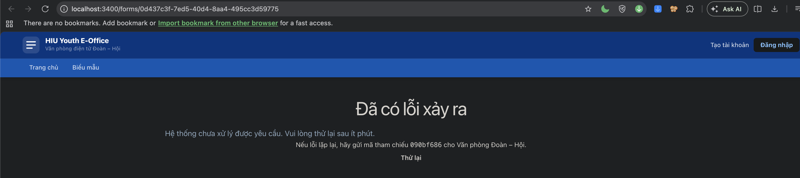

# Bằng chứng logging – Lab03 mục 4.1 (issue #55)

Ngày chạy: 06/11/2026. Branch `feat/55-logging`.

## Môi trường

| Mục | Giá trị |
|---|---|
| Web | Bản build production của branch, chạy bằng `npm start` ở cổng 3400 trong worktree riêng `~/Developer/eoffice-th3-run`. Không dùng `.env.local` của thư mục làm việc |
| DB | Stack Supabase tách biệt `eoffice-v100` (cổng 563xx), dựng lại từ gói v1.0.0 và nạp dữ liệu demo giả theo `docs/TH2/demo-data.md`. Không đụng DB local đang dùng |
| Cấu hình | `LOG_LEVEL=info`, `DB_SLOW_MS` để trống (1000 ms). Riêng một lần chạy đặt `DB_SLOW_MS=20` để có mẫu `db.slow` |
| Dữ liệu | MSSV, họ tên trong log là tài khoản demo giả. IP là địa chỉ dành cho tài liệu (`198.51.100.0/24`, `203.0.113.0/24`, gửi qua header `x-forwarded-for`) hoặc `::1` |

Sự kiện được sinh bằng cách gọi API thật (đăng nhập, lập/nộp/duyệt kế hoạch, đăng ký, điểm danh QR, nộp/xử lý hồ sơ Đoàn viên) và bằng các tình huống lỗi trên stack tách biệt.

## Cách ghi log

- `src/lib/log.ts` giữ API `logEvent(level, event, fields)` và `requestIdFrom(request)`. Mỗi dòng là một JSON: `ts`, `level`, `source`, `event`, `requestId` (request web), rồi các trường khác. `source` mặc định là tiền tố của `event`.
- Trước khi ghi, mọi trường được lọc: bỏ hẳn khóa có tên kết thúc bằng `pin`, `password`, `token`, `secret`, `cookie`, `authorization`, `pepper`, `…Key` (api/service role/publishable/…); che MSSV dạng `221***34`; che email dạng `n***@student.hiu.vn`.
- `src/lib/log-node.ts` chỉ được `src/instrumentation.ts` nạp khi `NEXT_RUNTIME === "nodejs"`. Nó tạo logger winston 3.19.0 với `winston-daily-rotate-file` 5.0.0: `logs/app-%DATE%.log`, `datePattern YYYY-MM-DD`, `maxFiles 7`. Console vẫn ghi như cũ.
- Mức log đọc từ `LOG_LEVEL` qua `src/lib/env.ts`. Đổi mức chỉ cần đổi biến môi trường rồi khởi động lại, không sửa code.
- Mã tham chiếu yêu cầu: `src/proxy.ts` gắn `x-request-id` cho mọi request (chuyển tiếp xuống route/trang và trả lại ở header phản hồi).

## Từng loại sự kiện (Lab03 mục 4.1 bước 5)

Trích đoạn ở `excerpts/`. Bản đầy đủ của lần chạy: `excerpts/0-full-run-2026-11-06.log` (87 dòng). Đường dẫn máy trong stack trace đã thay bằng `<app>`.

| Sự kiện | Mức | Tệp | Ví dụ |
|---|---|---|---|
| Khởi động, dừng | info | `1-app-start-stop.log` | `app.start` có `version`, `nodeEnv`, `logLevel`; `app.stop` có `signal: "SIGTERM"`, `exitCode: 143`, `uptimeSec` |
| Lỗi chưa xử lý | error | `2-unhandled-error.log` | `app.unhandled_error` (qua `onRequestError`), `api.unhandled_error` (API), kèm `reference`, `requestId`, `stack` |
| Giao dịch chính | info | `3-transactions.log` | `auth.login_succeeded`, `event_program.created/submitted/reviewed`, `event_program.document_attached`, `program_registration.registered`, `program_attendance.checked_in`, `union_application.submitted/reviewed`: có `userId` và UUID đối tượng (`programId`, `sessionId`, `applicationId`), kết quả (`status`, `outcome`) |
| Giao dịch bị từ chối | warn | `3b-transactions-rejected.log` | `event_program.submit_rejected` (`PLAN_DOCUMENT_REQUIRED`), `program_registration.register_rejected` (`REGISTRATION_FULL`) |
| Lời gọi database lỗi/chậm | error/warn | `4-db-errors-slow.log` | `db.call_failed` có `operation` (ví dụ `select.accounts`, `rpc.is_valid_student_code`, `auth.user`), `durationMs`, `status`, `errorCode` (`57P01`, `PGRST001`); `db.slow` có `durationMs`, `thresholdMs` |
| Đăng nhập sai, truy cập bị từ chối | warn | `5-login-failed-access-denied.log` | `auth.login_failed` có `studentCode: "221***01"`, `ip`, `reason` (`wrong_pin`, `unknown_account`); `auth.access_denied` từ proxy (`NO_SESSION`) và API (`UNAUTHENTICATED`, `FORBIDDEN` kèm MSSV đã che) |

### Lỗi chưa xử lý: người dùng thấy gì

Tái hiện trên stack tách biệt: đặt `questions` của một biểu mẫu demo thành dữ liệu sai cấu trúc, mở `/forms/<id>`, rồi trả lại giá trị gốc ngay sau đó.



Người dùng chỉ thấy "Đã có lỗi xảy ra" và mã tham chiếu `090bf686`. Dòng log tương ứng:

```json
{"level":"error","source":"next.render","event":"app.unhandled_error","requestId":"090bf686-cd56-483e-a96d-b61eb6de5864","reference":"2501579416","path":"/forms/0d437c3f-…","routePath":"/forms/[id]","errorName":"TypeError","errorMessage":"a.questions is not iterable","stack":"…"}
```

Lỗi phát sinh ở client component nên React render lại trên trình duyệt và không còn `digest`. Khi đó trang lỗi dùng 8 ký tự đầu của `requestId` (đọc từ thẻ meta do layout gắn). Nếu có `digest`, trang hiện `digest` và log có cùng giá trị ở `reference`.

Với API, lỗi chưa xử lý trả `{"error":"INTERNAL_ERROR","message":"Không thể xử lý yêu cầu. Vui lòng thử lại. Mã tham chiếu: 84fcef7d.","reference":"84fcef7d"}`. Header phản hồi có `x-request-id: 84fcef7d-886e-…`, và dòng `api.unhandled_error` có cùng `requestId`.

### Mất kết nối database (stack tách biệt)

`docker stop supabase_db_eoffice-v100` lúc 01:56:39Z, `docker start` lúc 01:56:40Z (giờ UTC trong log):

| Yêu cầu | Phản hồi |
|---|---|
| `GET /api/health` | 503 `{"app":"ok","db":"error","version":"1.0.0"}`, 32 ms |
| `GET /api/event-programs` (đã đăng nhập) | 401 `UNAUTHENTICATED` |
| `GET /programs` (đã đăng nhập) | 307 về `/login` |
| `POST /api/auth/login` | 500, mã tham chiếu `84fcef7d` |

Log ghi rõ nguyên nhân (`db.call_failed`, `PGRST001`, `57P01`), trong khi người dùng đã đăng nhập lại nhận thông báo "Vui lòng đăng nhập". Điểm này dùng cho phần phân tích INC-01 (Việc 3).

## /api/health

`health.txt`: `200 {"app":"ok","db":"ok","version":"1.0.0"}` khi DB chạy, `503 {"app":"ok","db":"error",…}` khi DB dừng. Không trả URL, mã lỗi hay thông điệp nội bộ; chi tiết nằm trong log (`health.db_unavailable`). Kiểm tra DB bằng hàm chỉ đọc `is_valid_student_code` đã cấp cho `anon`, hết giờ sau 3 giây.

## Kiểm tra YC5 (Lab03 mục 4.1 bước 7)

`yc5-grep.txt`: `grep -niE "password|token|secret|apikey|pin" logs/*.log` trên file log của lần chạy (87 dòng), có 4 dòng khớp:

| Dòng | Từ khớp | Giải thích |
|---|---|---|
| 2, 46 | `pin` trong `"reason":"wrong_pin"` | Mã lý do đăng nhập thất bại, không phải giá trị PIN |
| 45, 50 | `token` trong `"operation":"auth.token"` | Tên endpoint Supabase Auth `/auth/v1/token` (đăng nhập bằng mật khẩu), không có giá trị token |

Kiểm tra thêm trên cùng file, đều 0 dòng: `@` (email), `123456` (PIN demo), `sb-` (cookie phiên), `eyJ` (JWT), `Bearer`, `sb_publishable`, `sb_secret`, MSSV đầy đủ `2211110101`, `student.hiu`.

Ghi chú: dòng 38 (`program_attendance.check_in_rejected`) có `code` chứa phần UUID của một token QR giả do script gửi; Postgres nhắc lại giá trị đó trong thông báo lỗi `invalid input syntax for type uuid`. Phần chữ ký của token không xuất hiện. Đây là hành vi có sẵn của route điểm danh (ghi `error.message` của RPC).

## Kiểm thử tự động

`vitest-logging.txt`: `tests/logging.test.ts` và `tests/env-config.test.ts`, 2 file, 27 test PASS. Gồm: lọc mức log cho từng `LOG_LEVEL` (cả console lẫn file), cấu trúc dòng, che MSSV/email, bỏ trường cấm (PIN, mật khẩu, token, cookie, secret, apikey, service role key), log `db.call_failed`/`db.slow`, mã tham chiếu của lỗi API.

## Hạn chế đã thấy

- Lỗi ném ra **trong proxy** (`src/proxy.ts`) không đi qua `onRequestError` ở Next.js 16.3.8, và người dùng thấy trang "Internal Server Error" thô. Thấy được khi chạy thử thiếu `NEXT_PUBLIC_SUPABASE_URL`: bản build biên dịch `optionalPublicSupabaseEnv()` thành object luôn khác `null`, nên proxy vẫn tạo Supabase client với URL rỗng và ném lỗi. Thuộc phạm vi phân tích sự cố (Việc 3), chưa sửa ở PR này.
- Token QR sai định dạng UUID làm `POST /api/attendance/check-in` trả 500 (RPC báo `22P02`). Hành vi có sẵn, ghi lại để xử lý sau.
