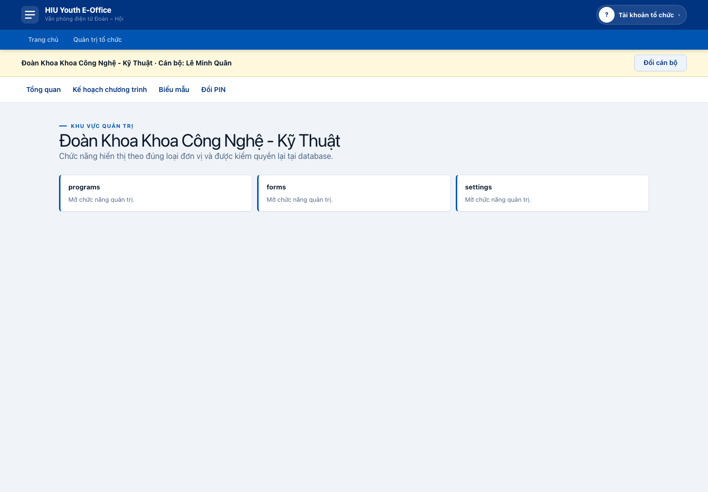
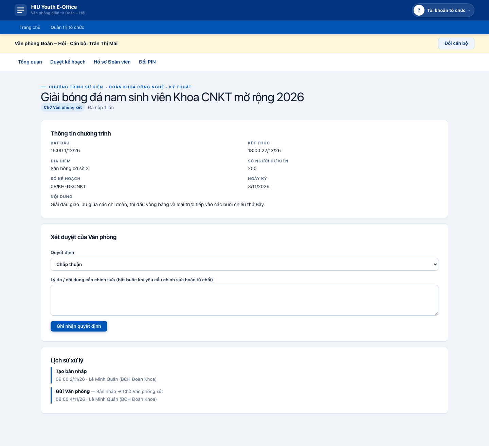
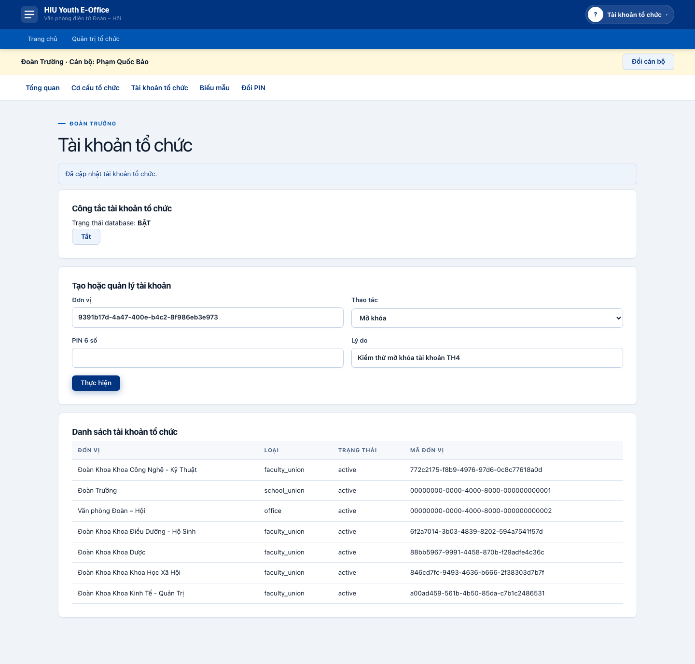
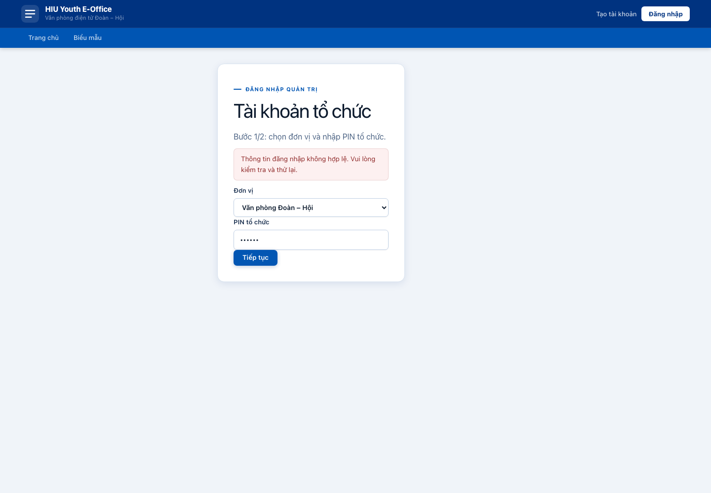
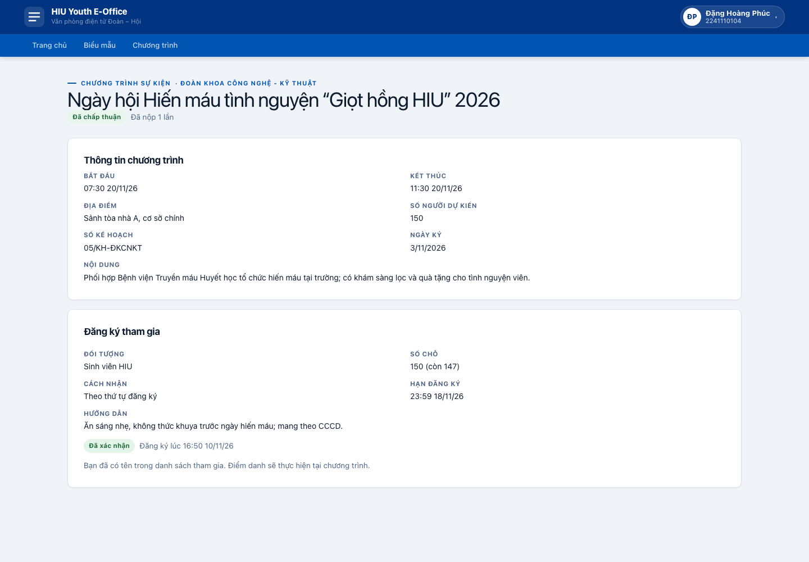
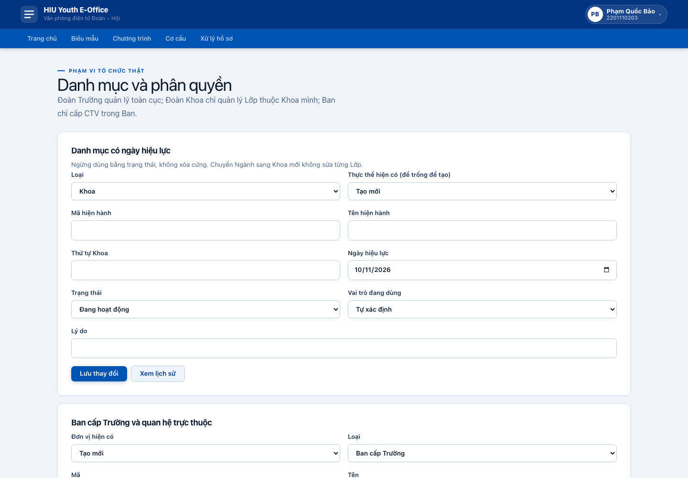

# 1 Thông tin chung và phạm vi

| Mục | Nội dung |
|---|---|
| Môn học | Phát triển, vận hành, bảo trì phần mềm |
| Giảng viên | Hoàng Ngọc Long |
| Sinh viên | Nguyễn Thanh Hoàng — MSSV 2211110012 — Lớp TH22DH-CN1 |
| Đề tài | HIU Youth E-Office — Văn phòng Đoàn – Hội điện tử Trường ĐH Quốc tế Hồng Bàng |
| Bài thực hành | TH4 — hoàn tất Change Request CR-01, kiểm thử, phát hành và so sánh phiên bản |
| Hạn nộp | 23:59 ngày 11/11/2026 |
| Ngày thực hiện và chốt số liệu | 10/11/2026, lấy bằng lệnh `date` |
| Repository | https://github.com/HoangntDev/eoffice-hiu |
| Change Request | Issue #37, Milestone `TH4` |
| Pull Request | PR #50, branch `cr/CR-01-TaiKhoanToChuc` |
| Phát hành | Tag annotated `v1.1.0`, GitHub Release https://github.com/HoangntDev/eoffice-hiu/releases/tag/v1.1.0 |
| Báo cáo | Issue #79, branch `docs/79-th4-report` |

TH4 hoàn tất CR-01 về tài khoản tổ chức. Phạm vi gồm đăng nhập quản trị hai bước,
phiên tổ chức gắn cán bộ, phân quyền theo công tắc database, giao diện `/admin`,
kiểm thử hồi quy và phát hành v1.1.0. Thanh toán Đoàn phí không nằm trong phạm vi
hiện thực của TH4; mục 8 chỉ nêu kế hoạch v1.2.0 dùng VNPay sandbox.

Các ràng buộc an toàn được giữ trong toàn bộ quá trình. Migration chưa merge chỉ
chạy trên stack Supabase tách biệt; không đụng Supabase cloud hay Vercel; dữ liệu
và ảnh dùng tài khoản demo; PIN, token và service key không được ghi vào tài liệu.
Ảnh kiểm thử được Playwright chụp từ bản build production rồi mở xem lại trước khi
commit.

## 1.1 Kết quả chính

| Hạng mục | Kết quả |
|---|---|
| AC1–AC14 | 14/14 đạt |
| CI trước merge PR #50 | `build-test` và `pgtap` thành công |
| CI trên merge commit | Run `42790927112` thành công |
| pgTAP khi công tắc TẮT | 8 file, 205/205 assertion đạt |
| pgTAP khi công tắc BẬT | 10 file, 306/306 assertion đạt |
| Vitest | 17 file, 203/203 test đạt |
| Test case TH2 và AC6 | 19/19 đạt |
| Smoke test branch | 8/8 bước đạt |
| Smoke test gói Release tải về | 8/8 bước đạt, thêm trường hợp công tắc TẮT đạt |
| Release | v1.1.0, ZIP và SHA-256 đã tải xuống kiểm tra lại |

# 2 Change Request và tiêu chí chấp nhận

## 2.1 Mục tiêu thay đổi

Trước CR-01, cán bộ dùng tài khoản sinh viên cá nhân để thực hiện nghiệp vụ quản
lý. CR-01 chuyển ngữ cảnh quản lý sang tài khoản của đơn vị, nhưng vẫn phải xác
định cán bộ chịu trách nhiệm cho từng phiên. Thiết kế đã chọn dùng tài khoản tổ
chức trong Supabase Auth, đăng nhập hai bước và giữ phần lớn RPC/RLS hiện có bằng
các hàm cổng viết bằng PL/pgSQL.

Luồng mới gồm hai bước. Bước một chọn đơn vị và nhập PIN tổ chức, tạo phiên tạm
năm phút dùng một lần. Bước hai nhập MSSV và PIN cá nhân của cán bộ thuộc đơn vị.
Sau đó server tạo phiên Auth của tài khoản tổ chức và lưu liên kết giữa phiên,
đơn vị và cán bộ. Audit vì vậy ghi được cả chủ thể tổ chức lẫn người thực hiện.

Đơn vị được hỗ trợ trong giai đoạn này là Đoàn Trường, Văn phòng Đoàn – Hội và
Đoàn Khoa. Ban `school_committee` là hướng mở rộng chưa làm ở giai đoạn này. Chi
đoàn `class_union` không bao giờ có tài khoản tổ chức.

## 2.2 Ma trận AC1 đến AC14

| AC | Nội dung đã hiện thực | Kiểm chứng | Kết quả |
|---|---|---|---|
| AC1 | `account_type` trong `accounts`, tài khoản tổ chức và thành viên đơn vị | pgTAP 009/010, Vitest, đăng nhập Đoàn Khoa | PASS |
| AC2 | Dropdown chỉ hiện nhóm đơn vị có thể đăng nhập | pgTAP 010 | PASS |
| AC3 | Chặn Chi đoàn, không khóa vĩnh viễn đường mở rộng cho Ban | pgTAP 009 | PASS |
| AC4 | Thông báo lỗi chung và kiểm PIN giả ở nhánh không có tài khoản | pgTAP 010, FT-LOGIN-ERROR | PASS |
| AC5 | Giới hạn năm lần sai trong 15 phút, tách theo đơn vị và IP | pgTAP 010 | PASS |
| AC6 | Giữ grant cá nhân; TẮT dùng như v1.0.0, BẬT bỏ qua quyền quản lý cá nhân | pgTAP hai trạng thái, bốn ca UC-A/B/C/D | PASS |
| AC7 | Quyền theo biên đơn vị; CTV cá nhân giữ hành vi cũ | pgTAP 010 | PASS |
| AC8 | Tự duyệt xét theo cán bộ; audit ghi đơn vị và cán bộ | pgTAP 010 | PASS |
| AC9 | `/admin` và menu theo Đoàn Khoa, Văn phòng, Đoàn Trường | Vitest và Playwright | PASS |
| AC10 | Tạo, đặt lại PIN, khóa, mở, đổi PIN và bootstrap Đoàn Trường | pgTAP, Playwright, script bootstrap | PASS |
| AC11 | Hồi quy nghiệp vụ và fixture cũ | 203 Vitest, 205 assertion cũ, 15 test case TH2 | PASS |
| AC12 | Phiên tạm năm phút, dùng một lần, chưa qua bước hai không có quyền | pgTAP và Vitest | PASS |
| AC13 | Đổi cán bộ không nhập lại PIN tổ chức | pgTAP và Playwright | PASS |
| AC14 | Không đọc khi chưa có cán bộ; đổi cán bộ thu hồi phiên và token cũ | pgTAP 010 | PASS |

Không có AC chưa đạt. Mốc dừng 18:00 ngày 11/11/2026 không bị kích hoạt vì 14/14
AC đã đạt, CI xanh và PR #50 được merge lúc 16:27 ngày 10/11/2026 theo giờ Việt
Nam.

## 2.3 Trạng thái issue và PR

PR #50 có 33 commit và được merge bằng merge commit
`1bcdda18fb1fe03cb4b8372b066a4497bf05d1a1`. Hai check trước merge đều thành
công. Issue #37 tự đóng ngay sau merge vì PR có `Closes #37`. CI trên chính merge
commit cũng thành công. Không squash, rebase hoặc force push.

# 3 Phân tích tác động và kế hoạch

## 3.1 Phạm vi tác động

Impact Analysis tại `docs/TH3/CR-01-TaiKhoanToChuc/impact-analysis.md` được đọc lại
trước khi sửa code. Thay đổi chạm ba lớp chính.

| Lớp | Tác động |
|---|---|
| Database | Migration `20261109222454_cr01_organization_accounts.sql` thêm loại tài khoản, bảng PIN/thành viên/phiên tổ chức, feature flag, audit và chuyển dữ liệu |
| Ứng dụng | Route đăng nhập tổ chức, `/admin`, proxy phân luồng, menu theo loại đơn vị, đổi PIN và đổi cán bộ |
| Kiểm thử | pgTAP 009/010, helper đăng nhập tổ chức, cập nhật fixture 002/004/005/007/008, Vitest và Playwright |

Migration là phần rủi ro nhất vì phải giữ đường quay lui. Feature flag được lưu
trong bảng `feature_flags`; chỉ phiên Đoàn Trường hoặc script có quyền thay đổi và
mỗi thay đổi có audit. Khi TẮT, `/admin` và đăng nhập tổ chức không dùng được,
trong khi grant cá nhân tiếp tục hoạt động. Khi BẬT, bốn vai trò quản lý cá nhân bị
các hàm cổng bỏ qua; dữ liệu grant vẫn còn để có thể tắt công tắc.

## 3.2 Rủi ro và biện pháp

| Rủi ro | Biện pháp đã áp dụng | Bằng chứng |
|---|---|---|
| Grant cá nhân lọt qua một nhánh kiểm quyền khi BẬT | Gom điều kiện vào hàm cổng, thêm bốn ca UC-A/B/C/D kiểm 403 và DB không đổi | `final/test-cases.log` |
| Phiên tổ chức chưa chọn cán bộ vẫn đọc được | `organization_session_ok()` đi vào RPC/RLS đọc và ghi | pgTAP AC14 |
| Token cán bộ cũ còn hiệu lực sau khi đổi cán bộ | Thu hồi session Auth cũ, kiểm phiên ở database | pgTAP AC13/AC14 |
| Thời gian phản hồi làm lộ đơn vị chưa có tài khoản | Chạy `crypt()` với hash PIN giả ở nhánh âm | pgTAP AC4 |
| Fixture cũ mất ý nghĩa | Helper đăng nhập tổ chức chỉ thay chủ thể thực hiện, giữ assertion nghiệp vụ | 205 assertion ở trạng thái TẮT, 306 khi BẬT |
| Migration làm mất đường quay lui | Không thu hồi grant cá nhân; kiểm thử đồng thời cả hai trạng thái công tắc | Hai job pgTAP trong CI |

## 3.3 Kế hoạch thực hiện

Thứ tự được giữ theo yêu cầu: điều chỉnh test RED của AC6 trước, hoàn thành phần
database và phiên tổ chức không được cắt, sau đó mới làm giao diện `/admin`, dữ
liệu demo, kiểm thử chức năng và tài liệu phát hành. Mọi kiểm thử SQL của migration
chưa merge chạy trên stack `eoffice-cr01-spike` ở cổng 573xx. Stack này đã được
dừng sau khi hoàn tất; stack local đang dùng không nhận migration CR-01.

Số migration cao nhất trong `CLAUDE.md` đã được sửa thành `202610300003`, khớp
`AGENTS.md` tại thời điểm yêu cầu. Migration thật của CR-01 dùng version thời gian
`20261109222454`, lớn hơn các version trên mọi nhánh đã kiểm tra.

# 4 Hiện thực thay đổi

## 4.1 RED GREEN và refactor

Commit `3812cbd test(cr01): điều chỉnh AC6 theo công tắc tính năng (#37)` đứng
trước các commit GREEN. Bản RED có 95 assertion trong hai file 009/010, trong đó
82 assertion thất bại đúng vì chưa có feature flag, bảng và hàm CR-01. Test mới
không yêu cầu thu hồi grant; nó yêu cầu giữ grant, cho phép khi TẮT và vô hiệu khi
BẬT.

| Giai đoạn | Commit tiêu biểu | Kết quả |
|---|---|---|
| RED ban đầu | `fa1d4c9` | Test AC1–AC14 thất bại tại phần chưa hiện thực |
| RED điều chỉnh AC6 | `3812cbd` | 95 assertion, 82 FAIL đúng lý do |
| GREEN nền database | `a98ad36`, `aa86c9a` | Loại tài khoản, feature flag, đăng nhập và phiên tổ chức |
| GREEN chính sách | `4198ca1`, `e27bbd0`, `2e4d917`, `ee92c63` | Phân luồng, đổi cán bộ, công tắc và chặn grant cá nhân |
| GREEN giao diện | `e32ffe1`, `beed917`, `a493557`, `9ee4f11`, `8c4dbc6` | API, `/admin`, chương trình, biểu mẫu và đổi PIN |
| GREEN hồi quy | `b6db5cb`, `6dfc399`, `1411358`, `7a16ce5` | Fixture cũ và CI hai trạng thái |
| Hoàn thiện | `4c6ae7a`, `a9d406a`, `5bb7eed` | Bootstrap, dữ liệu demo và bằng chứng chức năng |
| Sửa sau review | `5ae3547` | Đổi origin giả từ HTTP sang HTTPS theo phát hiện Sonar |

Không có refactor tách riêng cần thiết sau GREEN. Các thay đổi cấu trúc đều gắn
trực tiếp với tiêu chí chấp nhận và được commit theo từng lát chức năng; vì vậy
không tạo commit `refactor` chỉ để đổi tên hoặc di chuyển code.

## 4.2 Phần không được cắt

Migration thêm `account_type` vào `accounts`, các bảng tài khoản tổ chức và thành
viên đơn vị, cùng hàm kiểm phiên PL/pgSQL. Đăng nhập `/admin/login` dùng hai bước;
phiên tạm hết hạn sau năm phút và chỉ dùng một lần. Hệ thống giới hạn năm lần sai
trong 15 phút và chạy kiểm PIN giả khi đơn vị không có tài khoản.

Khi công tắc bật, tài khoản cá nhân không thể gọi các thao tác quản lý UC-A,
UC-B, UC-C và UC-D. Phiên tổ chức ghi cả đơn vị và cán bộ trong audit, đồng thời
quy tắc tự duyệt xét dựa trên cán bộ. R-7 và R-11 được xử lý: phiên chưa gắn cán
bộ không đọc được dữ liệu nội bộ, còn đổi cán bộ thu hồi phiên cũ. Migration sao
chép dữ liệu sang tài khoản tổ chức nhưng giữ grant cá nhân; script
`bootstrap_school_admin` được viết lại; giao diện có chức năng Đổi cán bộ.

Hai file pgTAP 009/010 và fixture 002/004/005/007/008 dùng helper đăng nhập tổ
chức. Sau phần nền này, `/admin` có menu theo loại đơn vị, `/admin/accounts`, đổi
PIN, và UC-A chạy trong phiên Văn phòng.

## 4.3 Phát hiện khi hiện thực

Phát hiện quan trọng nhất là kế hoạch cũ thu hồi grant quản lý cá nhân, làm công
tắc không thể đưa hệ thống về hành vi v1.0.0. Tiêu chí AC6 được sửa trước GREEN:
migration giữ grant, trạng thái BẬT chỉ vô hiệu chúng trong hàm kiểm quyền. Lý do
và ảnh hưởng đã được ghi ở issue #37, PR #50, mục 2.10 của Impact Analysis và báo
cáo này.

Các phát hiện khác gồm một nhánh `has_permission` từng đọc grant trực tiếp, fixture
cũ cần tách theo trạng thái công tắc, link nghiệp vụ có thể thoát khỏi `/admin`,
và seed demo chưa ghi lịch sử dưới tài khoản tổ chức. Mỗi điểm đều có test bảo vệ
hoặc bằng chứng chạy lại. SonarQube còn phát hiện origin giả dùng `http`; commit
`5ae3547` chuyển sang `https` và 16/16 test liên quan đạt.

Đính chính phạm vi đơn vị cũng được áp dụng: Ban chỉ là chưa làm trong giai đoạn
này; Chi đoàn là loại không bao giờ có tài khoản tổ chức.

## 4.4 Yêu cầu chất lượng YC1 đến YC6

| YC | Cách đáp ứng |
|---|---|
| YC1 | Không áp dụng vì CR-01 không gọi dịch vụ ngoài |
| YC2 | Không áp dụng vì không có hợp đồng hoặc SLA dịch vụ ngoài |
| YC3 | Không thêm secret mới; dùng service role và pepper đã có, PIN không ghi log |
| YC4 | Feature flag database cho phép tắt ngay mà không rollback schema |
| YC5 | Log đăng nhập tổ chức ghi đơn vị, MSSV che giữa, IP và kết quả; không ghi PIN, token hoặc cookie |
| YC6 | Ba mức kiểm thử gồm unit/component bằng Vitest, database bằng pgTAP, chức năng và smoke bằng HTTP/Playwright |

# 5 Kiểm thử và truy vết

## 5.1 Kết quả tự động

| Bộ kiểm thử | Kết quả thật | Trạng thái |
|---|---:|---|
| pgTAP công tắc TẮT | 8 file, 205/205 assertion | PASS |
| pgTAP công tắc BẬT | 10 file, 306/306 assertion | PASS |
| Vitest với coverage | 17 file, 203/203 test | PASS |
| Test case TH2 và AC6 | 19/19 ca | PASS |
| Lint | exit 0 | PASS |
| Typecheck | exit 0 | PASS |
| Build production | 69 trang tĩnh | PASS |
| Smoke test branch | 8/8 bước | PASS |

Coverage v8 trên toàn bộ `src` đạt 18,70% statement, 15,88% branch, 21,45%
function và 19,58% line. Chỉ số này không đo SQL; 306 assertion pgTAP bảo vệ phần
nghiệp vụ PostgreSQL.

## 5.2 Kết quả chức năng và hồi quy

| Mã | Loại | Kịch bản | Kết quả |
|---|---|---|---|
| FT-LOGIN-ERROR | Lỗi | Sai PIN tổ chức trả thông báo chung | PASS |
| FT-FACULTY | Chính và biên | Đoàn Khoa quản lý chương trình, biểu mẫu, đổi PIN và đổi cán bộ | PASS |
| FT-OFFICE | Chính | Văn phòng duyệt kế hoạch và hồ sơ Đoàn viên | PASS |
| FT-SCHOOL | Chính và biên | Đoàn Trường tạo, đặt lại PIN, khóa và mở tài khoản | PASS |
| FT-FLAG-OFF | Hồi quy | Tắt công tắc chặn `/admin`, tài khoản cá nhân quản lý như v1.0.0 | PASS |
| TC-AC6-UCA đến UCD | Bảo mật | Grant cá nhân trả 403 khi BẬT và database không đổi | PASS 4/4 |
| TC-UCA đến UCD | Hồi quy TH2 | Các luồng chính, lỗi và biên dùng phiên tổ chức | PASS 15/15 |
| SMOKE-01 đến 08 | Smoke | Khởi động, DB, route bảo vệ, đăng nhập, UC-C và đăng xuất | PASS 8/8 |

Ma trận đầy đủ AC1–AC14, kết quả máy đọc được và đường dẫn log nằm trong
`docs/TH4/evidence/README.md`. Tám ảnh chức năng và hai ảnh smoke được chụp trên
bản build production với dữ liệu demo.

## 5.3 Smoke test gói phát hành

Gói `hiu-youth-e-office-v1.1.0.zip` được tải từ GitHub Release, kiểm SHA-256,
giải nén ngoài repository và chạy với stack `eoffice-v110-smoke` ở dải cổng
583xx. `/api/health` trả
`{"app":"ok","db":"ok","config":"ok","version":"1.1.0"}`. Cả tám bước smoke
đều đạt.

Trạng thái database là `ORG_ACCOUNTS_ENABLED=false`. Playwright xác nhận
`/admin/login` chuyển về `/login`, còn tài khoản cá nhân quản trị Đoàn Trường mở
được `/organization`. Đây là kiểm chứng trực tiếp yêu cầu “TẮT chạy như v1.0.0”
trên artifact tải từ Release, không phải trên thư mục source.

# 6 Phát hành và so sánh phiên bản

## 6.1 Phát hành v1.1.0

Sau khi AC1–AC14 đạt và CI xanh, PR #50 được merge bằng merge commit. Tag
annotated `v1.1.0` trỏ tới commit `1bcdda1`. Script
`scripts/package-release.sh 1.1.0` tạo gói và tự kiểm tra `/api/health`. GitHub
Release được phát hành với hai asset.

| Asset | Kích thước | SHA-256 |
|---|---:|---|
| `hiu-youth-e-office-v1.1.0.zip` | 9.913.327 byte | `322ecb146b3e437c5781f8135e63779f99095372e019918a7b17a54ce1a66d0f` |
| `hiu-youth-e-office-v1.1.0.zip.sha256` | 96 byte | `a8ae8d81c900c5c70ac9375159a95e033e7dce499563b6fca0dd7219014040ba` |

`CHANGELOG.md` có mục 1.1.0; README mô tả cấu hình, cách bật hoặc tắt công tắc và
tạo tài khoản tổ chức đầu tiên. INC-01 không được ghi lặp như thay đổi mới vì đã
phát hành ở v1.0.1.

## 6.2 Lịch sử và diff giữa hai tag

Hai lệnh bắt buộc cho kết quả 22 merge commit trên first-parent và diff gồm 340
file, 16.106 dòng thêm, 316 dòng xóa. Khoảng so sánh từ v1.0.0 đến v1.1.0 chứa
toàn bộ TH2, TH3 và CR-01, nên không thể xem 340 file là kích thước riêng của
CR-01. Output đầy đủ được lưu ở `docs/TH4/evidence/comparison/`.

## 6.3 Bảng so sánh phiên bản

| Tiêu chí | v1.0.0 | v1.1.0 | Nhận xét |
|---|---|---|---|
| Chức năng | Tài khoản cá nhân quản lý | Tài khoản tổ chức hai bước, `/admin`, audit đơn vị và cán bộ, feature flag | CR-01 hoàn tất; chế độ TẮT giữ tương thích |
| Cấu hình | Chưa có `ORG_ACCOUNTS_ENABLED` | Feature flag nằm trong database, có audit | Không thêm secret |
| Dependency | Next 16.3.8, Zod 4.6.5, chưa có Winston | Next 16.4.5, Zod 4.6.7, Winston 3.19.0 và daily rotate 5.0.0 | Thay đổi gồm cả công việc TH3 |
| Automated test | TH1 có 9 file, 109 Vitest; 8 file, 205 pgTAP | 17 file, 203 Vitest; 10 file, 306 pgTAP khi BẬT | Tăng 94 Vitest và 101 assertion pgTAP |
| Coverage v8 | statement 12,14%; branch 9,97%; function 15,92%; line 12,51% | statement 18,70%; branch 15,88%; function 21,45%; line 19,58% | Tăng lần lượt 6,56; 5,91; 5,53; 7,07 điểm phần trăm |
| Sự cố | Chưa có hotfix INC-01 | INC-01 đã sửa ở v1.0.1; QR sai định dạng đã sửa | Không ghi INC-01 lặp trong CHANGELOG 1.1.0 |

## 6.4 SonarQube và khả năng bảo trì

| Chỉ số | Baseline TH1 | v1.1.0 | Chênh lệch |
|---|---:|---:|---:|
| Dòng code | 7.427 | 9.400 | +1.973 |
| Complexity | 1.830 | 2.380 | +550 |
| Cognitive complexity | 822 | 1.137 | +315 |
| Dòng trùng | 1,7% | 1,3% | -0,4 điểm phần trăm |
| Bug | 22 | 25 | +3 |
| Reliability issue | 25 | 30 | +5 |
| Code smell | 3 | 5 | +2 |
| Maintainability issue | 3 | 3 | Không đổi |
| Nợ kỹ thuật | 15 phút | 55 phút | +40 phút |
| Vulnerability và hotspot mở | 0 | 0 | Không đổi |

SonarQube không nhận LCOV trong cả quy trình này, nên coverage của Sonar là 0 và
không thay thế số v8 ở bảng trên. Quality Gate báo ERROR vì một lần scan thử rỗng
đã trở thành `previous version`; lần scan thật bị tính toàn bộ là code mới, dẫn
tới `new_coverage = 0` và 30 new violation. Đây là sai lệch baseline của lần đo,
nhưng 30 issue mở vẫn là nợ cần xử lý. Một vulnerability HTTP được Sonar phát hiện
đã chuyển sang CLOSED sau commit `5ae3547`; số vulnerability hiện hành là 0.

Khả năng bảo trì tốt hơn ở chỗ quyền tổ chức tập trung trong module riêng, feature
flag cho phép quay lui nhanh, audit rõ chủ thể và CI chạy database ở cả hai trạng
thái. Mặt khác, hệ thống khó hơn vì có thêm trạng thái phiên, 1.973 dòng code và
315 điểm cognitive complexity. Nợ còn lại tập trung ở các route cũ, regex và một
số component lớn; SQL chưa được Sonar phân tích nên phải tiếp tục dựa vào pgTAP và
review migration.

# 7 Vấn đề kỹ thuật và nhật ký sử dụng AI

## 7.1 Vấn đề kỹ thuật

| Vấn đề | Xử lý | Cách kiểm chứng |
|---|---|---|
| AC6 cũ làm mất đường quay lui | Giữ grant cá nhân, vô hiệu bằng feature flag khi BẬT | Test RED riêng rồi pgTAP hai trạng thái |
| Grant cá nhân có thể lọt qua quyền trực tiếp | Sửa `has_permission` và thêm bốn ca UC quản lý | 4/4 ca trả 403, DB không đổi |
| Link cũ thoát khỏi `/admin` | Thêm test RED từng luồng rồi sửa route/link | Vitest và Playwright |
| Seed demo chưa phản ánh audit mới | Seed tạo ba tài khoản tổ chức, giữ ba grant và ghi 11/11 lịch sử đủ hai chủ thể | Log seed sạch và kiểm tra database |
| Origin giả dùng HTTP | Chuyển sang HTTPS sau phát hiện Sonar | 16/16 test liên quan đạt, vulnerability đóng |
| Quality Gate dùng sai baseline previous version | Ghi rõ sai lệch, giữ JSON và log scan | Đối chiếu measures tổng thể và điều kiện gate |

## 7.2 Nhật ký sử dụng AI

Nhật ký này được ghi theo Phụ lục D để công khai công cụ hỗ trợ và cách kiểm chứng.
Nội dung do công cụ đề xuất không được coi là bằng chứng nếu chưa có output lệnh,
test hoặc review Files changed.

| Thời gian | Công cụ | Mục đích | Cách kiểm chứng | Phần sửa lại hoặc không dùng |
|---|---|---|---|---|
| Đến 10/11/2026 | Claude Code | Hỗ trợ Impact Analysis, spike, test RED ban đầu, logging, vận hành và tài liệu TH3 | Chạy lệnh thật, CI GitHub, pgTAP/Vitest, xem ảnh và review PR | Thiết kế thu hồi grant cá nhân được thay bằng feature flag; mô tả Ban và Chi đoàn được đính chính |
| Từ 10/11/2026 | Codex | Đối chiếu handoff với Git/GitHub, hoàn tất GREEN, kiểm thử, release, SonarQube và báo cáo TH4 | Kiểm tra branch/PR/CI thật; chạy stack tách biệt; 205/306 pgTAP, 203 Vitest, 19 test case, Playwright; tải lại gói Release và kiểm checksum | Không dùng gợi ý cài thêm qua brew; sửa ảnh feature flag lần đầu vì chụp khi dữ liệu còn tải; sửa origin HTTP theo Sonar; không triển khai cloud |

AI không tạo số liệu giả và không thay thế quyết định merge. Quyết định merge dựa
trên 14/14 AC, hai check CI thành công và review Files changed. Các secret cục bộ
chỉ đi qua biến môi trường; báo cáo không chứa PIN, token hoặc service key. Commit,
issue và PR không có dòng ghi công hoặc dấu hiệu công cụ AI; nhật ký này là phần
bắt buộc duy nhất nêu tên công cụ.

# 8 Tự đánh giá và kế hoạch tiếp theo

## 8.1 Tự đánh giá theo checklist

| Nội dung tự đánh giá | Kết quả | Bằng chứng |
|---|---|---|
| Issue, branch, commit và PR đúng quy trình | Đạt | #37, PR #50, merge commit `1bcdda1` |
| Không commit thẳng vào main | Đạt | Lịch sử first-parent chỉ có merge commit |
| RED trước GREEN | Đạt | `3812cbd` và chuỗi commit GREEN sau đó |
| AC1–AC14 có truy vết | Đạt | Mục 2.2 và `evidence/README.md` |
| Kiểm thử đủ ba mức | Đạt | Vitest, pgTAP, HTTP và Playwright |
| Hồi quy công tắc TẮT | Đạt | 205 assertion cũ và smoke gói Release |
| CI xanh trước và sau merge | Đạt | Run PR `42790508751`, run main `42790927112` |
| Tag và Release đúng commit | Đạt | Tag annotated v1.1.0 trỏ `1bcdda1` |
| Gói phát hành có checksum và smoke | Đạt | SHA-256 `322ecb…d0f`, 8/8 bước |
| Không secret, dữ liệu cá nhân thật hoặc cloud | Đạt | Dữ liệu demo; stack local tách biệt; không deploy |
| Số liệu so sánh có output thật | Đạt | `evidence/comparison/` và `evidence/sonarqube/` |
| Báo cáo đủ tám mục và nhật ký AI | Đạt | Tài liệu này |

Tự đánh giá: TH4 đạt phạm vi bắt buộc. Điểm cần cải thiện là đưa LCOV vào
SonarQube, sửa 30 issue mở và giảm complexity ở các route/component cũ. Những việc
này không làm thay đổi kết quả AC1–AC14 nhưng ảnh hưởng khả năng bảo trì dài hạn.

## 8.2 Kế hoạch thanh toán Đoàn phí v1.2.0

Thanh toán chưa được hiện thực trong TH4. Kế hoạch trước buổi báo cáo là phát hành
v1.2.0 với VNPay sandbox theo một CR và PR riêng.

1. Phân tích quy trình tạo kỳ thu, lập yêu cầu thanh toán, nhận kết quả và đối soát.
2. Lưu cấu hình VNPay trong biến môi trường server; không đưa secret vào
   `NEXT_PUBLIC_*`, log hoặc repository.
3. Tạo bảng giao dịch có mã idempotency, trạng thái khởi tạo, chờ, thành công,
   thất bại và hoàn tiền; audit mọi thay đổi trạng thái.
4. Ký request và kiểm chữ ký callback ở server, đối chiếu số tiền, mã giao dịch và
   thời gian; không tin dữ liệu quay về từ trình duyệt.
5. Viết test RED cho chữ ký sai, callback lặp, sai số tiền, hết hạn và giao dịch đã
   xử lý; sau đó mới viết GREEN.
6. Chạy sandbox trên stack tách biệt, chụp ảnh thật, thêm smoke test và runbook đối
   soát trước khi mở PR phát hành v1.2.0.

Việc chọn hoặc cấu hình dịch vụ thật cần phê duyệt riêng. Kế hoạch này không tạo
tài khoản VNPay, không gọi sandbox và không thêm dependency trong TH4.
