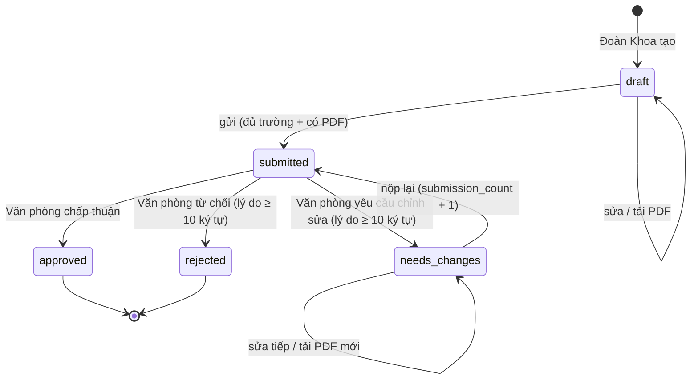
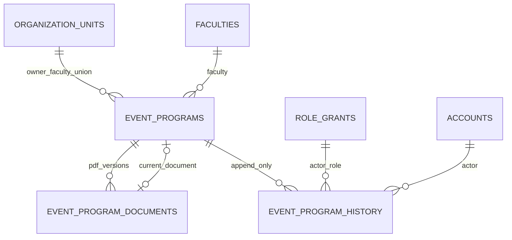

# UC6 — Quản lý kế hoạch chương trình sự kiện

Trạng thái: đã hiện thực và kiểm thử local ngày 13/10/2026 trên nhánh `feat/event-program-plans`. Chưa phải release, chưa deploy.

## Phạm vi

Trong phạm vi: Đoàn Khoa lập/sửa bản nháp, khai báo thông tin, tải PDF kế hoạch đã ký, gửi Văn phòng; Văn phòng xem, yêu cầu chỉnh sửa, từ chối có lý do hoặc chấp thuận; Đoàn Khoa sửa tiếp đúng hồ sơ và nộp lại; lưu lịch sử; chỉ chương trình đã chấp thuận được hiển thị là đã duyệt.

Ngoài phạm vi lượt này: QR điểm danh, điểm rèn luyện (kể cả điểm tối đa xin cấp), mượn phòng/vật phẩm, đăng ký tham gia, truyền thông.

## Quy tắc đã chốt được áp dụng

| Nguồn | Quy tắc | Cách hiện thực |
|---|---|---|
| Prompt 01 §1 | Tài khoản cá nhân; audit ghi actor và vai trò thật | `event_program_history.actor_user_id` + `actor_role_grant_id`; `audit_events` cùng `request_id` |
| Prompt 01, hỏi đáp mục 6 | Đoàn Khoa thao tác trong phạm vi Khoa | `event_program_manager_grant(org)` chỉ nhận `faculty_manager`/`faculty_executive` trên đơn vị `faculty_union` |
| Hỏi đáp 12.2 | BTC tự xin điểm ngoài hệ thống; Văn phòng không xác nhận điểm | Không có trường điểm trong UC6 |
| Hỏi đáp 16.1 | Văn phòng là đơn vị nghiệm thu/công nhận | Chỉ role `office` trên đơn vị `office` được xét; `school_admin` không mặc nhiên có quyền (quyết định 13/10/2026) |
| Hỏi đáp 21.11, quy tắc hồ sơ Đoàn viên | Khi bị yêu cầu chỉnh sửa thì sửa tiếp hồ sơ hiện có | Cùng `id`, `submission_count` tăng; không tạo hồ sơ mới |
| Hỏi đáp 17.x | Đã có hệ thống mượn phòng riêng | Chỉ lưu "Địa điểm" dạng văn bản |
| Prompt 02 | Không tạo hệ thống form thứ hai | Kế hoạch là thực thể nghiệp vụ có trường cố định + PDF, không dùng `form_*` và không tự sinh câu hỏi |

Quy trình ký kế hoạch: tài liệu khảo sát chỉ ghi Văn phòng "kiểm tra kế hoạch đã ký" (12.2). Mẫu đăng ký CTTN của Đoàn Trường có Số văn bản, ngày và chữ ký Bí thư Đoàn Khoa, nên hệ thống yêu cầu **Số kế hoạch**, **Ngày ký** và một **PDF**. Hệ thống không xác minh chữ ký số; Văn phòng đối chiếu bằng mắt. Đây là giả định cần người dùng xác nhận nếu quy trình thực tế khác.

## Actor và quyền

| Hành động | Đoàn Khoa sở hữu | Đoàn Khoa khác | Văn phòng Đoàn – Hội | Sinh viên, Đoàn Trường (`school_admin`) |
|---|---|---|---|---|
| Tạo/sửa bản nháp, tải PDF | ✅ khi `draft`/`needs_changes` | ❌ | ❌ | ❌ |
| Gửi Văn phòng | ✅ | ❌ | ❌ | ❌ |
| Xem bản nháp | ✅ | ❌ | ❌ | ❌ |
| Xem hồ sơ đã gửi, PDF, lịch sử | ✅ | ❌ | ✅ | ❌ |
| Yêu cầu chỉnh sửa / từ chối / chấp thuận | ❌ | ❌ | ✅ trừ hồ sơ chính mình đã nộp | ❌ |
| Xem chương trình đã chấp thuận (thông tin chung) | ✅ | ✅ | ✅ | ✅ |

## Vòng đời



## Luồng dữ liệu

```mermaid
sequenceDiagram
  participant UI as Browser (React)
  participant RH as Route Handler (Next.js)
  participant ST as Supabase Storage
  participant DB as PostgreSQL (RPC + RLS)
  UI->>RH: POST /api/event-programs/{id}/documents (multipart)
  RH->>RH: requireUser, kích thước ≤ 5MB, đuôi + MIME + "%PDF-", SHA-256
  RH->>ST: upload {id}/{uuid}.pdf bằng session người dùng
  ST->>DB: INSERT storage.objects → policy can_upload_event_program_object
  RH->>DB: rpc attach_event_program_document(...)
  DB->>DB: khóa hàng, kiểm quyền Khoa + trạng thái + tệp tồn tại; ghi document, history, audit
  RH-->>UI: 201 + x-request-id
  UI->>RH: POST /submit → rpc submit_event_program (kiểm đủ trường + PDF)
  UI->>RH: POST /review → rpc review_event_program (vai trò, lý do, không tự duyệt)
```

Ba lớp kiểm tra độc lập: Zod ở Route Handler (định dạng), RPC `security definer` (quyền + chuyển trạng thái trong một transaction có `for update`), RLS + revoke INSERT/UPDATE/DELETE (chặn truy cập trực tiếp qua PostgREST). Nút trên UI chỉ là gợi ý.

## API

```
GET   /api/event-programs                         danh sách theo RLS
POST  /api/event-programs                         tạo bản nháp
GET   /api/event-programs/{id}                    chi tiết + PDF + lịch sử (lọc theo RLS)
PATCH /api/event-programs/{id}                    sửa khi draft/needs_changes
POST  /api/event-programs/{id}/documents          tải PDF đã ký (multipart, field "file")
GET   /api/event-programs/{id}/documents/{docId}  chuyển hướng signed URL 60 giây
POST  /api/event-programs/{id}/submit             gửi Văn phòng
POST  /api/event-programs/{id}/review             {decision: approve|request_changes|reject, reason}
```

Trang: `/programs` (hàng đợi Văn phòng, kế hoạch của Khoa, danh sách đã chấp thuận), `/programs/new`, `/programs/{id}`.

## Dữ liệu



- PDF lưu ở bucket riêng tư `event-program-plans` (5MB, chỉ `application/pdf`). Mỗi lần tải là một bản ghi mới kèm SHA-256; bản cũ không bị ghi đè.
- Giới hạn 5MB thấp hơn mức buffer 10MB mặc định của `proxy.ts` (Next 16 `proxyClientMaxBodySize`).

## Yêu cầu phi chức năng

1. **Bảo mật:** 100% thao tác ghi đi qua RPC; `authenticated`/`anon` bị revoke INSERT/UPDATE/DELETE trên ba bảng; pgTAP kiểm chứng ghi trực tiếp bị từ chối (42501).
2. **Toàn vẹn:** chuyển trạng thái khóa hàng `for update`; `check` ràng buộc lý do khi từ chối/yêu cầu sửa và `decided_at` chỉ có ở trạng thái kết thúc.
3. **Truy vết:** mỗi request có `x-request-id`, xuất hiện ở log JSON, `event_program_history.request_id` và `audit_events.request_id`.
