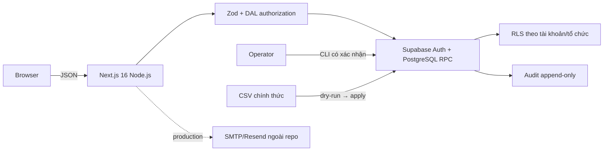
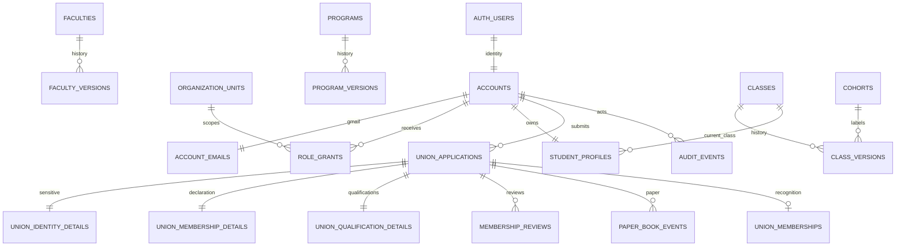

# Phạm vi Prompt 01

Trạng thái: nền tảng và hai use case Prompt 01; chưa phải toàn bộ đồ án, release v1.0, INC-01 hay CR-01.

## Actor và use case

- Sinh viên: tài khoản cá nhân, đăng nhập MSSV, profile cơ bản, tự khai/sửa một hồ sơ Đoàn viên mỗi chu kỳ.
- Đoàn Trường: toàn quyền danh mục, cơ cấu, Ban/Đoàn Khoa và phân quyền.
- Đoàn Khoa: xem sinh viên và CRUD Lớp/Chi đoàn trong Khoa; không chuyển Khoa/Ngành.
- Trưởng Ban: cấp/thu hồi CTV trong Ban. Ban Tổ chức – Kiểm tra xem toàn trường; Ban khác chỉ xem hồ sơ được phân công.
- CTV: checklist và đề xuất, không duyệt cuối. Văn phòng: nhận/rút Sổ, sửa MSSV, duyệt cuối.
- Người vận hành: migration, bootstrap, import, backup/restore, Auth/SMTP/domain.

### UC1 — Danh mục và cơ cấu

Khoa, Ngành, Lớp/Chi đoàn dùng UUID bất biến và phiên bản `daterange` không chồng lấn. Lớp chỉ thuộc Ngành; Khoa của Lớp suy qua Ngành nên chuyển Ngành không nhân bản Lớp. Bản nộp giữ snapshot. Không xóa cứng thực thể đã tham chiếu. CSV luôn dry-run, báo xung đột trước khi ghi, không xóa Lớp vắng. Quyền gắn tài khoản cá nhân + đơn vị; audit ghi người, role grant và tổ chức thật.

### UC2 — Tiếp nhận/công nhận Đoàn viên

Đăng ký chỉ nhận MSSV 10 số, một Gmail, mật khẩu tối thiểu 6 ký tự theo repo; phải xác minh Gmail trước profile. Profile cơ bản chỉ có trường đã chốt và server suy cơ cấu từ Lớp. Hồ sơ Đoàn tách căn cước/Đoàn/trình độ; lời khai không tự tạo tư cách. Sinh viên sửa cùng `user_id + cycle_key` ở `draft/needs_changes`. Sự kiện Sổ chỉ snapshot họ tên, MSSV, ngày; rút Sổ không đổi tư cách. CTV phải được phân công và hoàn tất checklist bắt buộc; Văn phòng chỉ công nhận sau lần nhận Sổ còn hiệu lực. API danh sách không trả CCCD/địa chỉ.

## NFR đo được

1. 100% mutation xác thực server; mutation đặc quyền kiểm tra scope ở Route Handler/RPC và RLS. pgTAP kiểm truy cập trái phép.
2. `supabase db reset` áp dụng sạch; importer chạy lại không nhân đôi; khoảng hiệu lực không chồng lấn.
3. Đổi MSSV, quyền, danh mục, nộp/duyệt/Sổ có audit append-only; `authenticated` không sửa/xóa audit.
4. API tối đa 1.000 dòng; nguồn CSV hiện tại có 347 Lớp. Mục tiêu staging dưới 2 giây chưa được đo.
5. CI chạy Node 24: lint, typecheck, unit test, build. Restore drill tách biệt bắt buộc trước release (chưa chạy cloud).

## Cần xác nhận / NEEDS_USER_ACTION

- CSV `data/DSN LOPWS - Sheet1 (1).csv` đã được đối chiếu checksum với bản người dùng cung cấp: 347 dòng dữ liệu, 10 Khoa, 51 Ngành, 6 Khóa, 347 mã Lớp; không trùng mã hoặc thiếu ô. Import local ngày 02/10/2026 tạo đúng các số lượng này; chạy lại thêm/cập nhật 0 bản ghi.
- CSV không có mã Khoa/Ngành riêng: importer giữ tên gốc, để mã chính thức `NULL`; cần nguồn mã.
- Chưa có nguồn sáu danh mục trình độ/chuyên môn và checklist; UI cho người có quyền cấu hình, không seed giả.
- Cần xác nhận quy tắc `cycle_key` sau `2026-2027` và nghiệp vụ rút Sổ mở rộng.
- SMTP/Resend, production redirect và `doanhoihiu.io.vn` cần cấu hình dashboard thật.

## Kiến trúc

Module: `auth-account`, `organization-catalog`, `student-profile`, `union-membership`; `lib/auth` và audit SQL là lớp cắt ngang. Route Handler là public boundary, RPC là transaction boundary, RLS là lớp phòng thủ bổ sung.

## ERD rút gọn

