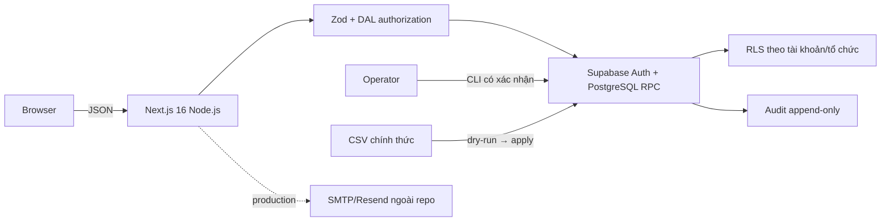
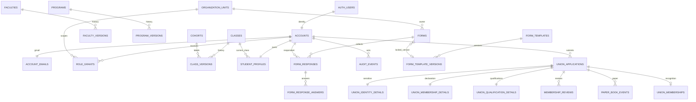

# Phạm vi MVP — Prompt 01 + Prompt 02

Trạng thái: nền tảng, UC1–UC2 (Prompt 01), UC3–UC5 (Prompt 02) và UC6 (kế hoạch chương trình, nhánh `feat/event-program-plans`); chưa phải release v1.0, INC-01 hay CR-01.

## Actor và use case

- Sinh viên: tài khoản cá nhân, đăng nhập MSSV, profile cơ bản, tự khai/sửa một hồ sơ Đoàn viên mỗi chu kỳ.
- Đoàn Trường: toàn quyền danh mục, cơ cấu, Ban/Đoàn Khoa và phân quyền.
- Đoàn Khoa: xem sinh viên và CRUD Lớp/Chi đoàn trong Khoa; không chuyển Khoa/Ngành.
- Trưởng Ban: cấp/thu hồi CTV trong Ban. Ban Tổ chức – Kiểm tra xem toàn trường; Ban khác chỉ xem hồ sơ được phân công.
- CTV: checklist và đề xuất, không duyệt cuối. Văn phòng: nhận/rút Sổ, sửa MSSV, duyệt cuối.
- Người vận hành: migration, bootstrap, import, backup/restore, Auth/SMTP/domain.

### UC1 — Danh mục và cơ cấu (Prompt 01)

Khoa, Ngành, Lớp/Chi đoàn dùng UUID bất biến và phiên bản `daterange` không chồng lấn. Lớp chỉ thuộc Ngành; Khoa của Lớp suy qua Ngành nên chuyển Ngành không nhân bản Lớp. Bản nộp giữ snapshot. Không xóa cứng thực thể đã tham chiếu. CSV luôn dry-run, báo xung đột trước khi ghi, không xóa Lớp vắng. Quyền gắn tài khoản cá nhân + đơn vị; audit ghi người, role grant và tổ chức thật.

### UC2 — Tiếp nhận/công nhận Đoàn viên (Prompt 01)

SIGN UP chỉ nhận MSSV 10 số và một email sinh viên `@student.hiu.vn` khớp MSSV (phần số trước `@` phải kết thúc bằng 3 chữ số đầu + 4 chữ số cuối của MSSV); phải xác minh email rồi mới tạo PIN đúng 6 chữ số, sau đó mới vào profile cơ bản. SIGN IN chỉ nhận MSSV + PIN; SIGN OUT hủy session và trang bảo vệ kiểm tra lại session/trạng thái tài khoản. Khôi phục PIN dùng email đã xác minh nhưng email không phải tên đăng nhập. Profile cơ bản chỉ có trường đã chốt và server suy cơ cấu từ Lớp; hồ sơ Đoàn không phải điều kiện hoàn tất tài khoản. Hồ sơ Đoàn tách căn cước/Đoàn/trình độ; lời khai không tự tạo tư cách. Sinh viên sửa cùng `user_id + cycle_key` ở `draft/needs_changes`. Sự kiện Sổ chỉ snapshot họ tên, MSSV, ngày; rút Sổ không đổi tư cách. CTV phải được phân công và hoàn tất checklist bắt buộc; Văn phòng chỉ công nhận sau lần nhận Sổ còn hiệu lực. API danh sách không trả CCCD/địa chỉ.

#### Thay đổi quy tắc email — 13/10/2026

Người dùng quyết định đổi email xác thực từ **Gmail** (Prompt 01) sang **email sinh viên HIU `@student.hiu.vn`**. Migration `202610130002_student_email_domain.sql` đổi CHECK của `account_emails`, `email_change_requests`, `pending_account_registrations` và RPC `reserve_account_registration`; `registerSchema`/`changeEmailSchema` kiểm tra cùng quy tắc ở server.

Tác động tới tài khoản Gmail cũ:
- CHECK mới dùng `NOT VALID`: dòng Gmail đã có **không bị xóa hay chặn**; tài khoản Gmail cũ vẫn đăng nhập MSSV + PIN và khôi phục PIN qua Gmail đó.
- Mọi đăng ký mới, đổi email và **mọi cập nhật trên dòng `account_emails`** phải dùng `@student.hiu.vn`. Muốn chuyển một tài khoản cũ sang email sinh viên thì dùng luồng đổi email (xác nhận email mới trước khi thay).
- Ở DB tạo mới (`db reset`) không có dòng Gmail nào. Chạy `VALIDATE CONSTRAINT` chỉ sau khi mọi tài khoản đã chuyển email.
- Đổi email chỉ kiểm tra tên miền, chưa kiểm tra số khớp MSSV (email mới vẫn phải được xác nhận qua hộp thư).

### UC3 — Thư viện mẫu biểu mẫu (Prompt 02)

Đoàn Trường (`school_admin`) tạo và chỉnh sửa `form_templates`; mỗi lần phát hành tạo `form_template_versions` bất biến chứa snapshot `questions jsonb`. Chỉ `school_admin` mới tạo/sửa template; không đơn vị khác có quyền này. Template có trạng thái `draft → published → deprecated`.

### UC4 — Vòng đời biểu mẫu động (Prompt 02)

Đơn vị có `committee_manager` hoặc `office` tạo `forms` trong đơn vị mình (kiểm tra RPC `user_can_manage_forms_for_org`). Form có thể tham chiếu một `form_template_versions` cố định hoặc tự xây questions. Trạng thái `draft → published → paused → closed → archived`; biến chuyển kiểm tra server. `audience_rule jsonb` đệ quy hỗ trợ `any`, `hiu_student`, `faculty`, `union_member`, `and`, `or`. Hệ thống đánh giá audience server-side qua RPC `evaluate_audience_rule`.

### UC5 — Thu nhận phản hồi và xuất CSV (Prompt 02)

Người phù hợp (theo audience) nộp qua RPC `submit_form_response`; INSERT trực tiếp vào `form_responses` bị thu hồi quyền. Phản hồi ghi `questions_snapshot` tại thời điểm nộp, `form_version int` và `identity_snapshot` tùy chọn. Xuất CSV UTF-8 BOM, cột ổn định theo `question_id`, nhãn lựa chọn được giải mã từ questions (không xuất option ID thô). RLS hạn chế GET phản hồi cho đơn vị quản lý form; sinh viên không xem phản hồi của người khác.

### UC6 — Quản lý kế hoạch chương trình sự kiện (13/10/2026)

Đoàn Khoa (`faculty_manager`/`faculty_executive` trên `faculty_union`) lập bản nháp, khai báo thông tin, tải PDF kế hoạch đã ký rồi gửi Văn phòng. Chỉ Văn phòng (`office`) yêu cầu chỉnh sửa/từ chối có lý do hoặc chấp thuận; người đã nộp không tự xét duyệt. Khi bị yêu cầu chỉnh sửa, Đoàn Khoa sửa tiếp đúng hồ sơ và nộp lại. Lịch sử append-only lưu người thao tác, vai trò, thời điểm, lý do. Chỉ `approved` được hiển thị như chương trình đã duyệt. Chi tiết: `docs/requirements/event-programs.md`. Chưa gồm QR điểm danh, điểm rèn luyện, mượn phòng.

### UC7 — Đăng ký tham gia chương trình (15/10/2026)

BTC (Đoàn Khoa sở hữu chương trình) cấu hình đối tượng, số chỗ (hoặc không giới hạn), nhận theo thứ tự hoặc xét duyệt, chỉ tiêu theo Khoa/ngành/Đoàn viên và hạn chuyển chỉ tiêu dư, mẫu đăng ký lấy từ biểu mẫu đã phát hành, rồi mở/đóng đăng ký. Chỉ chương trình `approved` mới mở được. Sinh viên xem điều kiện, điền mẫu, nhận xác nhận ngay hoặc chờ duyệt; không có chức năng tự hủy. DB chặn trùng, sai đối tượng, vượt chỉ tiêu, kể cả đồng thời (khóa hàng cấu hình). Điểm uy tín chỉ dùng khi vừa giới hạn chỗ vừa cần duyệt; duyệt vượt người uy tín cao hơn phải có lý do. Sinh viên không xem được điểm hay lịch sử uy tín. Đăng ký chưa phải điểm danh. Chi tiết: `docs/requirements/program-registrations.md`.

### UC8 — Điểm danh QR lượt và điểm dự kiến đề nghị (13/10/2026)

BTC cấu hình nhiều lượt, điểm tối đa (số nguyên) và một trong 4 quy tắc: đủ lượt bắt buộc, ít nhất một lượt, cộng từng lượt, hoặc theo bậc số lượt (có thể kèm lượt bắt buộc). Kết quả không vượt điểm tối đa. BTC mở/đóng từng lượt và chiếu QR chung đổi mỗi 30 giây; token ký HMAC và kiểm hạn theo giờ server. Sinh viên có đăng ký được nhận tự quét, mỗi lượt một lần. Mở lại đúng lượt cũ để điểm danh bổ sung (có lý do), mã của lần mở trước hết hiệu lực. Bảng xem trước phân loại Hoàn thành / Có tham gia / Đăng ký nhưng không tham gia kèm điểm dự kiến. Sau khi bắt đầu điểm danh, quy tắc bị khóa: chỉ faculty_manager điều chỉnh, có lý do và lịch sử. Không trừ uy tín. Chi tiết: `docs/requirements/program-attendance.md`.

### UC9 — Nghiệm thu, uy tín và khiếu nại điểm danh (13/10/2026)

BTC khóa điểm danh, xem từng sinh viên (lượt, kết quả tham gia, điểm dự kiến đề nghị), xuất bảng và xem trước dữ liệu đơn (không phải mẫu chính thức), rồi nộp hồ sơ gồm Đơn đề nghị PDF có chữ ký Trưởng BTC, báo cáo và ảnh minh chứng. Mọi phiên bản tệp đều được giữ.

Chỉ Văn phòng được yêu cầu bổ sung, từ chối hoặc nghiệm thu; người nộp không tự duyệt. Nghiệm thu chốt snapshot kết quả và trừ đúng 5 điểm uy tín, một lần mỗi chương trình, cho người được nhận mà không có lượt điểm danh nào, trong học kỳ chứa ngày chương trình. Ngày chương trình chưa thuộc học kỳ nào thì không nghiệm thu được.

Sinh viên khiếu nại đến hết học kỳ. BTC chấp nhận thì hệ thống bổ sung điểm danh đúng lượt, hoàn +5 một lần và tính lại thành snapshot mới; sổ uy tín chỉ thêm, không sửa hay xóa. Có thêm trạng thái hủy chương trình (không trừ) và màn hình học kỳ cho Đoàn Trường/Văn phòng. Sinh viên không xem uy tín. Chi tiết: `docs/requirements/program-acceptance.md`.

## NFR đo được

1. 100% mutation xác thực server; mutation đặc quyền kiểm tra scope ở Route Handler/RPC và RLS. pgTAP kiểm truy cập trái phép.
2. `supabase db reset` áp dụng sạch; importer chạy lại không nhân đôi; khoảng hiệu lực không chồng lấn.
3. Đổi MSSV, quyền, danh mục, nộp/duyệt/Sổ có audit append-only; `authenticated` không sửa/xóa audit.
4. API tối đa 1.000 dòng; nguồn CSV hiện tại có 347 Lớp. Mục tiêu staging dưới 2 giây chưa được đo.
5. CI chạy Node 24: lint, typecheck, unit test, build. Restore drill tách biệt bắt buộc trước release (chưa chạy cloud).

## Cần xác nhận / NEEDS_USER_ACTION

- CSV `data/DSN LOPWS - Sheet1 (1).csv` đã được đối chiếu checksum với bản người dùng cung cấp: 347 dòng dữ liệu, 10 Khoa, 51 Ngành, 6 Khóa, 347 mã Lớp; không trùng mã hoặc thiếu ô. Import local ngày 02/10/2026 tạo đúng các số lượng này; chạy lại thêm/cập nhật 0 bản ghi.
- CSV không có mã Khoa/Ngành riêng: importer giữ tên gốc, để mã chính thức `NULL`; cần nguồn mã.
- Chưa có nguồn sáu danh mục trình độ/chuyên môn và checklist; UI cho người có quyền cấu hình, không seed giả.
- Cần xác nhận quy tắc `cycle_key` sau `2026-2027` và nghiệp vụ rút Sổ mở rộng.
- SMTP/Resend, production redirect và `doanhoihiu.io.vn` cần cấu hình dashboard thật.

## Cổng release v1.0-local

G4 cloud/SMTP/Vercel được hoãn sang giai đoạn triển khai thật sau release local; đây không phải điều kiện của `v1.0-local`. CI của PR #1 đã xanh ở run #2; còn merge và xác minh CI trên `main` trước khi tag. Các bằng chứng kiểm thử local và giới hạn restore nằm trong `docs/testing/test-report.md` và `docs/operations/release-checklist-v1.0-local.md`.

| # | Điều kiện | Trạng thái |
|---|---|---|
| G1 | lint, typecheck, Vitest, pgTAP và build local | ✅ PASS theo báo cáo 05–06/10/2026 |
| G2 | GitHub Actions trên PR và `main` xanh | ✅ PR #1 run #2 xanh; ⬜ chờ merge và CI main |
| G3 | Migration từ đầu và catalog import idempotent local | ✅ PASS theo báo cáo 05/10/2026 |
| G4 | Smoke test Supabase cloud, SMTP/Resend, Vercel | ➡️ Hoãn sau `v1.0-local` |
| G5 | Backup và restore drill trên DB thử tách biệt | ✅ PASS với giới hạn đã ghi nhận: lỗi sequence nội bộ Supabase; chưa pgTAP trên instance khôi phục |
| G6 | Browser UI write flow | ✅ Playwright 12/12 PASS theo báo cáo 06/10/2026 |
| G7 | Rà secret trong source và lịch sử | ✅ Theo báo cáo rà ngày 06/10/2026 |
| G8 | Yêu cầu, ERD, test report và release checklist | ✅ Có tài liệu trong PR #1; cập nhật trạng thái release sau merge |

## Kiến trúc



Module: `auth-account`, `organization-catalog`, `student-profile`, `union-membership`, `forms`; `lib/auth` và audit SQL là lớp cắt ngang. Route Handler là public boundary, RPC là transaction boundary, RLS là lớp phòng thủ bổ sung.

**Prompt 02 thêm:**

```
POST /api/forms/templates          — school_admin tạo template
GET  /api/forms/templates          — danh sách template (admin)
GET  /api/forms/templates/[id]     — chi tiết + versions
PATCH /api/forms/templates/[id]    — sửa template
POST /api/forms/templates/[id]/publish — phát hành version mới

POST /api/forms                    — tạo form (committee_manager/office)
GET  /api/forms                    — danh sách form (published + managed)
GET  /api/forms/[id]               — chi tiết form (audience check)
PATCH /api/forms/[id]              — sửa form
PATCH /api/forms/[id]/status       — chuyển trạng thái
GET  /api/forms/[id]/responses     — xem phản hồi (org manager only)
POST /api/forms/[id]/responses     — nộp phản hồi (audience check, guest-ok)
GET  /api/forms/[id]/export        — xuất CSV với BOM + resolved labels
```

## ERD rút gọn


