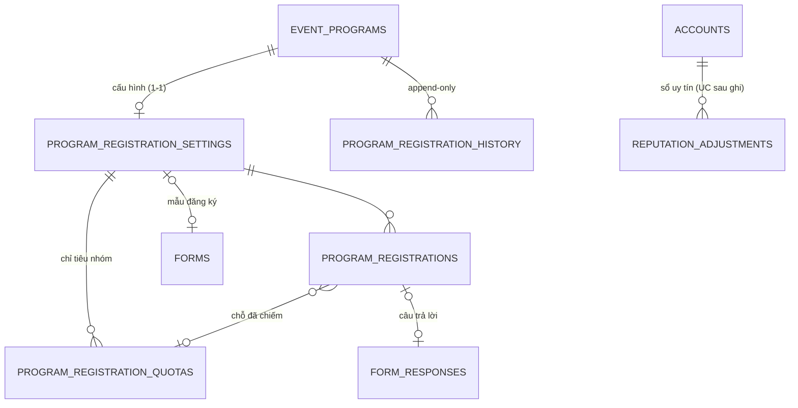
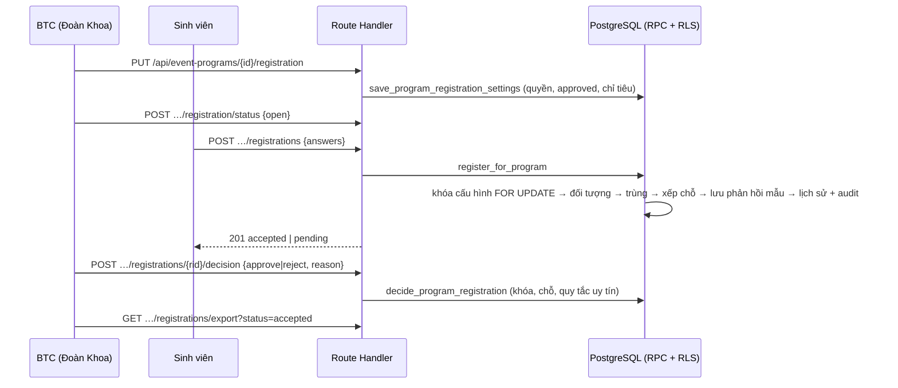

# UC7 — Đăng ký tham gia chương trình

Trạng thái: hiện thực trên nhánh `feat/program-registrations` (PR #3). DB đã kiểm bằng pgTAP và kiểm thử đồng thời trên stack local tách biệt. Luồng UI đăng ký → BTC duyệt đã chạy trên trình duyệt local (16/10/2026). Chưa deploy.

## Quy tắc đã chốt và cách hiện thực

| Quy tắc | Nguồn | Hiện thực |
|---|---|---|
| Chỉ mở đăng ký cho chương trình đã được Văn phòng duyệt và được BTC mở | Yêu cầu UC7 | `save_…`/`set_program_registration_status` từ chối `PROGRAM_NOT_APPROVED`; `register_for_program` kiểm `status = 'open'` và chương trình `approved` |
| BTC = Đoàn Khoa sở hữu chương trình; quyền theo đơn vị | UC6, Prompt 01 | `event_program_manager_grant(owner_org_id)`; Khoa khác, Văn phòng, sinh viên nhận `FORBIDDEN` |
| Không giới hạn hoặc giới hạn chỗ; nhận theo thứ tự hoặc BTC duyệt | Hỏi đáp 13.1, 14.3 | `capacity` null/≥1; `requires_approval` |
| Chỉ tiêu theo Khoa/ngành/đối tượng; sau hạn BTC đặt, chỉ tiêu dư thành chỉ tiêu chung | 14.3, 15.3 (B) | `program_registration_quotas` + `quota_release_at`; `program_registration_slot` xếp nhóm trước, rồi chỉ tiêu chung |
| Chặn trùng, vượt chỉ tiêu, sai đối tượng ở DB, kể cả đồng thời | Yêu cầu UC7 | `unique (program_id, user_id)`; `evaluate_audience_rule`; khóa `for update` hàng cấu hình trong mọi thao tác chiếm chỗ |
| Không có chức năng sinh viên tự hủy | 13.2 | Không có RPC/route hủy; bảng bị revoke UPDATE/DELETE |
| Uy tín chỉ dùng khi vừa giới hạn chỗ vừa yêu cầu duyệt; bỏ qua người cao hơn **đang cạnh tranh cùng suất** phải có lý do | 15.2, 16.3, 16.4 (B); review PR #3 | `decide_program_registration` trả `SKIP_REASON_REQUIRED`; lịch sử lưu `skipped_higher_reputation` + lý do |
| Sinh viên không xem điểm uy tín và lịch sử trừ/hoàn | 14.2 (sửa đổi) | `reputation_adjustments` không có policy, revoke hết; `reputation_score` không cấp cho `authenticated`; CSV không có cột uy tín |
| Đăng ký chưa phải điểm danh | 14.1, 16.1 | Trạng thái chỉ `pending/accepted/rejected`; UC7 không ghi `reputation_adjustments` |
| Không tạo hệ thống form thứ hai | Prompt 02 | Mẫu đăng ký là `forms` đã phát hành của Khoa; câu trả lời lưu ở `form_responses` qua `submit_form_response_internal` |

## Thiết kế dữ liệu



- `program_registrations.status`: `pending` → `accepted` | `rejected`. Nhận theo thứ tự thì tạo thẳng `accepted`; khi hết chỗ không tạo bản ghi (`REGISTRATION_FULL`).
- Chờ duyệt không chiếm chỗ; chỗ được chiếm lúc BTC duyệt (`QUOTA_FULL` khi hết).
- Một mẫu chỉ gắn một chương trình (unique index). Khi đã gắn, `submit_form_response` từ chối nộp rời (`FORM_REQUIRES_PROGRAM_REGISTRATION`).
- `evaluate_audience_rule` thêm loại `major` (ngành) và chỉ tính Đoàn viên có `status = 'recognized'`.

### Xếp chỗ (`program_registration_slot`)

1. Không giới hạn → nhận.
2. Đã đủ `capacity` → hết chỗ.
3. Không có nhóm, hoặc đã qua `quota_release_at` → nhận vào chỉ tiêu chung.
4. Theo `sort_order`, nhóm đầu tiên người này thuộc và còn chỗ → nhận vào nhóm.
5. Chỉ tiêu chung = `capacity − tổng chỉ tiêu nhóm`; còn → nhận, hết → hết chỗ.

### Điểm uy tín và học kỳ

`reputation_score(user, at)` = max(0, 100 + tổng `delta` của học kỳ chứa `at`) (hỏi đáp 15.1). Bảng `reputation_adjustments` hiện chưa có luồng ghi: việc trừ 5 điểm sau công nhận và hoàn điểm thuộc UC điểm danh/nghiệm thu sau này.

**Quyết định về học kỳ (review PR #3, migration `202610150002`):**
- Bỏ hàm `semester_key_for`, vốn cố định HK1 tháng 8–12, HK2 tháng 1–5, HK3 tháng 6–7.
- Học kỳ giờ là dữ liệu cấu hình trong bảng `academic_terms`: năm học, mã, tên, ngày bắt đầu, ngày kết thúc. Mỗi năm học tự đặt ngày; hai học kỳ không được chồng ngày.
- UC7 vẫn cần học kỳ, vì điểm uy tín reset mỗi học kỳ và BTC phải thấy điểm của học kỳ đang diễn ra khi xét duyệt. UC7 chỉ đọc học kỳ chứa thời điểm duyệt (`academic_term_at`).
- Chưa có học kỳ nào bao trùm thời điểm đó thì không tính khoản trừ nào: mọi người 100 điểm.
- **Màn hình và quyền quản lý học kỳ để cho UC điểm danh/uy tín.** Hiện chỉ ghi được bằng `service_role`/SQL. Mỗi khoản trừ/hoàn bắt buộc gắn `term_id`.

### Thế nào là "cạnh tranh cùng suất"

Khi BTC duyệt người R, hệ thống tính suất R sẽ chiếm lúc đó: một nhóm chỉ tiêu, hoặc chỉ tiêu chung (`program_registration_slot`). Người P đang chờ, điểm cao hơn R, chỉ được tính là bị bỏ qua khi P lúc đó cũng được xếp vào **đúng suất đó**. Không tính các trường hợp:
- P được xếp vào nhóm chỉ tiêu khác còn chỗ (P vẫn có chỗ của mình).
- P không thể nhận suất này (không thuộc nhóm, và chỉ tiêu chung đã hết).

Sau hạn chuyển chỉ tiêu dư, mọi người dùng chỉ tiêu chung nên đều cạnh tranh nhau. Trang danh sách hiện cột "Suất / gợi ý" (`pool_label`) và xếp hạng gợi ý trong từng suất.

## Luồng



## API và trang

```
PUT  /api/event-programs/{id}/registration                         BTC lưu cấu hình (chỉ khi chưa mở/đã đóng)
POST /api/event-programs/{id}/registration/status                  {status: open|closed}
GET  /api/event-programs/{id}/registrations                        BTC xem danh sách (có uy tín khi áp dụng)
POST /api/event-programs/{id}/registrations                        sinh viên đăng ký
POST /api/event-programs/{id}/registrations/{rid}/decision         {decision: approve|reject, reason}
GET  /api/event-programs/{id}/registrations/export?status=…        CSV (accepted mặc định | pending | rejected | all)
```

Trang: phần "Đăng ký tham gia" trên `/programs/{id}` (BTC cấu hình; sinh viên xem điều kiện, điền mẫu, xem kết quả) và `/programs/{id}/registrations` (BTC duyệt, xem lịch sử, xuất CSV).

## Giới hạn hiện tại

- Không sửa cấu hình khi đang mở. BTC đóng, sửa, rồi mở lại.
- Đăng ký bị từ chối không được gửi lại, vì mỗi người chỉ có một bản ghi cho mỗi chương trình.
- Văn phòng và Đoàn Trường không xem danh sách đăng ký của Khoa.
